# Ashen Vow — v0.0.7

> **Sumpah di antara abu.** Simulasi metroidvania medieval 2D dengan combat pedang real-time, relik lompat ganda, **delapan ruang dan empat boss** (hingga tiga fase), **dialog boss** di awal/fase/akhir pertempuran, **peta perjalanan**, **indeks sumpah** untuk musuh/senjata/boss/barang, checkpoint di ambang pertempuran, dan **Warung Abu** tempat membelanjakan abu untuk senjata baru.

Ashen Vow adalah game web tanpa build step: HTML5 Canvas + ES Modules murni. Seluruh simulasi combat berjalan deterministik di `src/core.js`, sehingga bisa diuji otomatis dengan Node tanpa browser.

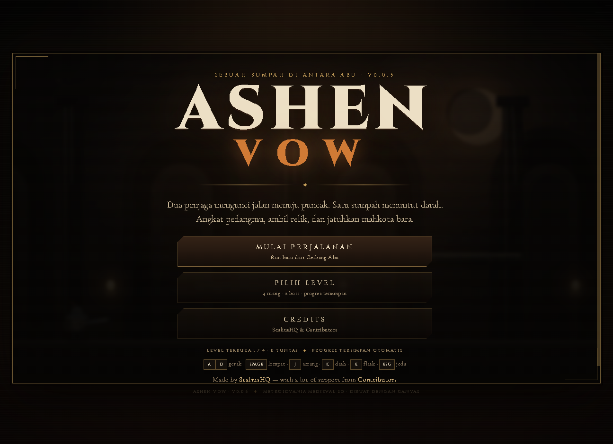

## Trailer sinematik

[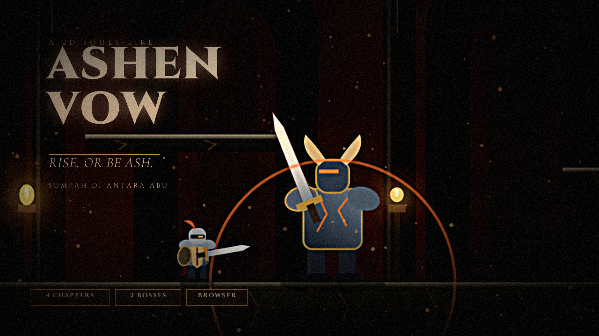](trailer/ashen-vow-trailer.mp4)

Trailer resmi berdurasi **2 menit** (1280×720, 30 fps) beserta thumbnail tersedia di folder [`trailer/`](trailer/):

- [`trailer/ashen-vow-trailer.mp4`](trailer/ashen-vow-trailer.mp4) — 120 detik, H.264 + AAC.
- [`trailer/thumbnail.png`](trailer/thumbnail.png) — key art 1280×720.

Seluruh footage diambil langsung dari build game ini (bukan mockup): pertarungan Gerbang Abu, traversal Balai Sumpah, duel **Sir Mordrake**, **Warung Abu**, dan pertarungan **Vhael**. Lihat [`trailer/README.md`](trailer/README.md) untuk rincian produksi.

## Cara menjalankan

```bash
npm start
```

Buka <http://127.0.0.1:4300>.

Tidak perlu `npm install` — tidak ada dependensi runtime.

## Alur menu

Game **tidak langsung masuk ke gameplay**. Saat dibuka, yang tampil adalah menu utama:

- **MULAI PERJALANAN** — memulai run baru dari Gerbang Abu.
- **PILIH PENJAGA** — buka layar karakter: pilih Sera atau Karn, atur ras, warna kulit, warna pakaian, dan gaya armor sebelum berangkat.
- **PILIH LEVEL** — melihat 8 ruang, status terkunci/terbuka/tuntas, dan progres tersimpan.
- **PETA SUMPAH** — peta seluruh perjalanan, bisa dibuka kapan saja dengan `M`.
- **INDEKS SUMPAH** — indeks musuh, senjata, boss, dan barang, bisa dibuka dengan `I`.
- **CREDITS** — halaman kredit game.

Progres disimpan otomatis di `localStorage` dengan key `ashen-vow-progress-v1`. Menyelesaikan sebuah ruang membuka ruang berikutnya. Layar jeda, kematian, dan kemenangan juga punya jalan kembali ke **PILIH LEVEL** dan **MENU UTAMA**.

### Peta dan Indeks

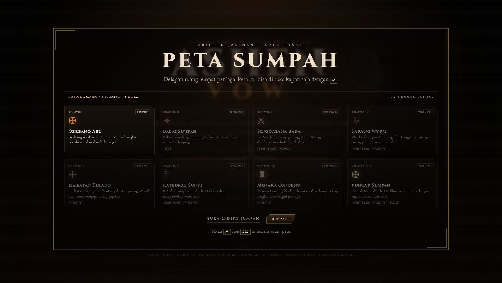

**Peta Sumpah** (`M`) menampilkan delapan ruang beserta bab, status (terkunci/terbuka/tuntas), penanda posisi saat ini, tag boss/relik/warung, dan hitungan ruang tuntas. Peta dapat dibuka dari menu utama, layar jeda, atau langsung saat berada di dalam stage tanpa menghentikan progres.

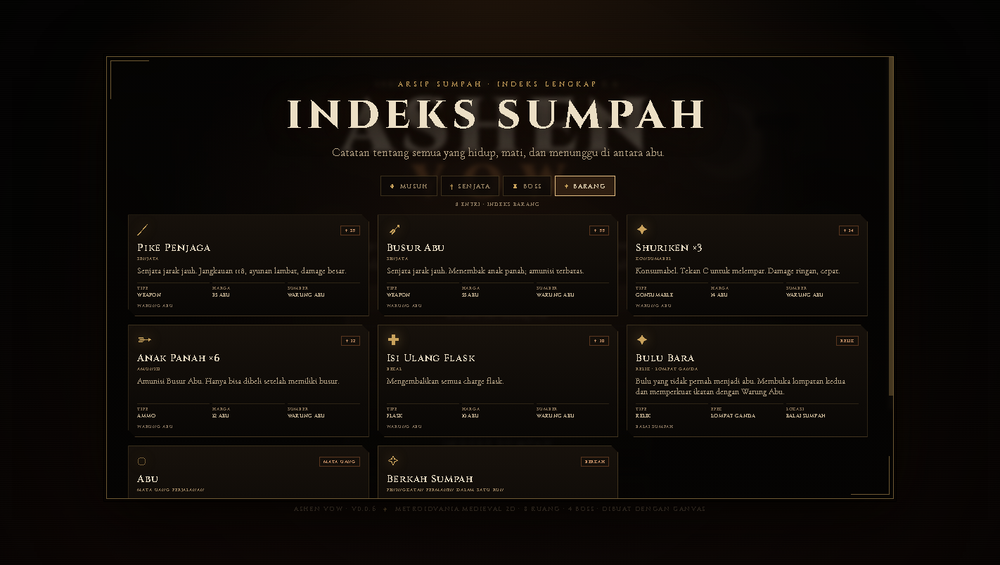

**Indeks Sumpah** (`I`) memiliki empat tab:

- **MUSUH** — crawler, sentinel, hollow wraith, cinder brute.
- **SENJATA** — Pedang Sumpah, Pike Penjaga, Busur Abu.
- **BOSS** — keempat penjaga, HP, jumlah fase, hadiah abu, dan lokasinya.
- **BARANG** — isi Warung Abu, relik, abu, dan berkah sumpah.

### Dialog Boss

Setiap boss berbicara di awal pertempuran, saat berpindah fase, dan ketika gugur. Dialog membekukan simulasi sampai pemain menekan `Space`/`Enter`, mengklik **LANJUT**, atau menutupnya dengan `Esc`. The Oathbreaker memiliki dialog tambahan untuk fase III.

### Level Select dan Sneak Peek

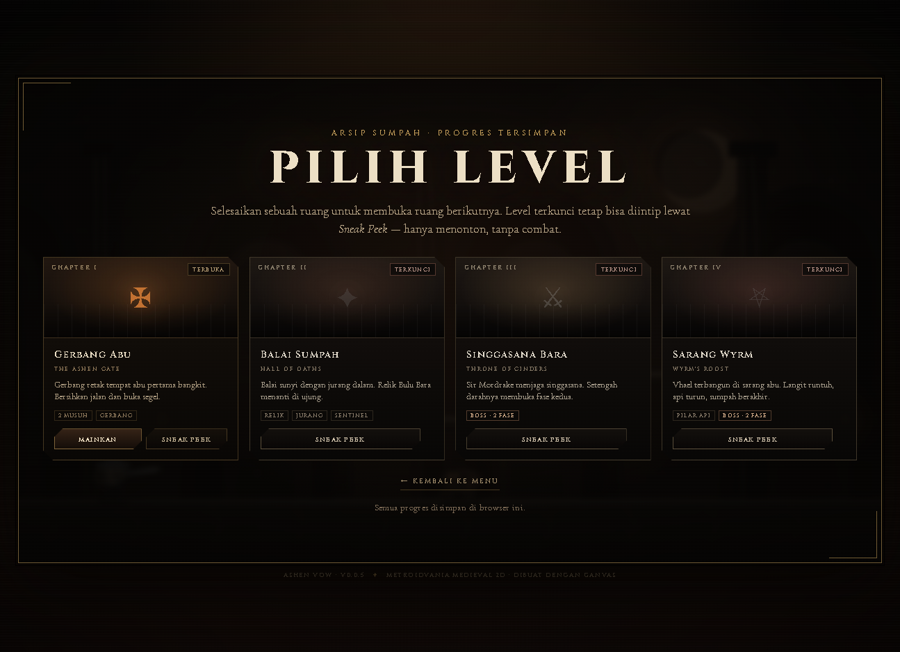

Semua ruang tampil di Level Select. Ruang yang belum selesai berstatus **TERKUNCI**:

- tombol **MAINKAN** disembunyikan,
- hanya tersedia **SNEAK PEEK**.

Sneak Peek adalah mode **spectate-only**: kamera menyusuri ruang atau mengitari boss, tanpa pemain, tanpa HUD, dan tanpa combat. Tekan `←` / `→` untuk menggeser kamera, `Esc` untuk kembali.

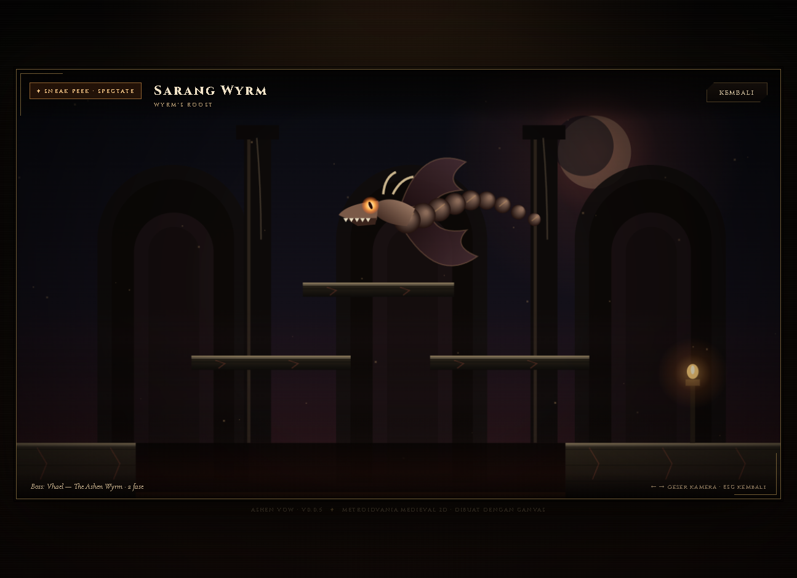

### Credits

Halaman credits memuat:

> **MADE BY SealiusHQ**
> with a lot of support from **Contributors**

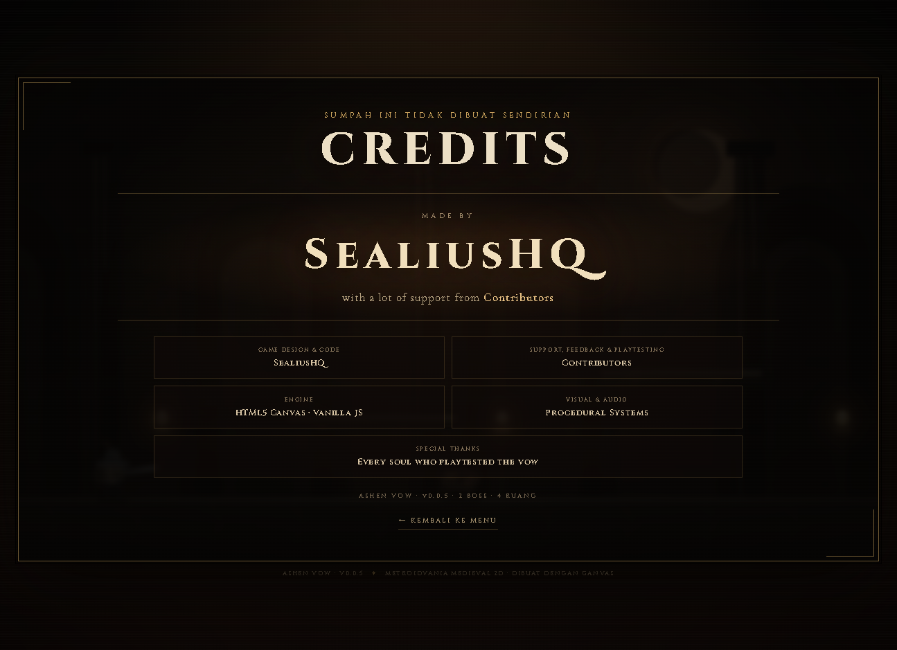

### Pilih Penjaga, Kustomisasi & Keahlian Khusus

Terdapat **lima penjaga/kelas** yang bisa dimainkan, masing-masing dengan statistik dan **Keahlian Khusus (*Active Ability*)**:

| Penjaga | Kelas | Darah | Serangan | Kecepatan | Keahlian Khusus |
| --- | --- | --- | --- | --- | --- |
| **Sera Vayne** | The Knight | 100 | 1.00x | 1.00x | **Tebasan Sumpah** (`U`/`V`) |
| **Lyna Windstrider** | Elf Archer | 88 | 1.04x | 1.08x | **Tembakan Badai** (`U`/`V`) |
| **Kael Shadowstep** | Assassin | 82 | 1.12x | 1.14x | **Langkah Bayangan** (`U`/`V`) |
| **Karn of the Ash** | Brawler | 125 | 1.08x | 0.93x | **Hentakan Bara** (`U`/`V`) |
| **Ignis Pyrewalker** | Mage | 86 | 1.16x | 0.98x | **Ledakan Nova Bara** (`U`/`V`) |

Di layar **PILIH PENJAGA** kamu bisa mengganti:

- **Karakter / Kelas** — Knight, Archer, Assassin, Brawler, Mage.
- **Ras** — Manusia, Elf, Goblin, Orc, Iblis. Setiap ras punya warna kulit, mata, dan ciri wajah sendiri (telinga panjang, taring, tanduk).
- **Pakaian** — Medieval, Modern, Tribal, Royal, Ashen. Gaya menentukan bentuk armor, helm, jubah, dan aksen.
- **Warna kulit** — delapan nada dari pucat sampai hijau goblin dan merah iblis.
- **Warna pakaian** — delapan warna kain, jubah, dan aksen.
- **Efek VFX & Animasi Altar**: Altar berputar, partikel bintang sparkling berkilau (*glitter stars*), dan gelombang kejut transisi (*shockwave pulse*) saat pergantian karakter.

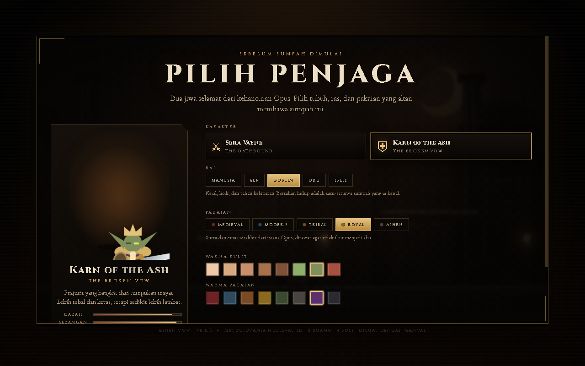

Pratinjau karakter digambar langsung di Canvas dan ikut berubah setiap kali pilihan diganti. Pilihan disimpan otomatis di `localStorage` dengan key `ashen-vow-character-v1`, jadi tetap ada saat game dibuka lagi. Stat karakter tetap seimbang: Karn lebih tebal dan keras, Sera lebih lincah.

### Prolog Opus (60 detik)

Saat memulai perjalanan baru dari menu utama atau layar karakter, game memutar **prolog sinematik satu menit** sebelum ruang pertama. Prolog menceritakan:

1. Kemegahan **Kerajaan Opus** di atas tujuh bukit.
2. Sumpah para raja dan kemakmuran yang menarik perhatian dunia lain.
3. **Serangan Iblis** yang membelah langit dan membuka gerbang neraka.
4. **Pengkhianatan Elf Kegelapan** yang menyerang dari bayangan.
5. Kehancuran Opus, ladang abu, dan sumpah yang masih berdiri.

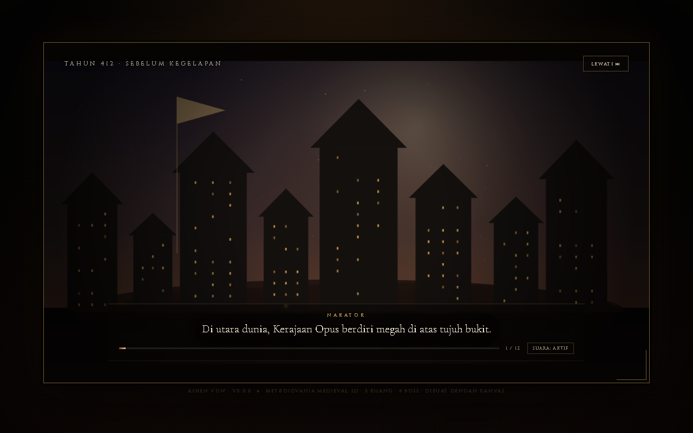

Prolog terdiri dari **12 babak × 5 detik**. Setiap babak punya narasi suara (Web Speech API, `id-ID`) dan **subtitle** yang selalu tampil, sehingga cerita tetap terbaca meskipun browser tidak punya suara. Musik prolog dimainkan lewat WebAudio.

- **LEWATI** atau `Esc` — langsung memulai permainan.
- `Space` / `Enter` — maju ke babak berikutnya.
- **SUARA: AKTIF/MATI** atau `N` — menyalakan atau mematikan narasi.

Prolog hanya diputar untuk perjalanan baru; memulai dari **PILIH LEVEL** atau tombol coba lagi tidak memutarnya kembali.

## Kontrol

| Aksi | Keyboard |
| --- | --- |
| Bergerak | `A` / `D` atau `←` / `→` |
| Lompat | `Space` / `W` / `↑` |
| Lompat ganda | Tekan lompat lagi setelah **Relik Bulu Bara** |
| Serang (kombo 3 hit) | `J` atau `Z` |
| Keahlian Khusus (Ability) | `U` / `V` / `R` |
| Ganti senjata | `X` |
| Lempar shuriken | `C` |
| Buka/tutup Warung Abu | `F` (dekat pedagang) |
| Dash (i-frame) | `K` atau `Shift` |
| Minum flask | `E` atau `Q` |
| Jeda | `Esc` |
| Peta Sumpah | `M` |
| Indeks Sumpah | `I` |
| Suara | `N` |
| Pilih berkah | `1` / `2` / `3` |

Di menu: `Enter` memulai run (dengan prolog), `P` membuka layar karakter, `L` membuka Level Select, `C` membuka Credits.
Di perangkat sentuh, tombol kiri/kanan, lompat, serang, dash, flask, ganti senjata (`⇄`), dan lempar shuriken (`✦`) muncul otomatis.

## Isi v0.0.7

- **2 penjaga yang bisa dipilih** — Sera Vayne (seimbang) dan Karn of the Ash (lebih tebal, lebih keras).
- **Kustomisasi karakter** — ras (manusia, elf, goblin, orc, iblis), 5 gaya armor, 8 warna kulit, dan 8 warna pakaian, dengan pratinjau Canvas langsung.
- **Prolog sinematik 60 detik** — 12 babak naratif tentang kejatuhan Opus, lengkap dengan voice-over dan subtitle, dapat dilewati.

- **Menu awal, Level Select, Credits, dan progres tersimpan** — tidak langsung masuk gameplay.
- **8 ruang** yang terhubung: Gerbang Abu → Balai Sumpah → Singgasana Bara → Sarang Wyrm → Jembatan Tulang → Katedral Sunyi → Menara Lonceng → Puncak Sumpah.
- **4 boss** dengan dialog dan fase:
  - **Sir Mordrake, the Fallen Warden** (340 HP, 2 fase) — telegraf tebasan, ground slam, gelombang kejut. Fase II mempercepat gerak, mempersingkat windup, dan menambah gelombang kejut.
  - **Vhael, the Ashen Wyrm** (480 HP, 2 fase) — volley bola api dan dive attack. Fase II menambah **pilar api**.
  - **The Hollow Choir** (560 HP, 2 fase) — koor tanpa suara yang melayang, menembakkan **note** spiral dan **beam** vertikal. Fase II mempercepat pola dan menambah gema.
  - **The Oathbreaker** (720 HP, 3 fase) — final boss dengan tebasan, dash, volley, dan nova. Fase II dan III membuka pola tambahan; mengalahkannya menyelesaikan run.
- **Dialog boss** untuk intro, setiap fase, dan akhir pertempuran; simulasi berhenti selama dialog.
- **Peta Sumpah (`M`)** — terbuka dari menu, jeda, atau saat bermain.
- **Indeks Sumpah (`I`)** — tab musuh, senjata, boss, dan barang.
- **Dua musuh baru**:
  - **Hollow Wraith** — melayang, menjaga jarak, dan melepas wisp.
  - **Cinder Brute** — lambat dan besar; hentakan lantainya memancarkan gelombang kejut.
- **Combat real-time**: kombo 3 hit, hitbox aktif per frame, hit-stop, screen shake, knockback, dan partikel.
- **AI pengejaran platform-aware** — crawler dan sentinel mengejar pemain, mendeteksi tepi platform, melompat ke pemain yang lebih tinggi, dan melintasi jurang. Patroli hanya aktif saat pemain di luar jangkauan.
- **Checkpoint Warung Abu** di ambang setiap ruang bos. Mati setelah checkpoint membangkitkan pemain di ruang bos dengan HP/flask penuh; abu, senjata, amunisi, dan berkah tetap tersimpan.
- **Mata uang Abu (`ash`)** — didapat dari crawler (8), sentinel (15), wraith (16), brute (22), Warden (60), Wyrm (90), Choir (110), dan Oathbreaker (160). Ditampilkan di HUD.
- **Warung Abu** — toko di samping checkpoint ruang bos. Buka dengan `F` saat dekat pedagang atau dari menu jeda. Menjual:
  - **Pike Penjaga** (35 abu) — jangkauan 118, windup lambat, damage 29.
  - **Busur Abu** (55 abu) — menembak anak panah, amunisi terbatas; termasuk 8 anak panah.
  - **Shuriken ×3** (14 abu) — konsumabel lempar, tombol `C`.
  - **Anak Panah ×6** (12 abu) — amunisi busur.
  - **Isi Ulang Flask** (10 abu).
  Mulai langsung dari Level Select di ruang 2–8 memberi stipend abu bertingkat (45 hingga 240) agar toko tetap bisa dipakai.
- **Tiga senjata** dengan animasi berbeda: Pedang Sumpah (kombo), Pike Penjaga (jangkauan), Busur Abu (proyektil). Berganti dengan `X`.
- **Dash dengan i-frame** dan cooldown.
- **Relik Bulu Bara** — membuka lompat ganda dan menyegel gerbang Balai Sumpah.
- **Jurang** sebagai hazard: jatuh mengurangi HP dan mengembalikan pemain ke titik aman.
- **Tiga berkah** setelah setiap boss non-final: Max HP, damage, atau dash.
- **Flask penyembuh** (3 charge) dengan waktu minum yang bisa diganggu.
- **HUD** HP, flask, status relik, abu, senjata/amunisi, bar boss dengan label **FASE I / II / III**, petunjuk gerbang, banner ruang.
- **Audio prosedural** WebAudio — tanpa file audio.
- Layar judul, jeda, berkah, kematian, dan kemenangan.

## Tangkapan layar

| Gerbang Abu | Warden fase II |
| --- | --- |
| 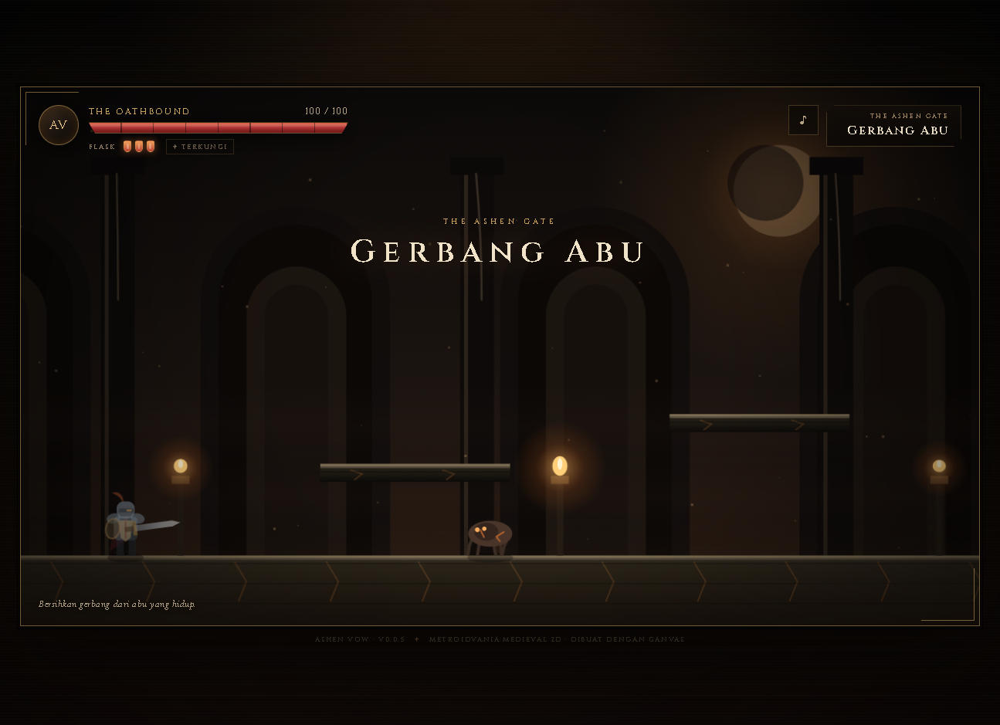 | 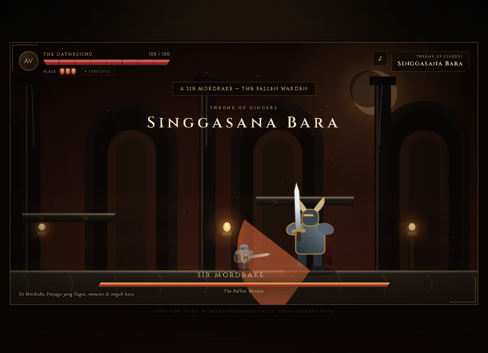 |

| Wyrm menembak | Sneak Peek |
| --- | --- |
| 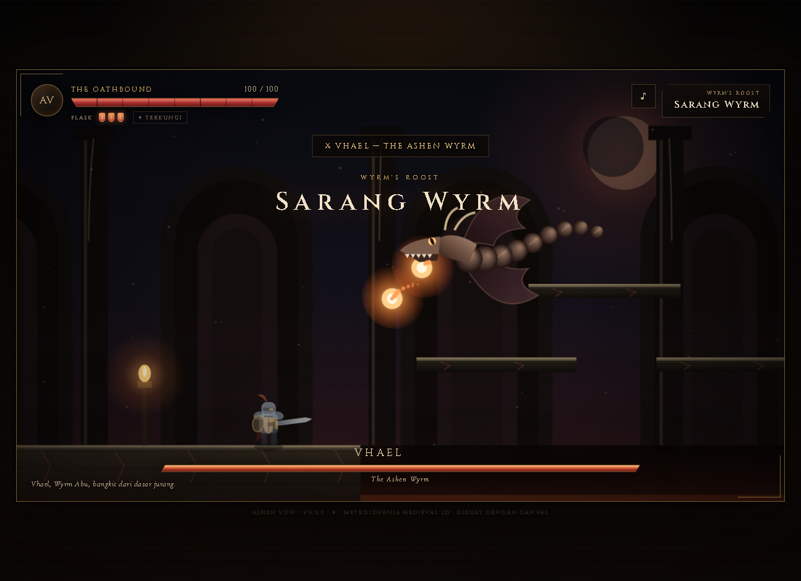 |  |

## Verifikasi mekanik

```bash
npm test
```

**45 tes deterministik, semuanya lulus.** Cakupannya:

- gravitasi dan pendaratan di platform,
- pergerakan dan batas dunia,
- lompat tunggal vs lompat ganda setelah relik,
- registrasi hitbox pedang sampai crawler mati,
- i-frame saat terkena dan saat dash,
- konsumsi flask,
- gerbang terkunci/terbuka dan transisi ruang,
- pengambilan relik,
- damage jurang dan respawn,
- siklus serangan sentinel,
- **pengejaran crawler dan lompatan ke platform yang lebih tinggi**,
- **posisi musuh yang mengejar tidak dipaksa kembali ke batas patroli saat terkena pukulan**,
- **checkpoint ruang bos, respawn yang mempertahankan abu/senjata/berkah**,
- **hadiah abu dari musuh dan boss**,
- **pembelian Warung Abu, validasi amunisi, dan penolakan pembelian ganda**,
- **jangkauan/windup Pike, panah Busur yang menghabiskan amunisi, lempar Shuriken**,
- **siklus ganti senjata dan interaksi pedagang berbasis jarak**,
- transisi fase Warden dan gelombang kejut fase II,
- kematian Warden → pilihan berkah → gerbang terbuka,
- pengaruh berkah damage,
- proyektil Wyrm melukai pemain,
- siklus dive Wyrm dan bola api,
- **transisi fase II Wyrm dan serangan pilar api**,
- **kemenangan setelah Wyrm — kini berlanjut ke bab V, bukan mengakhiri run**,
- **8 ruang dan 4 boss: warden, wyrm, choir, oathbreaker**,
- **dialog intro, fase II, dan kekalahan untuk setiap boss; fase III khusus The Oathbreaker**,
- **wraith yang melayang dan menembak wisp, brute yang menghentak lantai**,
- **serangan note dan beam The Hollow Choir serta gerbangnya**,
- **tiga fase The Oathbreaker dan kemenangan akhir**,
- **isi indeks: 4 musuh, 3 senjata, 4 boss, dan seluruh barang**,
- **gerbang boss memakai ruang saat ini, bukan indeks hardcoded**,
- state kematian membekukan simulasi.

Smoke test browser dijalankan lewat Chrome DevTools Protocol untuk memastikan:

- menu awal tampil dan HUD tersembunyi,
- Level Select menampilkan 8 kartu dengan status terkunci yang benar,
- peta menampilkan 8 ruang, menandai posisi saat ini, dan bisa dibuka dengan `M` saat bermain,
- indeks memiliki 4 tab dengan entri yang benar,
- dialog boss muncul untuk intro, fase, dan kekalahan; `Space`/`Enter` melanjutkannya,
- HUD menampilkan FASE II / FASE III dengan benar,
- ruang 5, 6, dan 8 (choir, oathbreaker, wraith/brute) berjalan tanpa exception,
- Sneak Peek menyembunyikan pemain dan HUD,
- teks credits sesuai,
- progres tersimpan setelah reload,
- **Warung Abu terbuka, menampilkan 5 kartu, dan pembelian memperbarui abu/HUD**,
- **checkpoint respawn mempertahankan abu dan senjata serta memulihkan HP/flask/boss**,
- **AI mengejar dan melompat, senjata berganti, dan busur tanpa amunisi ditolak**,
- tidak ada error console,
- layout desktop dan mobile portrait (390×844) tidak memiliki overflow horizontal, termasuk peta dan indeks.

## Struktur proyek

```
ashen-vow/
├── index.html          # shell, menu, HUD, level select, map, codex, dialogue, spectate
├── styles.css          # tema medieval, layout responsif, touch controls, peta/indeks
├── server.js           # static server port 4300
├── CLAUDE.md           # master plan / handoff untuk Claude
├── src/
│   ├── core.js         # simulasi murni: player, musuh, boss, dialog, indeks, senjata, toko, checkpoint
│   ├── render.js       # renderer Canvas prosedural + mode spectate, choir, oathbreaker
│   ├── audio.js        # SFX WebAudio prosedural
│   └── main.js         # loop fixed-timestep, menu, progres, input, HUD, peta, indeks, dialog
├── tests/
│   └── core.test.js    # 45 tes Node
└── docs/               # tangkapan layar
```

### Desain simulasi

`AshenGame.update(dt, input)` memakai fixed timestep `1/120` detik. Logika tidak menyentuh DOM sehingga hasilnya sama di Node dan browser. Renderer dan audio hanya membaca state/event; event gameplay dikumpulkan di `game.events` untuk dipetakan ke SFX, UI, dan progres.

Event penting:

- `gatePass { from, to }` — ruang selesai dan ruang berikutnya dimasuki.
- `bossDown { room, kind, name }` — boss dikalahkan.
- `bossPhase { name, phase }` — transisi fase boss.
- `bossDialogue { kind, phase, name, title, lines }` — dialog boss untuk `intro`, `phase2`, `phase3`, atau `defeat`.
- `bossSpawn`, `bossTelegraph`, `bossSlash`, `bossSlam`, `bossDie`, `note`, `beam`.
- `checkpoint { room, name }` — checkpoint aktif saat memasuki ruang bos.
- `checkpointRespawn { room }` — pemain bangkit di checkpoint.
- `ashGain { amount, total }` — abu diperoleh dari musuh/boss.
- `shopBuy { id, name, cost }` — pembelian Warung Abu berhasil.
- `weaponSwitch`, `arrowShot`, `shurikenThrow`, `noAmmo` — umpan balik senjata/konsumabel.

Debug hook `window.__ashen` tersedia untuk smoke test (`snap()`, `step()`, `enterRoom()`, `damageBoss()`, `chooseBlessing()`, `startSpectate()`, `openShop()`, `buyShopItem()`, `respawnAtCheckpoint()`, `giveAsh()`, `openMap()`, `closeMap()`, `openCodex()`, `closeCodex()`, `advanceDialogue()`, `clearProgress()`).

## Master plan

Ringkasan arsitektur, keputusan desain, status verifikasi, dan roadmap ada di [`CLAUDE.md`](CLAUDE.md).

## Lisensi

Proyek demo pribadi. Aset visual dan audio dibuat secara prosedural di dalam kode.
