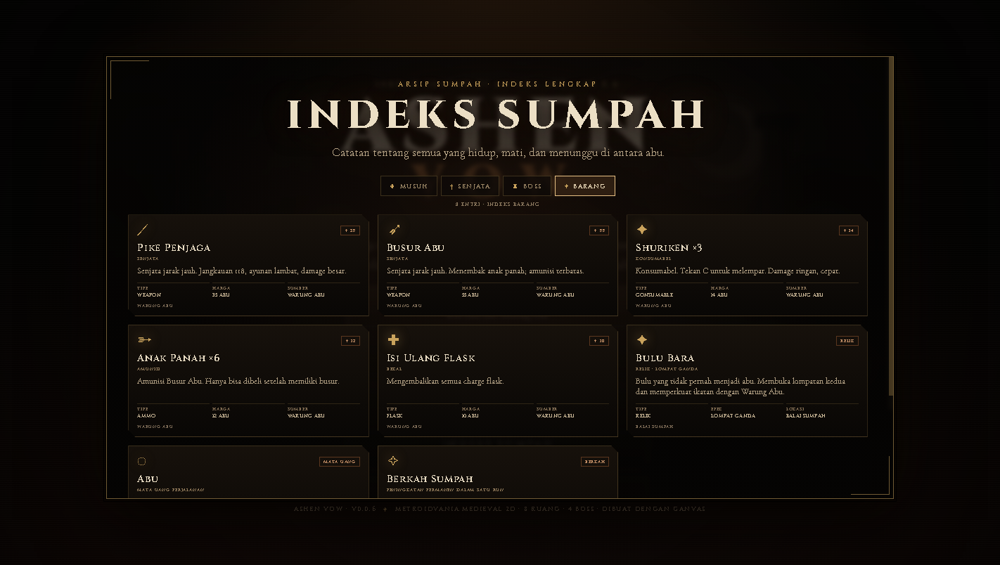
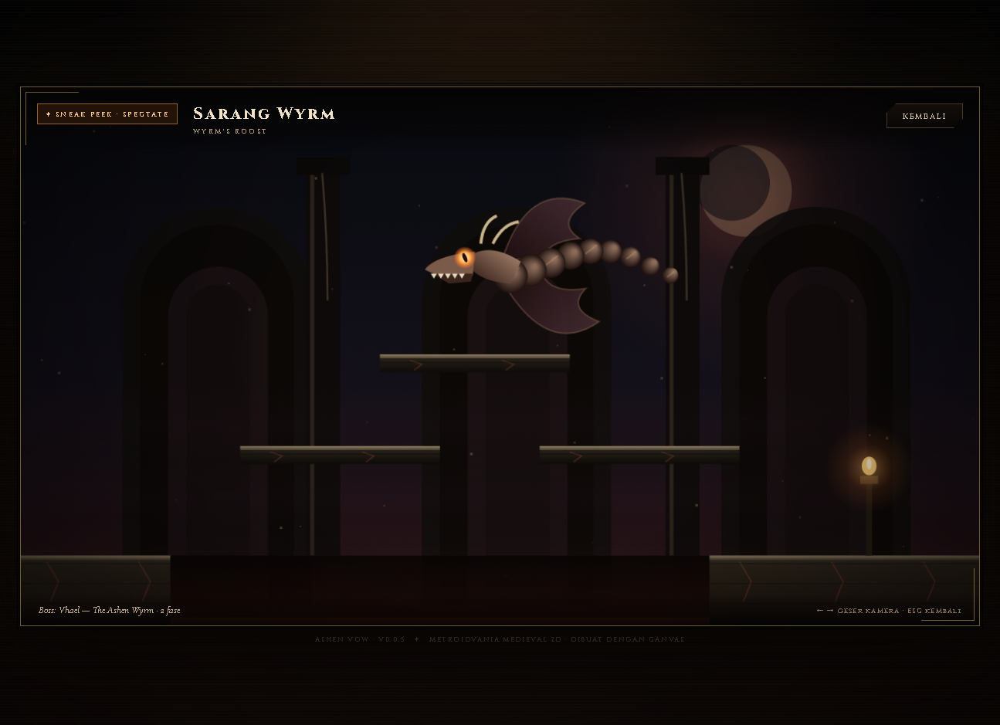
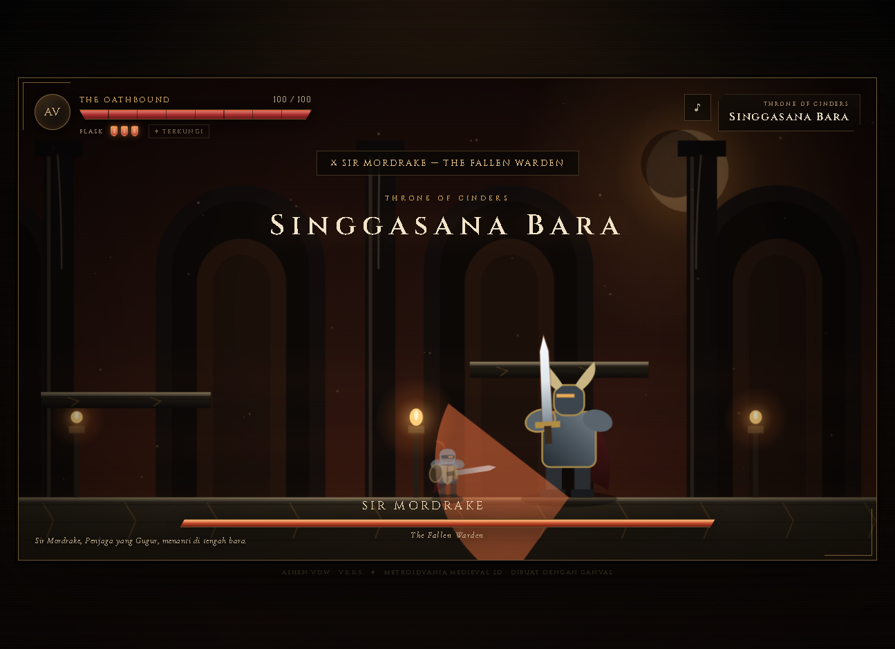

# Ashen Vow — v0.11.0

## Speedrun — Satu Nyawa (v0.11.0)

Satu nyawa, tanpa checkpoint, dan tempo yang terus menderas sampai kau jatuh.

- **Jalankan:** menu utama → **SPEEDRUN — SATU NYAWA**.
- **Mulai 2×, naik tiap bos terakhir:** kampanye penuh berjalan dua kali lebih cepat. Setiap kali **The Oathbreaker** gugur, multiplier naik satu tingkat (3×, 4×, 5×, …) dan kampanye dimulai lagi dari Gerbang Abu dengan tempo baru. Rantai ini berhenti hanya saat kau mati.
- **Satu nyawa, tanpa checkpoint:** `retryRun` tidak bisa membangkitkanmu, `respawnAtCheckpoint()` menolak selama mode ini, dan jurang berubah jadi maut — jatuh langsung mengakhiri run alih-alih melemparkanmu ke titik aman.
- **Cara kerja kecepatan:** simulasi tetap deterministik pada 120 Hz; yang bertambah adalah jumlah langkah per frame (`speedrunMaxSubsteps` membatasinya agar tab yang tertidur tidak melompat), bukan ukuran langkahnya.
- **HUD:** badge `⚡ 2× · 1 NYAWA · PUTARAN 1` di kanan atas, berubah merah mulai 5×.
- **Hub & ringkasan:** hub menampilkan rekor multiplier, putaran tuntas, waktu terbaik, jumlah run, lima aturan mode, dan tangga kecepatan 2× sampai ∞. Kematian membuka layar ringkasan berisi kecepatan akhir, putaran, ruang yang dilewati, dan waktu bertahan, dengan tombol mulai lagi 2×.
- **Rekor & riwayat run:** `progress.speedrun` di `ashen-vow-progress-v1` menyimpan `bestMultiplier`, `bestCycles`, `bestTime`, `bestRooms`, `runs`, `deaths`, dan `clears`, plus `history` berisi 10 percobaan terakhir (multiplier, putaran tuntas, ruang, waktu, hasil, dan stempel waktu). Hub merender riwayat itu di bawah tangga kecepatan — terbaru di atas, ditandai **GUGUR** atau **TUNTAS**; sanitizer membatasi angka, memotong daftar, dan mempertahankan field masa depan.
- **Test & smoke:** `tests/speedrun.test.js` menambah 9 test; total suite **274 test deterministik**. `npm run smoke:speedrun` memverifikasi start 2×, tempo yang lebih cepat dari jam dinding, jurang mematikan, ringkasan satu nyawa, eskalasi Oathbreaker ke 3×, kematian kedua di 3×, riwayat run, dan persistensi setelah reload. `npm run smoke:speedrun:mobile` mengulang alur itu di viewport potret 390×844 (hub, badge HUD, layar ringkasan, baris riwayat).

## Taman Peri — Faewood (v0.10.0)

Sepuluh tahap taman peri, dua bos baru, dan penutup kisah Opus.

- **Jalankan:** menu utama → **TAMAN PERI — FAEWOOD**.
- **Sepuluh tahap berurutan** — Gerbang Lumut, Lorong Jamur, Kolam Peri, Kapel Spora, Jembatan Akar, Taman Cahaya, Sarang Kunang, Padang Tanduk, Ambang Bara, dan Gerbang Singgasana (indeks ruang global 414–423). Tahap berikutnya terkunci sampai tahap sebelumnya tuntas, dan kedua bos tetap tersegel sampai kesepuluh tahap bersih.
- **Dua bos baru** — **Gelora, Slime Magma** (arena ruang 424, 4 fase, HP 1600) dan **Sylvara, Peri Naga Spektral** (arena ruang 425, 4 fase, HP 2600, kemenangan menutup bioma).
- **Sepuluh mob baru** — Tiny Cap, Puff Spore, Glow Midge, Thorn Pixie, Myconid Guard (elite), Shroom Brute, Fae Duelist, Lantern Moth, Magma Blob, dan Elder Spore (spawner). Empat di antaranya bertanda *tiny* dan satu *elite*, jadi kerumunan jamur/peri terasa berbeda dari kroco biasa.
- **Empat NPC mini** — Pipp si Spora, Nia Lentera, Moss Tua, dan Wick Sayap Abu duduk di tahap-tahap awal; mereka menyapa lewat `npcHello` saat ruang dimuat dan digambar sebagai sprite peri kecil.
- **Cutscene potret 20 detik** sebelum duel terakhir (`src/cutscene.js`): lima ketukan yang memperkenalkan Sylvara, mahkota sayapnya, dan ancaman yang menutup gerbang Opus. Bisa dilewati dengan `Esc` atau tombol **LEWATI**.
- **Empat fase dengan dunia yang berubah** — fase 3 mengubah bos menjadi **Sylvara, Seraph of the Woven Sky** dan memindahkan arena ke tema **surga** (cakrawala keemasan, partikel cahaya, musik `magmaBoss`); fase 4 mengubahnya menjadi **Vharos, Demon Lord of the Last Vow** dengan tema **neraka** (langit merah, bara, partikel api). Palet latar, partikel, dan nama/judul bos ikut berubah lewat `arenaTheme` tanpa menyentuh data ruang.
- **Musik Celebratory** — begitu naga gugur, track `celebration` menggantikan victory theme selama layar kemenangan Taman Peri tampil.
- **Post-credit 30 detik** — epilog tentang Demon Lord yang tumbang dan kerajaan Opus yang akhirnya bebas dari cengkeramannya, diputar otomatis sesaat setelah layar kemenangan; layar kemenangan tetap ada di belakangnya.
- **Progres** — `progress.fairy` di `ashen-vow-progress-v1`: tahap yang tuntas, bos yang gugur, rekor waktu terbaik, dan sanitizer yang menolak keadaan mustahil. Menuntaskan kedua bos membuat hub melaporkan 100%.
- **Test & smoke** — `tests/fairy.test.js` menambah 12 test; total suite **264 test deterministik**. `npm run smoke:fairy` memverifikasi hub, rantai sepuluh tahap lewat gerbang asli, segel bos, cutscene, empat fase surga/neraka, musik `celebration`, epilog post-credit, dan persistensi setelah reload — **57 cek** tanpa error console. `npm run smoke:fairy:mobile` menguji tata letak ponsel portrait 390×844: menu utama, hub Taman Peri, Catatan Update, dan layar sinematik bebas overflow horizontal, dengan layar cutscene ikut melebar penuh seperti overlay lain.

## Skill Point & Panggung Abadi (v0.9.0)

- **Skill Point permanen** — setiap bos yang gugur memberi poin: **2** untuk kemenangan pertama atas jenis bos itu, **1** setiap tiga pengulangan, **5** untuk menuntaskan Panggung Abadi, dan **4** untuk menyelesaikan kampanye Echoes. Poin tersimpan di `progress.skills`.
- **Enam keahlian, 23 peringkat** — *Tebasan Membara* (+15% damage ultimate/peringkat), *Napas Kedua* (−6% cooldown), *Titik Hancur* (+5% peluang kritik ultimate, ×1.75 damage), *Sumpah Badan* (+12 HP), *Panen Abu* (+10% abu), dan *Pembawa Tegukan* (+1 flask). Respec gratis kapan saja.
- **Panel di layar karakter** — buka **PILIH PENJAGA** untuk melihat poin, membeli peringkat, dan membaca damage/CD ultimate saat ini. Menaikkan peringkat langsung mengubah ultimate di run berikutnya maupun run yang sedang berjalan.
- **Panggung Abadi — 6 bos baru** — Malveth the Ash King, Ilyra the Glass Warden, Abbot Vurn the Hollow, Valkyr of the Ninth Storm, Seraph of the Last Dawn, dan The Oath Eater Final Judge. Masing-masing 3–5 fase dengan dialog intro/fase/defeat, pola slam/volley/ring/charge/summon/rain, dan tema musiknya sendiri. Buka dari tab Perjalanan Hearthfall.
- **Gauntlet berurutan** — penjaga dibuka satu per satu, HP dipulihkan 25% di antara penjaga, rekor waktu disimpan, dan seluruh rangkaian memberi 5 Skill Point tambahan.
- **Musik bos lebih epik** — enam track baru (`bossAsh`, `bossGlass`, `bossAbbot`, `bossStorm`, `bossDawn`, `bossJudge`), peta `BOSS_TRACKS` untuk setiap bos, dan intensitas yang naik per fase (filter terbuka, pulsa rendah, perkusi menguat).
- **Optimasi terukur** — kompaksi array in-place di loop 120 Hz. `node tools/sim-bench.mjs` mengukur **1.27×** throughput simulasi (25.091 vs 19.683 langkah/detik pada adegan 10 musuh, 160 proyektil, 220 efek).
- **Test & smoke** — `tests/skills.test.js` menambah 12 test; total suite **251 test deterministik**. `npm run smoke:skill` memverifikasi panel Skill Point, enam kartu bos, tema musik, seluruh gauntlet, dan persistensi setelah reload tanpa error console.

## Multiplayer Co-op

- **Kampanye · Hearthfall · Labyrinth** — buka **MULTIPLAYER — CO-OP** dari menu utama. Host memilih mode, membuat room, dan membagikan kode 5 karakter; 2–4 penjaga bisa bergabung.
- **Host authoritative** — host menjalankan simulasi nyata, sedangkan guest mengirim input 20 Hz dan menerima snapshot terkuantisasi. Guest mengikuti avatar-nya sendiri, bukan avatar host.
- **Jaringan aman** — relay WebSocket menandai pengirim, membuang `_from`/`_role` palsu, membatasi ukuran pesan, menolak frame terfragmentasi, dan memigrasikan host ketika socket host putus.
- **Join aman** — kata sandi lobby, pemeriksaan kapasitas 4 pemain, penolakan terarah, dan pembersihan companion saat guest keluar.
- **Verifikasi** — `tests/coop-relay.test.js` menguji spoofing, targeted reply, room penuh, JSON rusak, dan host migration; `npm run smoke:lab` menguji lobby nyata, campaign host, snapshot scene/room, dan avatar guest.

## Hearthfall — The Hollow Court (v0.8.0)

Kampanye rumah terakhir Opus: enam zona baru, enam puluh level, dua belas bos, tiga belas kelas, delapan senjata data-driven, dua belas alat, dan sebuah rumah yang tumbuh dari setiap kemenangan.

- **Jalankan:** menu utama → **HEARTHFALL — THE HOLLOW COURT**.
- **Enam zona · 60 level** — Pendopo Abu, Kebun Kaca, Istana Rongga, Pabrik Abu, Menara Jaga, dan Relikui Abu (indeks ruang global 354–413). Setiap zona berisi 5 ruang tempur, 1 ruang elite, 1 ruang relik, 1 ruang istirahat, dan 1 arena bos.
- **Dua belas bos** — Cinder Steward, Mother Hearth, The Pruned Choir, The Orchard Saint, The Hollow Regent, The Nameless Sovereign, The Bellows Captain, The Forge King, The Vigil Captain, The Dawnless Watch, The Relic Sexton, dan The First Vow. Mini-bos punya 3 fase, bos zona 4 fase, dengan dialog di setiap fase.
- **Dua puluh empat musuh baru** — memakai tujuh arketipe AI yang sudah teruji, lengkap dengan statistik per zona dan varian elite.
- **Delapan senjata** — Kapak Perapian, Bilah Kembar, Tombak Rongga, Gada Sumpah (gelombang kejut), Busur Ulang (amunisi panah), Tongkat Bara (proyektil tanpa amunisi), Sabit Kabut (lifesteal), dan Bilah Wasiat (kombo + lifesteal).
- **Dua belas alat** — slot `charm` / `boots` / `relic`, masing-masing menambah HP, flask, damage, kecepatan, abu, atau penyembuhan. Satu alat per slot.
- **Tiga kelas court-native** — Ashwright, Hearthkeeper, dan Glassblade, masing-masing dengan ability aktif sendiri; roster karakter kini 13 kelas.
- **Rumah Hearthfall** — 6 ruangan (aula, dapur, tungku, kapel, kebun, gudang) hingga level 3, 24 perabot, dan kehangatan. Bonus rumah hanya berlaku di run Hearthfall.
- **Delapan penghuni NPC** — dialog berubah mengikuti ikatan, hadiah menaikkan afinitas, dan setiap penghuni punya misi tiga langkah yang memberi Tanda Perapian, senjata, atau alat.
- **Tantangan & NG+** — **Ronda Para Penjaga** (dua belas bos berurutan, heal 35% di antara penjaga) dan **Jalan Kaca** (10 ruang Kebun Kaca, heal 10% per ruang) menyimpan rekor waktu dan kemenangan. **Sumpah Berulang +0–4** menskalakan HP/damage musuh dan memberi bonus Tanda Perapian pada kemenangan pertama tiap tingkat.
- **Ekonomi Tanda Perapian yang dipacing** — alat termurah terjangkau setelah 4 ruang, senjata termurah setelah 6 ruang, dan satu clear penuh membiayai semua senjata/alat tanpa langsung membeli seluruh rumah. Kurva ini diuji otomatis.
- **Sembilan track musik prosedural** — `hearthfall`, `glassorchard`, `hollowcourt`, `cinderworks`, `lastvigil`, `reliquary`, `courtBoss`, `reliquaryBoss`, dan `hearth`, semuanya dari osilator tanpa file audio.
- **Grafik, inventaris, dan waktu** — menu grafik dengan preset, slider performa↔kualitas, anti-aliasing, FOV, render distance, kepadatan partikel, dan FPS; inventaris menampilkan loadout, amunisi, alat, serta keybind aktif; jam lokal dan timer stage tampil di kanan atas, dan rekor waktu tiap stage muncul di layar kemenangan serta kredit.
- **Save** — `progress.court` di `ashen-vow-progress-v1`, dengan sanitizer yang membatasi nilai, menyaring ID tak dikenal, menegakkan satu alat per slot, dan mempertahankan field masa depan.
- **Optimasi terukur** — indeks ruang O(1), cache agregat bonus rumah, dan statistik satu lintasan. Jalankan `npm run bench:court`; pada mesin pengembangan ini lookup ruang **5,82×** lebih cepat dan agregat bonus rumah **7,85×** lebih cepat daripada jalur naive (lookup penghuni setara, 0,98×).
- **Test & smoke** — `tests/court.test.js` kini berisi 22 test; total suite menjadi **237 test deterministik**. Smoke browser nyata: `npm run smoke:court` (hub, 60 kartu ruang, 12 bos, 12 alat, rumah, hadiah NPC, run room 354, clear + save, dan persistensi setelah reload) lulus tanpa error console.

## Infinite Labyrinth — Cursed Realms (v0.7.0)

Mode bertahan tanpa akhir dengan 20 zona, 30 bos multi-fase, 40 barang terkutuk/ritual, 6 Forbidden Synergy, reward chamber, mastery permanen, dan co-op 2–4 pemain.

- **Jalankan:** menu utama → **INFINITE LABYRINTH — CURSED REALMS**. Pilih salah satu dari 10 mode, lalu bertahan dari gelombang musuh, elite, dan bos. Setiap siklus berakhir di reward chamber.
- **Kutukan:** hadiah item menampilkan bonus dan kerugian sebelum dipilih. **Cursed Bargain** memberi kekuatan besar dengan harga permanen selama run.
- **Ritual:** barang ritual aktif saat syaratnya terpenuhi (mis. 10 kill tanpa damage, 2 elite, 1 bos). Progres terlihat di HUD/ringkasan.
- **Checkpoint:** disimpan setiap 5 siklus. Melanjutkan checkpoint menandai run tidak layak leaderboard.
- **Co-op:** tab **CO-OP 2–4 PEMAIN**. Host membuat room code (opsional kata sandi), pemain lain memasukkan kode yang sama. Game memakai host authoritative + relay `/ws`; untuk LAN jalankan `HOST=0.0.0.0 npm start`.
- **Kontrol tambahan:** co-op memakai kontrol yang sama; tahan **INTERACT** di dekat kawan yang tumbang untuk revive. HUD menampilkan siklus, gelombang, party HP, kutukan, dan skor.
- **Data tersimpan:** `progress.labyrinth` di `ashen-vow-progress-v1` (best cycle, riwayat, mastery, mata uang, discovery). Checkpoint di `ashen-vow-labyrinth-checkpoint-v1`.

Test: `npm test` mencakup 26 test baru untuk labirin/co-op (determinisme, wave director, item/ritual/synergy, save sanitization, snapshot codec, revive, lobby, loot).
Smoke browser + co-op WebSocket langsung: `npm run smoke:lab` (menyalakan server uji sendiri di port 4312).

> **Sumpah di antara abu — The Sundered Atlas (Parts V–VII).**
>
> Atlas terbelah menjadi delapan halaman dunia, dan setiap halaman menuntut sumpahnya sendiri:
> - **8 Zona Atlas & 240 Ruang**: Taman Vael, Kandang Emas, Observatorium Bintang Jatuh, Hutan Layu, Gurun Jam Pasir, Katakombe Tanpa Iman, Palung Abyssal, dan Pengecoran Mesin — 30 ruang per zona, 4 world tier, dan 6 gerbang kemampuan.
> - **Cerita & 4 Akhiran**: linimasa, tokoh, 8 bab, dan akhiran yang ditentukan oleh kemampuan, kelengkapan lore, dan bos yang kau kalahkan.
> - **Indeks Sumpah**: 11 kategori, 33 entri lore dengan 3 tier pengungkapan, pencarian, filter, fragmen, dan hadiah penyelesaian.
> - **Bos yang Menavigasi**: platform graph + A*, navigator dengan pemulihan saat tersangkut, pemilihan serangan berbasis skor, dan bot deterministik 100 iterasi per bos.
> - **Performa & Kualitas**: frame budget, object pooling, frustum culling, AI scheduler, auto-quality, dan 5 preset latar.
> - **Ekonomi Atlas**: 55 konsumabel dengan quick slot 1–4, 12 resep memasak/merakit, 6 warung NPC, 12 set zirah, 15 jimat, dan 40 senjata dengan mastery serta infusi.
> - **Warisan Tetap Utuh**: kampanye 14 ruang, ekspansi 100 level, Mode 3D, dan seluruh progres Infinite Frontiers tetap dapat dimainkan dan dimigrasikan.
> - **Prinsip Utama**: bonus zirah, jimat, dan senjata Atlas hanya berlaku di run Atlas; konten lama tidak direbalance secara paksa.

Ashen Vow adalah game web tanpa build step: HTML5 Canvas + ES Modules murni. Seluruh simulasi combat berjalan deterministik di `src/core.js` dan `src/mode3d.js`, sehingga bisa diuji otomatis dengan Node tanpa browser.


## Trailer sinematik

[](trailer/ashen-vow-trailer.mp4)

Trailer resmi berdurasi **2 menit** (1280×720, 30 fps) beserta thumbnail tersedia di folder [`trailer/`](trailer/):

- [`trailer/ashen-vow-trailer.mp4`](trailer/ashen-vow-trailer.mp4) — 120 detik, H.264 + AAC.
- [`trailer/thumbnail.png`](trailer/thumbnail.png) — key art 1280×720.

Seluruh footage diambil langsung dari build game ini (bukan mockup): pertarungan Gerbang Abu, traversal Balai Sumpah, duel **Sir Mordrake**, **Warung Abu**, dan pertarungan **Vhael**. Lihat [`trailer/README.md`](trailer/README.md) untuk rincian produksi.

## Cara menjalankan

```bash
npm start
```

Buka <http://127.0.0.1:4300>.

Tidak perlu `npm install` — tidak ada dependensi runtime.

## Alur menu

Game **tidak langsung masuk ke gameplay**. Saat dibuka, yang tampil adalah menu utama:

- **MULAI PERJALANAN** — memulai run baru dari Gerbang Abu.
- **PILIH PENJAGA** — buka layar karakter: pilih salah satu dari sepuluh penjaga, atur ras, warna kulit, warna pakaian, dan gaya armor sebelum berangkat.
- **PILIH LEVEL** — melihat 14 ruang, status terkunci/terbuka/tuntas, dan progres tersimpan.
- **PETA SUMPAH** — peta interaktif perjalanan dengan kabut perang dan pin, bisa dibuka kapan saja dengan `M`.
- **INDEKS SUMPAH** — indeks musuh, senjata, boss, dan barang, bisa dibuka dengan `O`.
- **ECHOES OF THE FORGOTTEN WORLD** — hub ekspansi dengan tab **Kampanye**, **Thornveil Haven**, **Ashen Chronicle**, dan **Lemari & Jurnal**, bisa dibuka dengan `X`.
- **THE SUNDERED ATLAS** — hub Parts V–VII dengan tab **Zona & Ruang**, **Cerita**, **Indeks Sumpah**, **Warung**, **Perlengkapan**, **Barang & Resep**, dan **Sistem**.
- **CATATAN UPDATE** — riwayat rilis di dalam game, dari fondasi pertama sampai **The Sundered Atlas**.
- **PENGATURAN** — audio, keybind, gamepad, dan aksesibilitas.
- **CREDITS** — halaman kredit game.

Progres disimpan otomatis di `localStorage` dengan key `ashen-vow-progress-v1`; pengaturan dan keybind disimpan terpisah di `ashen-vow-settings-v1`. Menyelesaikan sebuah ruang membuka ruang berikutnya. Layar jeda, kematian, dan kemenangan juga punya jalan kembali ke **PILIH LEVEL** dan **MENU UTAMA**.

### Peta dan Indeks


**Peta Sumpah** (`M`) sekarang berupa kanvas interaktif: ruang yang belum dimasuki tertutup kabut, tetangga langsung tampil sebagai garis putus-putus, setiap zona punya warna sendiri, posisi pemain berdenyut, boss yang gugur berubah menjadi tengkorak abu, dan tooltip menampilkan isi ruang. Geser untuk pan, gulir atau `+`/`−` untuk zoom, klik ganda untuk recenter. Klik peta untuk menaruh pin (catatan, air, kunci, kembali nanti; maksimal 10); klik kanan di dekat pin untuk menghapusnya. Pin dan fog tersimpan bersama progres.

Lima zona lama — Ashen Hall, Mycelial Hollow, Tidewrought Cistern, Frostglass Cathedral, dan Cinder Maw — kini ditambah sepuluh zona biome ekspansi, sehingga totalnya **15 zona**. Empat belas ruang lama tetap dipetakan ke empat zona; seratus ruang ekspansi memakai zona biome masing-masing, lengkap dengan palette, parallax, partikel, dan track musik sendiri. Mycelial Hollow bisa dimainkan penuh sebagai cabang opsional dari Singgasana Bara.



**Indeks Sumpah** (`O`) memiliki empat tab:

- **MUSUH** — crawler, sentinel, hollow wraith, cinder brute, sporeling, mycelial stalker, brood mother.
- **SENJATA** — Pedang Sumpah, Pike Penjaga, Busur Abu.
- **BOSS** — keenam penjaga, HP, jumlah fase, hadiah abu, dan lokasinya.
- **BARANG** — isi Warung Abu, relik, abu, dan berkah sumpah.

### Dialog Boss

Setiap boss berbicara di awal pertempuran, saat berpindah fase, dan ketika gugur. Dialog membekukan simulasi sampai pemain menekan `Space`/`Enter`, mengklik **LANJUT**, atau menutupnya dengan `Esc`. The Oathbreaker memiliki dialog tambahan untuk fase III.

### Level Select dan Sneak Peek


Semua ruang tampil di Level Select. Ruang yang belum selesai berstatus **TERKUNCI**:

- tombol **MAINKAN** disembunyikan,
- hanya tersedia **SNEAK PEEK**.

Sneak Peek adalah mode **spectate-only**: kamera menyusuri ruang atau mengitari boss, tanpa pemain, tanpa HUD, dan tanpa combat. Tekan `←` / `→` untuk menggeser kamera, `Esc` untuk kembali.



### Credits

Halaman credits memuat:

> **MADE BY SealiusHQ**
> with a lot of support from **Contributors**


### Pilih Penjaga, Kustomisasi & Keahlian Khusus

Terdapat **sepuluh penjaga/kelas** yang bisa dimainkan, masing-masing dengan statistik dan **Keahlian Khusus (*Active Ability*)**:

| Penjaga | Kelas | Darah | Serangan | Kecepatan | Keahlian Khusus |
| --- | --- | --- | --- | --- | --- |
| **Sera Vayne** | The Knight | 100 | 1.00x | 1.00x | **Tebasan Sumpah** (`U`/`V`) |
| **Lyna Windstrider** | Elf Archer | 88 | 1.04x | 1.08x | **Tembakan Badai** (`U`/`V`) |
| **Kael Shadowstep** | Assassin | 82 | 1.12x | 1.14x | **Langkah Bayangan** (`U`/`V`) |
| **Karn of the Ash** | Brawler | 125 | 1.08x | 0.93x | **Hentakan Bara** (`U`/`V`) |
| **Ignis Pyrewalker** | Mage | 86 | 1.16x | 0.98x | **Ledakan Nova Bara** (`U`/`V`) |
| **Varek the Unbroken** | Gladiator | 115 | 1.06x | 1.02x | **Terjangan Arena** (`U`/`V`) |
| **Neris of the Net** | Netfighter | 90 | 1.02x | 1.06x | **Jaring Penjaga** (`U`/`V`) |
| **Astra Stormcaller** | Stormcaller | 84 | 1.14x | 1.00x | **Rantai Badai** (`U`/`V`) |
| **Bram Ironward** | Sentinel | 120 | 1.00x | 0.94x | **Denyut Aegis** (`U`/`V`) |
| **Maera Thornward** | Warden | 98 | 1.03x | 1.03x | **Voli Duri** (`U`/`V`) |

Di layar **PILIH PENJAGA** kamu bisa mengganti:

- **Karakter / Kelas** — Knight, Archer, Assassin, Brawler, Mage, Gladiator, Netfighter, Stormcaller, Sentinel, Warden.
- **Ras** — Manusia, Elf, Goblin, Orc, Iblis. Setiap ras punya warna kulit, mata, dan ciri wajah sendiri (telinga panjang, taring, tanduk).
- **Pakaian** — Medieval, Modern, Tribal, Royal, Ashen. Gaya menentukan bentuk armor, helm, jubah, dan aksen.
- **Warna kulit** — delapan nada dari pucat sampai hijau goblin dan merah iblis.
- **Warna pakaian** — delapan warna kain, jubah, dan aksen.
- **Efek VFX & Animasi Altar**: Altar berputar, partikel bintang sparkling berkilau (*glitter stars*), dan gelombang kejut transisi (*shockwave pulse*) saat pergantian karakter.


Pratinjau karakter digambar langsung di Canvas dan ikut berubah setiap kali pilihan diganti. Pilihan disimpan otomatis di `localStorage` dengan key `ashen-vow-character-v1`, jadi tetap ada saat game dibuka lagi. Stat karakter tetap seimbang: Karn lebih tebal dan keras, Sera lebih lincah.

### Prolog Opus (60 detik)

Saat memulai perjalanan baru dari menu utama atau layar karakter, game memutar **prolog sinematik satu menit** sebelum ruang pertama. Prolog menceritakan:

1. Kemegahan **Kerajaan Opus** di atas tujuh bukit.
2. Sumpah para raja dan kemakmuran yang menarik perhatian dunia lain.
3. **Serangan Iblis** yang membelah langit dan membuka gerbang neraka.
4. **Pengkhianatan Elf Kegelapan** yang menyerang dari bayangan.
5. Kehancuran Opus, ladang abu, dan sumpah yang masih berdiri.


Prolog terdiri dari **12 babak × 5 detik**. Setiap babak punya narasi suara (Web Speech API, `id-ID`) dan **subtitle** yang selalu tampil, sehingga cerita tetap terbaca meskipun browser tidak punya suara. Musik prolog dimainkan lewat WebAudio.

- **LEWATI** atau `Esc` — langsung memulai permainan.
- `Space` / `Enter` — maju ke babak berikutnya.
- **SUARA: AKTIF/MATI** atau `N` — menyalakan atau mematikan narasi.

Prolog hanya diputar untuk perjalanan baru; memulai dari **PILIH LEVEL** atau tombol coba lagi tidak memutarnya kembali.

## Kontrol

| Aksi | Keyboard (bawaan) |
| --- | --- |
| Bergerak | `A` / `D` atau `←` / `→` |
| Lompat | `Space` / `W` |
| Lompat ganda | Tekan lompat lagi setelah **Relik Bulu Bara** |
| Serang (kombo 3 hit) | `J` atau `Z` |
| Keahlian Khusus (Ability) | `U` atau `V` |
| Ganti senjata | `Q` atau `C` |
| Lempar item cepat | `K` atau `X` |
| Ganti item cepat | `R` |
| Buka/tutup Warung Abu | `F` atau `Enter` (dekat pedagang) |
| Dash (i-frame) | `L` atau `Shift` |
| Minum flask | `E` atau `H` |
| Jeda / Pengaturan | `Esc` atau `P` |
| Peta Sumpah | `M` atau `Tab` |
| Indeks Sumpah | `O` |
| Inventaris | `I` |
| Suara | `N` |
| Pilih berkah | `1` / `2` / `3` |

Semua aksi di atas dapat diubah dari **Pengaturan → Kontrol** (satu atau dua slot per aksi). Perubahan langsung tersimpan dan dipakai gameplay. Di menu: `Enter` memulai run, `P` membuka layar karakter, `L` membuka Level Select, `C` membuka Credits, `U` membuka Catatan Update.
Di perangkat sentuh, tombol kiri/kanan, lompat, serang, dash, flask, ganti senjata (`⇄`), dan item cepat (`✦`) muncul otomatis.

## Fondasi v0.0.8 — Milestone A

Milestone A dari masterplan sudah mendarat. Semua fitur di bawah ini berjalan nyata di build, bukan tombol hiasan:

- **Audio engine prosedural** (`src/music.js`) — satu AudioContext dengan bus master, musik, dan SFX terpisah. Track menu, Ashen Hall, Mycelial Hollow, Tidewrought Cistern, Frostglass Cathedral, Cinder Maw, boss, dan victory disintesis langsung dari osilator; crossfade 1,7 detik antar ruang/zona dan layer combat yang memudar masuk saat musuh dekat. Audio baru aktif setelah klik/keypress pertama.
- **Pengaturan (menu utama & jeda)** — tab Audio (master/music/SFX, mute, mute saat tab blur), Kontrol (dua slot per aksi, deteksi konflik dengan Tukar/Batal, reset per aksi dan reset semua, Gamepad API), serta Gameplay & Aksesibilitas (screen shake Off/Low/Full, kurangi kilatan, kontras tinggi, mode buta warna, ukuran teks, batas 60/120/uncapped FPS, penghitung FPS).
- **Penyimpanan terpisah** — pengaturan dan keybind disimpan di `ashen-vow-settings-v1`, tidak pernah terhapus saat progres (`ashen-vow-progress-v1`) di-reset.
- **Peta interaktif v1** (`src/map.js`) — digambar dari konfigurasi ruang yang sama dengan game: fog of war, outline tetangga, warna per zona, marker pemain berdenyut, tengkorak boss yang menjadi abu setelah gugur, tooltip, legenda, pan/zoom, recenter, hingga 10 pin (catatan/air/kunci/kembali) yang tersimpan.
- **Input yang bisa diubah** — semua aksi gameplay membaca binding dari Settings; `Esc` selalu menutup satu lapis menu.
- **Migrasi save v0.0.7** — save lama tetap dimuat; ruang yang sudah tuntas otomatis ditandai ditemukan di peta baru.
- **Zona siap diperluas** — `src/zones.js` memetakan setiap ruang ke zona dan menyimpan palette, partikel, warna peta, serta ID musik. Menambah ruang/zona baru tidak menyentuh kode audio atau peta.
- **Tes baru** — `tests/foundations.test.js` menguji settings, konflik keybind, persistensi, gamepad, fog of war, pin, statistik peta, pemetaan zona, dan keamanan MusicManager tanpa AudioContext.

## Mycelial Hollow — Milestone B (v0.1.0)

Milestone B menambahkan bioma opsional penuh yang bisa dimasuki dari **Singgasana Bara** setelah Warden gugur, lalu kembali ke sana lewat gerbang akhir:

- **Enam ruang baru** — Lubang Masuk, Taman Spora, Jembatan Gantung, Sarang Induk, Relung Tersembunyi (rahasia), dan Altar Spora.
- **Trampolin spora** — topi spora memantulkan pemain dengan kekuatan berbeda di tiap ruang.
- **Miselium yang bisa dipanjat** — tahan lompat di strip akar untuk naik.
- **Tiga musuh baru** — Sporeling yang melompat, Mycelial Stalker yang menggali lalu menerjang, dan Brood Mother yang menetaskan Sporeling.
- **The Sporebound** — boss tiga fase dengan 780 HP; fase II menambah spora, fase III mempercepat pola dan memanggil brood.
- **Root of the First Vow** — mini-boss opsional di balik dinding miselium yang harus dihancurkan (120 damage). Hadiahnya **+1 flask maksimum permanen** untuk run tersebut plus isi ulang penuh.
- **Gerbang bercabang** — ruang 2 memakai gerbang timur dan barat; ruang 11 memakai gerbang rahasia ke relung tersembunyi dan gerbang timur ke arena bos. Progres baru menyimpan penemuan ruang rahasia, tetapi menyelesaikan ruang 12 tetap menandainya tuntas di Level Select.
- **Musik mycelial** — track zona dan boss baru di `src/music.js`.
- **Peta 14 simpul** — Mycelial Hollow tampil sebagai cabang simetris dengan warna zona sendiri; kartu Level Select ruang 12 tetap tersembunyi sampai ditemukan.
- **Tes dan smoke test** — 79 tes Node dan smoke test CDP 36 pemeriksaan mencakup trampolin, panjat, dinding rahasia, fase Sporebound, hadiah flask Root, gerbang kembali, serta persistensi setelah reload.

Zona yang belum bisa dimainkan dan direncanakan di milestone berikutnya: Tidewrought Cistern, Frostglass Cathedral, Cinder Maw, plus cerita/ending, bahasa Inggris, fast travel, dan boss tambahan. Lihat [`MASTERPLAN.md`](MASTERPLAN.md).

## Sigil & Ritual — v0.2.0

Update konten pertama setelah fondasi dan Mycelial Hollow. Semua sistem di bawah ini aktif di build:

- **Lima penjaga baru** — Gladiator (Terjangan Arena), Netfighter (Jaring Penjaga), Stormcaller (Rantai Badai), Sentinel (Denyut Aegis), dan Warden (Voli Duri), lengkap dengan statistik, penampilan, dan kemampuan sendiri.
- **Empat Sigil permanen** — dibeli sekali di Warung Abu dan bertahan sampai run berakhir:
  - **Sigil Bara** (45 abu) — +18% damage.
  - **Sigil Besi** (40 abu) — +25 HP maksimum dan langsung memulihkan 25 HP.
  - **Sigil Angin** (40 abu) — +8% kecepatan gerak dan cooldown dash 12% lebih singkat.
  - **Sigil Sumpah** (60 abu) — +1 charge flask dan isi ulang penuh.
- **Empat Item Ritual** — tersimpan sebagai stok dan dipakai dari inventaris:
  - **Ritus Penyucian** (50 abu) — 60 damage ke semua musuh dan melenyapkan proyektil lawan.
  - **Ritus Penjagaan** (40 abu) — kebal 6 detik dan +15 HP.
  - **Ritus Bara** (45 abu) — 12 bola api ke segala arah.
  - **Ritus Pemulihan** (35 abu) — +50 HP dan +1 charge flask.
- **Enam konsumabel** — Shuriken ×3 (14), Pisau Lempar ×5 (18), Bom Bara ×2 (24), Tonik Abu (16), Vial Asap (20), dan Batu Asah (22). Pisau terbang lebih cepat dan menusuk, bom meledak di area, tonik memulihkan 30 HP instan, asap memberi kebal 2,5 detik, dan batu asah memberi +30% damage selama 25 detik.
- **Inventaris in-run (`I`)** — layar baru yang mengelompokkan Sigil, Ritual, dan Konsumabel. Ritual/konsumabel bisa langsung dipakai dari sini; Sigil ditandai **AKTIF** karena efeknya pasif.
- **Item cepat (`R`)** — HUD menampilkan item cepat terpilih (Shuriken, Pisau, atau Bom) beserta sisa jumlahnya. `K`/`X` melempar item yang sedang dipilih.
- **Catatan Update** — layar riwayat rilis di menu utama, berisi ringkasan, sorotan, dan perbaikan setiap versi. Data rilis disimpan di `src/updates.js`.
- **Keybind yang dirapikan** — ability kini `U`/`V`, `I` menjadi inventaris, `O` membuka Indeks, `R` mengganti item cepat, dan gamepad memakai Select untuk inventaris, L3 untuk item cepat, serta R3 untuk peta.
- **Perbaikan HUD dan toko** — ikon, label tipe, status sigil aktif, dan tata letak grid toko diperluas untuk 18 barang.

## Echoes of the Forgotten World — v0.3.0

Ekspansi besar yang dibangun sebagai lapisan data di atas engine lama. Kampanye lama, peta, Level Select, Indeks Sumpah, dan save tetap utuh; konten baru memakai indeks ruang global **14–113** melalui `ALL_ROOMS`.

- **100 level dalam 10 bab** — setiap bab berisi 7 level standar, 1 level lingkungan/puzzle, 1 level elite dengan mini-boss, dan 1 level boss besar. Bab bergerak dari Hutan Abu, Rawa Tulang, Kawah Gema, Kota Terkubur, Gua Kristal, Padang Badai, Kuil Akar, Lautan Kabut, Menara Waktu, sampai Singgasana Terlupakan.
- **10 biome baru** — masing-masing punya parallax bergerak, cuaca dinamis, kondisi wilayah, hazard khas (angin, kabut, geyser, gergaji, beam, spora, void), platform, prop, waystone, dan track musik prosedural.
- **100 tipe musuh dasar + 300 varian** — dipetakan ke tujuh arketipe AI yang sudah teruji: chaser, lunge, ranged flyer, slam, burrower, spawner, dan hopper.
- **10 boss besar + 20 mini-boss** — pola slam, volley, ring, charge, summon, dan rain dengan dialog intro, fase, dan kekalahan. Level special dan elite masing-masing membawa satu mini-boss; level boss membawa boss bab.
- **5 kesulitan** — Cerita, Normal, Veteran, Mimpi Buruk, dan Master Abu — plus **6 modifier opsional** (Kulit Besi, Bilah Kaca, Paceklik, Buruan, Rapuh, Buta Kabut).
- **Thornveil Haven** — permukiman permanen dengan 10 NPC tetap, dialog yang mengikuti flag kampanye, 12 quest, 8 fasilitas yang bisa ditingkatkan memakai Gema, dan evolusi visual permukiman.
- **8 permukiman dan 52 NPC** — Thornveil Haven plus tujuh pos terdepan yang terbuka seiring bab; masing-masing punya layanan, dialog, dan NPC sendiri.
- **Ashen Chronicle** — 6 tema event musiman (Festival Abu, Bulan Lonceng, Musim Spora, Malam Badai, Pesta Panen, Gerhana Terakhir), misi, jalur hadiah, toko event, dan 20+ kulit eksklusif. Event berjalan lokal sesuai bulan; hadiah yang sudah diklaim **tidak pernah hilang** saat event berakhir.
- **Lemari & Jurnal** — pratinjau 32 kulit (hanya visual, tanpa bonus tempur) dan jurnal 12 kategori berisi 120 koleksi.
- **8 mode berulang** — Ujian Gema, Boss Rush, Gelombang Abu, Gauntlet, Buruan Besar, Perburuan Relik, Cermin Sumpah, dan Tanpa Akhir.
- **New Game Plus dan ujian akhir** — 5 tingkat NG+ serta 4 ujian endgame setelah kampanye tuntas.
- **Save yang sama** — progres ekspansi disimpan di `progress.expansion` dalam key `ashen-vow-progress-v1`. Save lama dimigrasikan tanpa menghapus progres, boss, peralatan, proyek peta, skill point, achievement, atau flag NPC.

## Isi v0.2.0

- **10 penjaga yang bisa dipilih** — Sera Vayne, Lyna Windstrider, Kael Shadowstep, Karn of the Ash, Ignis Pyrewalker, Varek the Unbroken, Neris of the Net, Astra Stormcaller, Bram Ironward, dan Maera Thornward.
- **Kustomisasi karakter** — ras (manusia, elf, goblin, orc, iblis), 5 gaya armor, 8 warna kulit, dan 8 warna pakaian, dengan pratinjau Canvas langsung.
- **Inventaris (`I`) dan Update Log** — Sigil, Ritual, dan konsumabel tersimpan per run; riwayat rilis bisa dibaca dari menu utama.
- **Prolog sinematik 60 detik** — 12 babak naratif tentang kejatuhan Opus, lengkap dengan voice-over dan subtitle, dapat dilewati.

- **Menu awal, Level Select, Credits, dan progres tersimpan** — tidak langsung masuk gameplay.
- **14 ruang** yang terhubung: Gerbang Abu → Balai Sumpah → Singgasana Bara → Sarang Wyrm → Jembatan Tulang → Katedral Sunyi → Menara Lonceng → Puncak Sumpah, ditambah cabang **Mycelial Hollow** (Lubang Masuk → Taman Spora → Jembatan Gantung → Sarang Induk → Relung Tersembunyi / Altar Spora) yang kembali ke Singgasana Bara.
- **6 boss** dengan dialog dan fase:
  - **Sir Mordrake, the Fallen Warden** (340 HP, 2 fase) — telegraf tebasan, ground slam, gelombang kejut. Fase II mempercepat gerak, mempersingkat windup, dan menambah gelombang kejut.
  - **Vhael, the Ashen Wyrm** (480 HP, 2 fase) — volley bola api dan dive attack. Fase II menambah **pilar api**.
  - **The Hollow Choir** (560 HP, 2 fase) — koor tanpa suara yang melayang, menembakkan **note** spiral dan **beam** vertikal. Fase II mempercepat pola dan menambah gema.
  - **The Oathbreaker** (720 HP, 3 fase) — final boss dengan tebasan, dash, volley, dan nova. Fase II dan III membuka pola tambahan; mengalahkannya menyelesaikan run.
  - **The Sporebound** (780 HP, 3 fase) — boss Mycelial Hollow dengan spora, cloud, dan panggilan brood; fase III mempercepat semuanya.
  - **Root of the First Vow** (360 HP, 2 fase, opsional) — mini-boss di balik dinding rahasia; hadiah **+1 flask maksimum** dan isi ulang penuh.
- **Dialog boss** untuk intro, setiap fase, dan akhir pertempuran; simulasi berhenti selama dialog.
- **Peta Sumpah (`M`)** — terbuka dari menu, jeda, atau saat bermain.
- **Indeks Sumpah (`O`)** — tab musuh, senjata, boss, dan barang.
- **Lima musuh baru**:
  - **Hollow Wraith** — melayang, menjaga jarak, dan melepas wisp.
  - **Cinder Brute** — lambat dan besar; hentakan lantainya memancarkan gelombang kejut.
  - **Sporeling** — tunas miselium yang melompat dan pecah menjadi awan spora.
  - **Mycelial Stalker** — menggali, muncul di bawah pemain, lalu menerjang.
  - **Brood Mother** — menetaskan Sporeling selama pertarungan.
- **Combat real-time**: kombo 3 hit, hitbox aktif per frame, hit-stop, screen shake, knockback, dan partikel.
- **AI pengejaran platform-aware** — crawler dan sentinel mengejar pemain, mendeteksi tepi platform, melompat ke pemain yang lebih tinggi, dan melintasi jurang. Patroli hanya aktif saat pemain di luar jangkauan.
- **Checkpoint Warung Abu** di ambang setiap ruang bos. Mati setelah checkpoint membangkitkan pemain di ruang bos dengan HP/flask penuh; abu, senjata, amunisi, dan berkah tetap tersimpan.
- **Mata uang Abu (`ash`)** — didapat dari crawler (8), sentinel (15), wraith (16), brute (22), sporeling (10), stalker (20), brood mother (32), Warden (60), Wyrm (90), Choir (110), Sporebound (150), Root (80), dan Oathbreaker (160). Ditampilkan di HUD.
- **Warung Abu** — toko di samping checkpoint ruang bos. Buka dengan `F` saat dekat pedagang atau dari menu jeda. Menjual 18 barang:
  - **Pike Penjaga** (35 abu) — jangkauan 118, windup lambat, damage 29.
  - **Busur Abu** (55 abu) — menembak anak panah, amunisi terbatas; termasuk 8 anak panah.
  - **Sigil Bara / Besi / Angin / Sumpah** (45/40/40/60 abu) — upgrade pasif permanen per run.
  - **Ritus Penyucian / Penjagaan / Bara / Pemulihan** (50/40/45/35 abu) — item ritual sekali pakai.
  - **Shuriken ×3** (14 abu), **Pisau Lempar ×5** (18 abu), **Bom Bara ×2** (24 abu) — item cepat, tombol `K` dan `R`.
  - **Tonik Abu** (16 abu), **Vial Asap** (20 abu), **Batu Asah** (22 abu) — konsumabel inventaris.
  - **Anak Panah ×6** (12 abu) — amunisi busur.
  - **Isi Ulang Flask** (10 abu).
  Mulai langsung dari Level Select di ruang 2–14 memberi stipend abu bertingkat (45 hingga 240) agar toko tetap bisa dipakai.
- **Tiga senjata** dengan animasi berbeda: Pedang Sumpah (kombo), Pike Penjaga (jangkauan), Busur Abu (proyektil). Berganti dengan `Q`.
- **Dash dengan i-frame** dan cooldown.
- **Relik Bulu Bara** — membuka lompat ganda dan menyegel gerbang Balai Sumpah.
- **Jurang** sebagai hazard: jatuh mengurangi HP dan mengembalikan pemain ke titik aman.
- **Tiga berkah** setelah setiap boss non-final: Max HP, damage, atau dash.
- **Flask penyembuh** (3 charge) dengan waktu minum yang bisa diganggu.
- **HUD** HP, flask, status relik, abu, senjata/amunisi, item cepat terpilih, bar boss dengan label **FASE I / II / III**, petunjuk gerbang, banner ruang.
- **Audio prosedural** WebAudio — tanpa file audio.
- Layar judul, jeda, berkah, kematian, dan kemenangan.

## Tangkapan layar

| Gerbang Abu | Warden fase II |
| --- | --- |
|  |  |

| Wyrm menembak | Sneak Peek |
| --- | --- |
|  |  |

## Verifikasi mekanik

```bash
npm test
```

**103 tes deterministik, semuanya lulus.** Cakupannya:

- gravitasi dan pendaratan di platform,
- pergerakan dan batas dunia,
- lompat tunggal vs lompat ganda setelah relik,
- registrasi hitbox pedang sampai crawler mati,
- i-frame saat terkena dan saat dash,
- konsumsi flask,
- gerbang terkunci/terbuka dan transisi ruang,
- pengambilan relik,
- damage jurang dan respawn,
- siklus serangan sentinel,
- **pengejaran crawler dan lompatan ke platform yang lebih tinggi**,
- **posisi musuh yang mengejar tidak dipaksa kembali ke batas patroli saat terkena pukulan**,
- **checkpoint ruang bos, respawn yang mempertahankan abu/senjata/berkah**,
- **hadiah abu dari musuh dan boss**,
- **pembelian Warung Abu, validasi amunisi, dan penolakan pembelian ganda**,
- **jangkauan/windup Pike, panah Busur yang menghabiskan amunisi, lempar Shuriken**,
- **siklus ganti senjata dan interaksi pedagang berbasis jarak**,
- transisi fase Warden dan gelombang kejut fase II,
- kematian Warden → pilihan berkah → gerbang terbuka,
- pengaruh berkah damage,
- proyektil Wyrm melukai pemain,
- siklus dive Wyrm dan bola api,
- **transisi fase II Wyrm dan serangan pilar api**,
- **kemenangan setelah Wyrm — kini berlanjut ke bab V, bukan mengakhiri run**,
- **14 ruang dan 6 boss: warden, wyrm, choir, oathbreaker, sporebound, root**,
- **dialog intro, fase II, dan kekalahan untuk setiap boss; fase III khusus The Oathbreaker dan The Sporebound**,
- **wraith yang melayang dan menembak wisp, brute yang menghentak lantai**,
- **sporeling yang melompat, stalker yang menggali dan menerjang, brood mother yang menetaskan adds**,
- **trampolin spora meluncurkan pemain dan miselium bisa dipanjat**,
- **dinding miselium menyerap damage pedang/proyektil dan membuka gerbang rahasia**,
- **gerbang barat ruang 2 menuju Mycelial Hollow setelah Warden gugur**,
- **tiga fase The Sporebound, gerbang kembali ke ruang 2, dan persistensi penemuan ruang rahasia**,
- **Root of the First Vow memberi +1 flask maksimum dan isi ulang penuh**,
- **serangan note dan beam The Hollow Choir serta gerbangnya**,
- **tiga fase The Oathbreaker dan kemenangan akhir**,
- **isi indeks: 7 musuh, 3 senjata, 6 boss, dan seluruh barang**,
- **gerbang boss memakai ruang saat ini, bukan indeks hardcoded**,
- **10 penjaga dengan statistik seimbang, penampilan valid, dan ability unik**,
- **lima ability baru: Terjangan Arena, Jaring Penjaga, Rantai Badai, Denyut Aegis, dan Voli Duri**,
- **Sigil permanen: beli sekali, efek langsung, dan pembelian ganda ditolak**,
- **Ritual: stok berkurang saat dipakai dan efek damage/heal/kebal berlaku**,
- **item cepat: siklus Shuriken → Pisau → Bom, lemparan, dan ledakan area**,
- **konsumabel Tonik, Asap, dan Batu Asah beserta durasi buff-nya**,
- **katalog Warung Abu berisi 18 barang dengan tipe, glyph, dan efek lengkap**,
- **ekspansi: 100 level, 10 bab dengan komposisi 7+1+1+1, 100 musuh, 300 varian, 20 mini-boss, 10 boss besar, 52 NPC, 32 kulit, 6 event, dan 120 koleksi**,
- **ruang ekspansi 14–113 terhubung, sedangkan 14 ruang lama dan 6 boss lama tetap utuh di `ROOMS`/`BOSS_INFO`/`CODEX`**,
- **unlock level mengikuti gerbang bab dan level sebelumnya; boss serta room lookup mengembalikan data yang benar**,
- **migrasi save ekspansi mempertahankan level tuntas, quest, upgrade, event yang sudah diklaim, stash, mode, flag, dan field tambahan**,
- **quest dan event hanya maju pada kondisi yang cocok; event nonaktif tidak bertambah, tetapi hadiah dan poin yang sudah diklaim tetap tersimpan**,
- **bonus Thornveil, modifier tantangan, hitungan koleksi, dan ringkasan save dihitung dengan benar**,
- **Update Log: versi terbaru di atas, tidak ada duplikat, dan cocok dengan `GAME_VERSION`**,
- **settings: satu atau dua slot unik per aksi, sanitasi nilai, persistensi, dan pemulihan JSON rusak**,
- **rebinding menukar aksi yang berkonflik tanpa meninggalkan tombol ganda**,
- **pemetaan gamepad dengan deadzone sumbu**,
- **peta: layout dua arah, fog of war, statistik, pin (maks. 10), dan pemetaan zona**,
- **setiap ruang punya zona, track, palette, dan partikel yang valid**,
- **MusicManager aman tanpa AudioContext**,
- state kematian membekukan simulasi.

Smoke test browser dijalankan lewat Chrome DevTools Protocol. Verifikasi v0.3.0 (**15/15 pemeriksaan, tanpa error console**):

- boot di v0.3.0 pada layar judul dengan progres ekspansi bersih,
- tab kampanye menampilkan 10 bab, 10 level per bab, dan kontrol progresi,
- Thornveil Haven menampilkan 10 NPC, 8 upgrade, 12 quest, dan 8 permukiman,
- Ashen Chronicle menampilkan 6 event dengan festival November aktif,
- wardrobe menampilkan 32 kulit dan jurnal koleksi 12 kategori,
- memulai level 1 memasuki ruang ekspansi 14 dengan musuh dan challenge state,
- memulai Ujian Gema memakai ruang awal ekspansi dan modifier mode,
- upgrade haven dan klaim quest mengubah Gema serta menyimpan flag,
- klaim misi dan tier Chronicle tersimpan dan memberi hadiah,
- memakai kulit event memperbarui run aktif dan save,
- progres ekspansi, hadiah event, upgrade haven, dan kulit bertahan setelah reload,
- hub ekspansi terbuka kembali dengan ringkasan tersimpan setelah reload,
- boss bab gugur → level tuntas, Gema bertambah, dan pilihan berkah terbuka,
- boss terakhir menyelesaikan kampanye dan membuka New Game Plus,
- tidak ada exception runtime atau error console selama alur smoke.

Smoke test browser v0.6.0 dijalankan lewat Chrome DevTools Protocol pada Chrome headless (**7 tab + 16 pemeriksaan, tanpa error console**):

- tombol **THE SUNDERED ATLAS** membuka hub dan menyembunyikan layar judul,
- ketujuh tab (Zona, Cerita, Indeks Sumpah, Warung, Perlengkapan, Barang & Resep, Sistem) merender judul yang benar,
- pembelian Warung Akar memotong Tanda dan menambah konsumabel,
- penugasan slot cepat, pengungkapan lore tier 1, pemasangan zirah, dan infusi senjata tersimpan,
- validator 240 ruang melaporkan LULUS dan bot bos 100 iterasi berjalan,
- ruang Atlas 114 dimulai, quickbar tampil, item slot 1 menyembuhkan pemain, dan retry kembali ke ruang yang sama,
- bos zona Vael memakai navigator platform, memberikan Sumpah Angin, menandai ruang, dan memberi jimat zona,
- bos final Prime Engine mencatat akhiran **Pembuat Peta Baru** dan layar kemenangan menampilkan teks akhiran,
- tidak ada exception runtime atau error console selama alur smoke.

Pemeriksaan legacy tetap dipertahankan:

- menu awal tampil dan HUD tersembunyi,
- Level Select menampilkan 14 kartu dengan status terkunci yang benar dan kartu rahasia yang tetap tersembunyi sampai ditemukan,
- indeks memiliki 4 tab dengan entri yang benar,
- peta interaktif menampilkan fog of war, statistik, legenda, dan alat pin; klik peta menyimpan pin ke progres,
- pengaturan terbuka dari menu dan jeda: 3 tab, 3 slider audio, 27 tombol binding, dan 3 pilihan gameplay,
- slider musik langsung tersimpan ke `ashen-vow-settings-v1` tanpa menyentuh progres,
- konflik keybind menampilkan **TUKAR/BATAL**; menukar Jump ke `L` memindahkan Dash ke `Space`, dan reset mengembalikan bawaan,
- audio ter-unlock lewat gesture pertama, membuat AudioContext, memutar `menu`, lalu crossfade ke `ashen` saat run dimulai,
- dialog boss muncul untuk intro, fase, dan kekalahan; `Space`/`Enter` melanjutkannya,
- HUD menampilkan FASE II / FASE III dengan benar,
- ruang 5, 6, dan 8 (choir, oathbreaker, wraith/brute) berjalan tanpa exception,
- Sneak Peek menyembunyikan pemain dan HUD,
- teks credits sesuai,
- progres tersimpan setelah reload,
- **Warung Abu terbuka, menampilkan 18 kartu, dan pembelian memperbarui abu/HUD**,
- **inventaris menampilkan Sigil/Ritual/Konsumabel, memakai item, dan menutup dengan `I`/`Esc`**,
- **Catatan Update terbuka dari menu utama dan menampilkan versi terbaru**,
- **checkpoint respawn mempertahankan abu dan senjata serta memulihkan HP/flask/boss**,
- **AI mengejar dan melompat, senjata berganti, dan busur tanpa amunisi ditolak**,
- **Mycelial Hollow: gerbang barat ruang 2, trampolin spora, panjat miselium, dan rangkaian ruang 8→9→10→11**,
- **dinding rahasia hancur oleh tebasan sungguhan, membuka Relung Tersembunyi; Root memberi +1 flask dan gerbang kembali**,
- **The Sporebound mencapai fase II/III, gerbang akhir kembali ke Singgasana Bara, dan Warden tetap gugur**,
- **penemuan serta penyelesaian enam ruang mycelial tersimpan ke localStorage dan bertahan setelah reload; kartu rahasia terbuka**,
- tidak ada error console,
- layout desktop dan mobile portrait (390×844) tidak memiliki overflow horizontal, termasuk peta dan indeks.

## Struktur proyek

```
ashen-vow/
├── index.html          # shell, menu, HUD, level select, map, codex, inventory, update log, dialogue
├── styles.css          # tema medieval, layout responsif, touch controls, peta/indeks/inventaris
├── server.js           # static server port 4300
├── CLAUDE.md           # master plan / handoff untuk Claude
├── MASTERPLAN.md       # roadmap v0.1.0 → v1.0 (zona, boss, cerita, rilis)
├── src/
│   ├── core.js         # simulasi murni: player, musuh, boss, dialog, indeks, senjata, toko, sigil, ritual
│   ├── render.js       # renderer Canvas prosedural + mode spectate, proyektil baru, opsi aksesibilitas
│   ├── audio.js        # SFX WebAudio prosedural + bus master/music/SFX
│   ├── music.js        # MusicManager prosedural: track zona, crossfade, layer combat
│   ├── settings.js     # pengaturan, keybind satu/dua slot, konflik, gamepad, persistensi
│   ├── updates.js      # riwayat rilis + GAME_VERSION untuk Update Log
│   ├── zones.js        # konfigurasi zona: palette, partikel, warna peta, ID musik
│   ├── expansion.js    # data ekspansi: 100 level, biome, musuh, boss, NPC, quest, event, kulit, mode, progres
│   ├── map.js          # model peta (fog, pin, statistik) + renderer canvas peta
│   └── main.js         # loop fixed-timestep, menu, progres, input, HUD, peta, pengaturan, dialog, inventaris, hub ekspansi
├── tests/
│   ├── core.test.js
│   ├── expansion.test.js    # data ekspansi, migrasi save, quest/event, boss, unlock
│   ├── foundations.test.js  # settings, keybind, peta, zona, musik
│   └── updates.test.js      # urutan dan kelengkapan Update Log
└── docs/               # tangkapan layar
```

### Desain simulasi

`AshenGame.update(dt, input)` memakai fixed timestep `1/120` detik. Logika tidak menyentuh DOM sehingga hasilnya sama di Node dan browser. Renderer dan audio hanya membaca state/event; event gameplay dikumpulkan di `game.events` untuk dipetakan ke SFX, UI, dan progres.

Event penting:

- `gatePass { from, to }` — ruang selesai dan ruang berikutnya dimasuki.
- `bossDown { room, kind, name }` — boss dikalahkan.
- `bossPhase { name, phase }` — transisi fase boss.
- `bossDialogue { kind, phase, name, title, lines }` — dialog boss untuk `intro`, `phase2`, `phase3`, atau `defeat`.
- `bossSpawn`, `bossTelegraph`, `bossSlash`, `bossSlam`, `bossDie`, `note`, `beam`.
- `wallHit`, `wallBroken` — dinding miselium menyerap damage / hancur dan membuka gerbang rahasia.
- `flaskReward { maxFlasks }` — Root of the First Vow memberi flask maksimum tambahan.
- `bounce`, `spore`, `sporeCloud` — trampolin spora dan serangan spora.
- `checkpoint { room, name }` — checkpoint aktif saat memasuki ruang bos.
- `checkpointRespawn { room }` — pemain bangkit di checkpoint.
- `ashGain { amount, total }` — abu diperoleh dari musuh/boss.
- `shopBuy { id, name, cost }` — pembelian Warung Abu berhasil.
- `weaponSwitch`, `arrowShot`, `shurikenThrow`, `noAmmo` — umpan balik senjata/konsumabel.
- `roomCondition { room, weather, condition }` — cuaca dan kondisi wilayah ekspansi saat memasuki ruang.
- `collectible { id, name, category }` — koleksi ekspansi diambil dan disimpan permanen.
- `echoGain { amount, total }` — Gema diperoleh dari level, boss, dan mode ekspansi.
- `campaignComplete { room, chapter }` — boss terakhir kampanye ekspansi gugur.

Debug hook `window.__ashen` tersedia untuk smoke test (`snap()`, `step()`, `enterRoom()`, `damageBoss()`, `chooseBlessing()`, `startSpectate()`, `openShop()`, `buyShopItem()`, `respawnAtCheckpoint()`, `giveAsh()`, `openMap()`, `closeMap()`, `openCodex()`, `closeCodex()`, `openInventory()`, `closeInventory()`, `useInventoryItem()`, `showUpdates()`, `advanceDialogue()`, `showSettings()`, `closeSettings()`, `clearProgress()`, `showExpansion()`, `buildExpansionScreen()`, `startExpansionLevel()`, `startExpansionMode()`, `startExpansionTrial()`, `claimQuest()`, `buyHavenUpgrade()`, `equipSkin()`, `claimEventMission()`, `claimEventTier()`, `buyEventShop()`, serta getter `settings`, `mapData`, `musicTrack`, `audioState`, `inventoryOpen`, `expansion`, dan `version`).

## Master plan

Ringkasan arsitektur, keputusan desain, status verifikasi, dan roadmap lengkap ada di [`CLAUDE.md`](CLAUDE.md) dan [`MASTERPLAN.md`](MASTERPLAN.md).

## Lisensi

Proyek demo pribadi. Aset visual dan audio dibuat secara prosedural di dalam kode.
