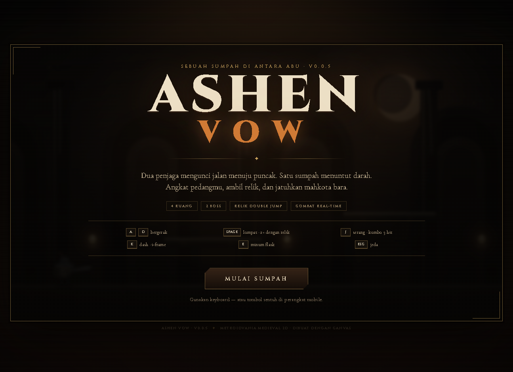

# Ashen Vow — v0.0.5

> **Sumpah di antara abu.** Simulasi metroidvania medieval 2D dengan combat pedang real-time, relik lompat ganda, dan **dua boss**.

Ashen Vow adalah game web tanpa build step: HTML5 Canvas + ES Modules murni. Seluruh simulasi combat berjalan deterministik di `src/core.js`, sehingga bisa diuji otomatis dengan Node tanpa browser.



## Cara menjalankan

```bash
npm start
```

Buka <http://127.0.0.1:4300>.

Tidak perlu `npm install` — tidak ada dependensi runtime.

## Kontrol

| Aksi | Keyboard |
| --- | --- |
| Bergerak | `A` / `D` atau `←` / `→` |
| Lompat | `Space` / `W` / `↑` |
| Lompat ganda | Tekan lompat lagi setelah **Relik Bulu Bara** |
| Serang (kombo 3 hit) | `J` atau `Z` |
| Dash (i-frame) | `K` atau `Shift` |
| Minum flask | `E` atau `Q` |
| Jeda | `Esc` |
| Suara | `M` |
| Pilih berkah | `1` / `2` / `3` |

Di perangkat sentuh, tombol kiri/kanan, lompat, serang, dash, dan flask muncul otomatis.

## Isi v0.0.5

- **4 ruang** yang terhubung: Gerbang Abu → Balai Sumpah → Singgasana Bara → Sarang Wyrm.
- **2 boss** dengan fase kedua:
  - **Sir Mordrake, the Fallen Warden** — telegraf tebasan, ground slam, gelombang kejut; fase II memanggil gelombang tambahan dan bergerak lebih cepat.
  - **Vhael, the Ashen Wyrm** — volley bola api yang bisa ditebas, dive attack, dan pilar api di fase II.
- **Combat real-time**: kombo 3 hit, hitbox aktif per frame, hit-stop, screen shake, knockback, dan efek partikel.
- **Dash dengan i-frame** dan cooldown.
- **Relik Bulu Bara** — membuka lompat ganda dan menyegel gerbang Balai Sumpah.
- **Jurang** sebagai hazard: jatuh mengurangi HP dan mengembalikan pemain ke titik aman.
- **Tiga berkah** setelah Warden: Max HP, damage, atau dash.
- **Flask penyembuh** (3 charge) dengan waktu minum yang bisa diganggu.
- **HUD** HP, flask, status relik, bar boss, petunjuk gerbang, banner ruang.
- **Audio prosedural** WebAudio — tanpa file audio.
- Layar judul, jeda, berkah, kematian, dan kemenangan.

## Tangkapan layar

| Gerbang Abu | Warden fase II |
| --- | --- |
|  |  |

| Wyrm menembak | Menang |
| --- | --- |
|  | Jalankan sendiri untuk melihat layar kemenangan. |

## Verifikasi mekanik

```bash
npm test
```

19 tes deterministik mencakup:

- gravitasi dan pendaratan di platform,
- pergerakan dan batas dunia,
- lompat tunggal vs lompat ganda setelah relik,
- registrasi hitbox pedang sampai crawler mati,
- i-frame saat terkena dan saat dash,
- konsumsi flask,
- gerbang terkunci/terbuka dan transisi ruang,
- pengambilan relik,
- damage jurang dan respawn,
- siklus serangan sentinel,
- transisi fase Warden dan kematian boss → pilihan berkah,
- pengaruh berkah damage,
- proyektil Wyrm melukai pemain,
- kemenangan setelah Wyrm dikalahkan,
- state kematian membekukan simulasi.

Selain itu, smoke test browser dijalankan lewat Chrome DevTools Protocol: mulai game, serang crawler sampai mati, ambil relik, lukai Warden sampai fase II, pilih berkah, masuk sarang Wyrm, dan selesaikan run tanpa error console.

## Struktur proyek

```
ashen-vow/
├── index.html          # shell, HUD, overlay
├── styles.css          # tema medieval, layout responsif, touch controls
├── server.js           # static server port 4300
├── src/
│   ├── core.js         # simulasi murni: player, musuh, boss, proyektil, gerbang
│   ├── render.js       # renderer Canvas prosedural
│   ├── audio.js        # SFX WebAudio prosedural
│   └── main.js         # loop fixed-timestep, input, HUD, overlay
├── tests/
│   └── core.test.js    # 19 tes Node
└── docs/               # tangkapan layar
```

### Desain simulasi

`AshenGame.update(dt, input)` memakai fixed timestep `1/120` detik. Logika tidak menyentuh DOM sehingga hasilnya sama di Node dan browser. Renderer dan audio hanya membaca state/event; semua event gameplay dikumpulkan di `game.events` untuk dipetakan ke SFX dan UI.

Debug hook `window.__ashen` tersedia untuk smoke test (`snap()`, `step()`, `enterRoom()`, `damageBoss()`, `chooseBlessing()`).

## Lisensi

Proyek demo pribadi. Aset visual dan audio dibuat secara prosedural di dalam kode.
