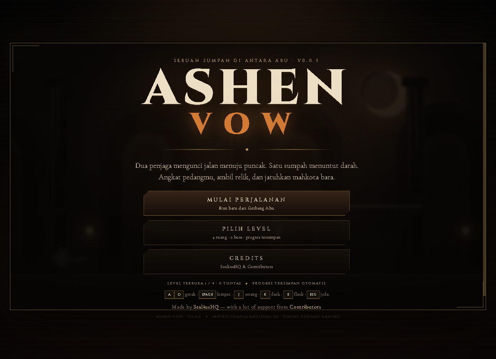
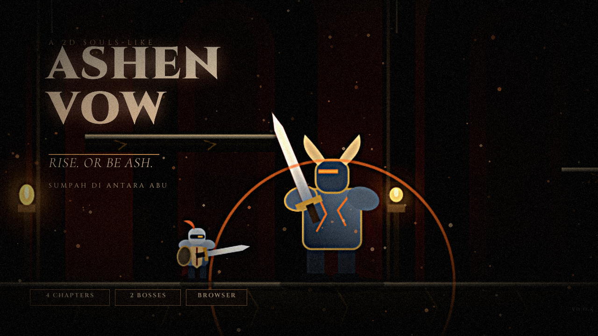
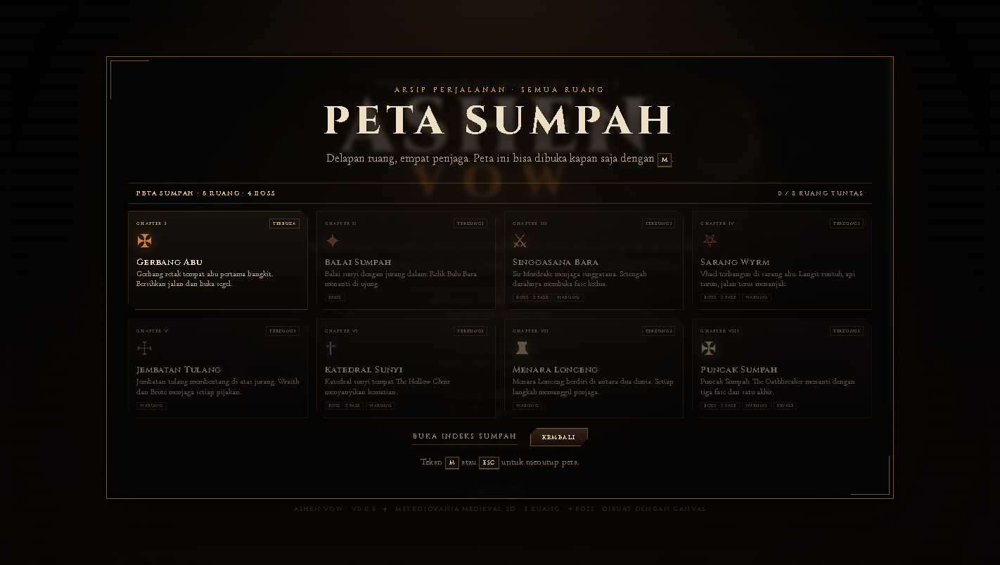
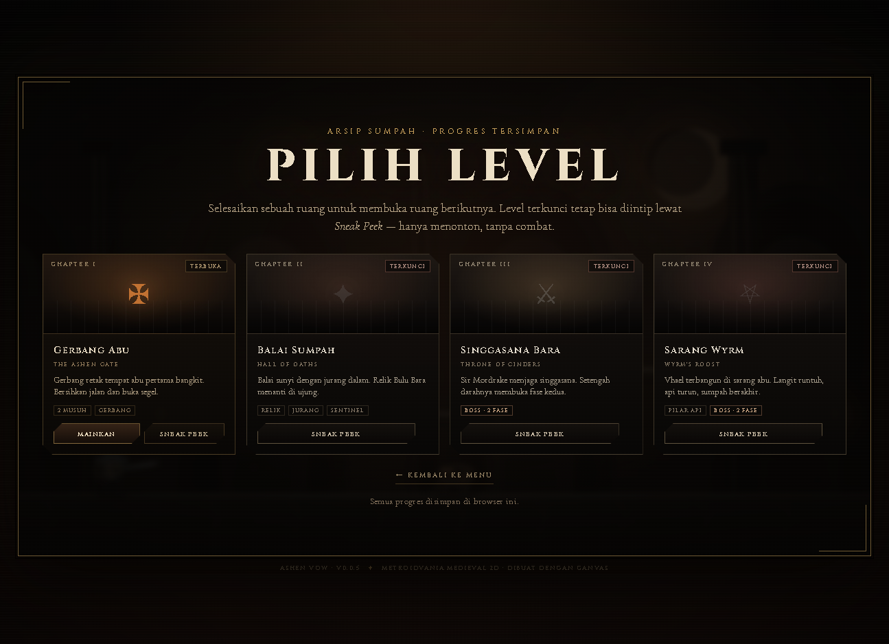
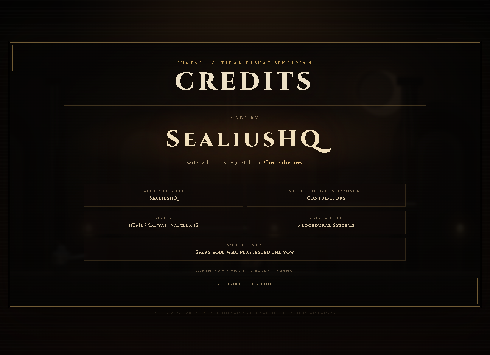
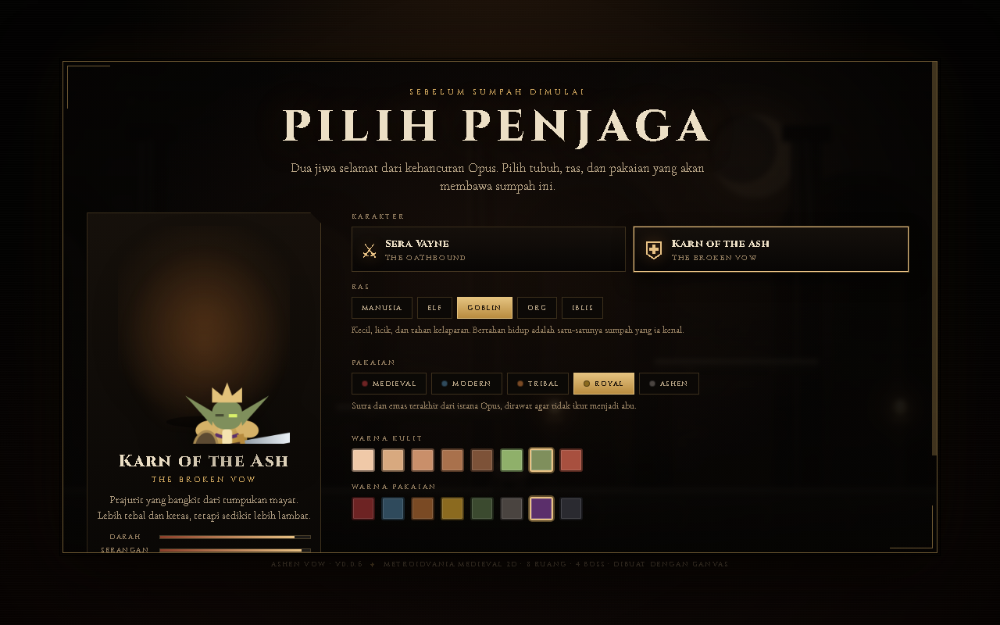
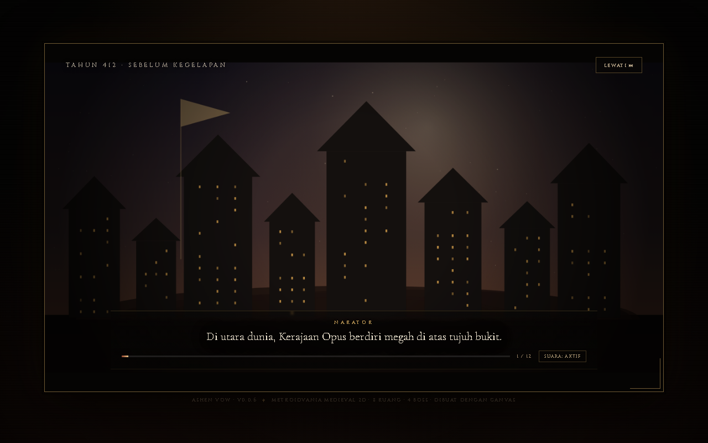
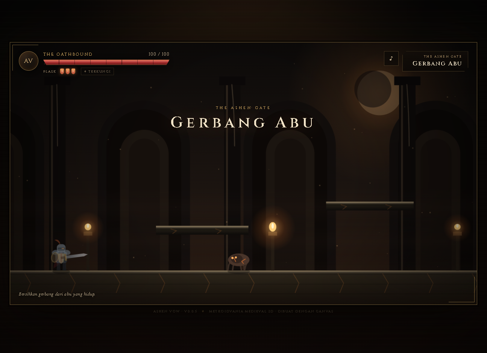
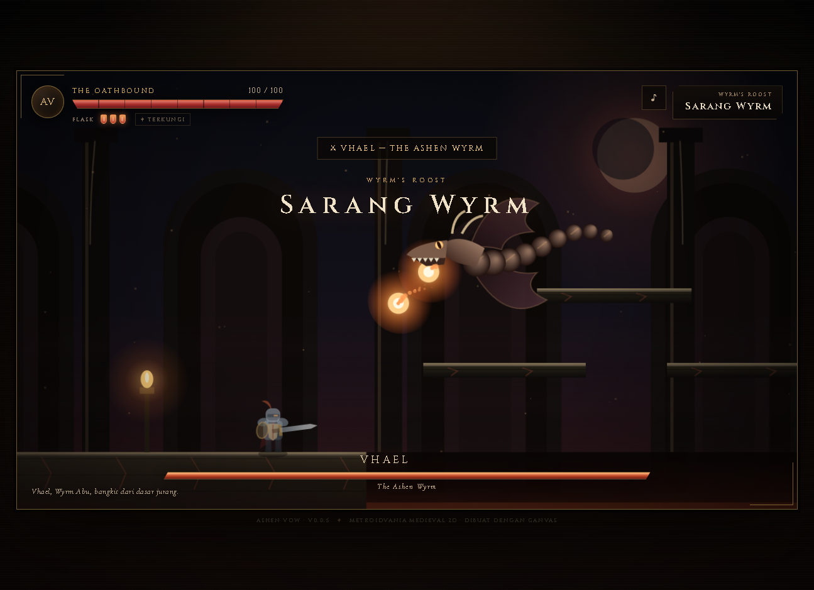

# Ashen Vow — v0.42.0

## v0.42.0 — Update XXXII: Infinite Frontiers — Batas Tak Berujung

Levels 101–200 stop being a table. The ladder is now **100 real rooms at ids 674–773**, built from the existing Frontier chapter and level specs, with ten chapter bosses and the E2–E7 elites actually spawning.

- **The room contract holds**: 19 normal bodies from four archetypes (chaser, ranged, lunge, slam) plus exactly one guaranteed elite per level. Boss levels hold only the boss.
- **Ten chapter bosses**: The Skybreaker (3 phases), Emperor Solvar (4), The Primordial Leviathan (4), Zarakh (3), Elder Yggvar (4), The Astral Devourer (5), The Architect of Nothing (4), Chronos (4), Gorath (4), and **Aethron, the Origin Beyond** (5 phases, ends on `victory`). Each has its own thresholds, dialogue, pattern, summon body, colour and music.
- **Forty new bodies and fifteen elites**: four per chapter from Sky Husk to Genesis Colossus, plus the authored `ELITE_MOBS` roster with rank multipliers and the ×2.2 elite bounty.
- **Readable curve**: normal HP ×1.0 → ×2.19, damage ×1.0 → ×1.59, speed +18%, ash stipend 120 → 516, boss HP 1,400 → 4,200. The run carries the player's growth instead of a character level: damage ×1.0 → ×2.78, vitality ×1.0 → ×1.99 and +1 flask every 25 levels, all run-scoped.
- **Save**: `progress.frontiers` inside `ashen-vow-progress-v1`; levels unlock strictly in order, boss clears are tied to their own seat, and the sanitizer repairs skipped clears. Campaign and arc ledgers are untouched.
- **Hub**: the existing Infinite Frontiers screen's **KAMPANYE 101–200** tab now renders a ten-chapter rail and ten level cards with lock/clear state, level numbers, elite ranks and boss phase counts. The run HUD shows `LV 147 · ASTRAL FRONTIER`.
- **Music**: `frontier` (92 BPM) for the ladder and `frontierBoss` (150 BPM) for Aethron.
- **Verification**: `npm test` green with `tests/frontiers.test.js` (16 tests, including live 20-body rooms and both live boss fights) and `npm run smoke:frontiers` **41/41** in real Chrome (locked hub, ten-chapter rail, a live 20-body level, the run power curve, a chapter boss, the full ladder, reload, 390×844).

Honest limits: the ten bosses still share the six engine attack families (Phase 3 gives each its own machine); the levels use authored palettes and particle moods rather than new level art; mounts and companions remain 3D-only.

## PETA KISAH — Story Map (unversioned, save-compatible)

The main menu now carries a second map. **PETA KISAH** is not the 14-room campaign map: it is the whole storyline, readable without starting a run.

- **Entry**: main menu → **PETA KISAH** (or `V`), the row directly under **PETA SUMPAH**. `Escape` returns to the menu.
- **14 sagas, in reading order**: Prolog Hearthfall → Arc I The Ashen Vow → Gema (Echoes of the Forgotten World) → Taman Peri (Faewood) → Arc II The Fallen Ones → Arc III The Radiant Crusade → Arc IV The Rift (locked) → Arc VI The Astral Dominion → Atlas → Arc VIII Eclipse of the Forgotten Gods → Arc IX The Veil of the Forgotten → Arc X The Eternal Night → BAB IX Tidewrought Cistern → Arc XI The Lanternwake.
- **What each card says**: numeral badge, title, subtitle, release era, room/stage scope, chapter and boss counts, a story summary, four story beats, the cast and guardians, and one honest note (what is locked, what needs another arc, what is reused).
- **Live counters**: the strip totals 14 sagas, 13 released, 7 numbered arcs and all 116 bosses, and the detail counter shows the position in the timeline.
- **Locked arcs stay locked**: The Rift is badged **TERKUNCI**, states that it has no rooms and no progress, and the screen never unlocks anything.
- **Read-only**: the screen touches no save key. A browser check compares `ashen-vow-progress-v1` before and after and it is byte-identical.
- **Data**: `src/storymap.js` is a pure module (no DOM, no storage). Arc ids and numerals are cross-checked against `CREDIT_ARCS` in `src/credits.js`; numbered arcs must match the credit scenes exactly.
- **Verification**: `tests/storymap.test.js` **8/8** (unique ids, readable copy, canonical numerals, credit-arc coverage, the single locked arc, room totals against the 774-room table, summary maths, clamped navigation) and `npm run smoke:storymap` **28/28** real-browser checks (menu entry, 14 chips, default current arc, chip swap, Rift badge, prev-arc nav, Escape, `V`, save untouched, 390×844 with zero overflow, no console errors).

Honest limits: the map is prose and counts, not a timeline diagram; it does not draw the branching between optional bosses or endings, and it cannot show per-player progress (that stays in PETA SUMPAH and each arc's own hub).

## v0.41.0 — Update XXXI: Peta Sumpah — Takaran, Elite & Bertahan

The Map Editor can now tell you whether a map is fair before you play it, and tune it if it is not. Every map picks its own difficulty, marks elites, can end on a survival clock, and reports a live threat ratio against your loadout.

- **Per-map takaran**: the six campaign profiles are used as absolute multipliers on one map — enemy HP, damage and speed, plus boss HP and contact damage. Normal is 1×, so a Story map stays light even for a player whose global setting is Abyssal. The map's takaran stacks on top of the global setting, which the editor states in plain words.
- **Balance meter**: `threatRating` compares room load (enemy HP, elites ×1.8, boss HP ×0.9, all at the chosen takaran) with player power (class HP and damage, flasks, weapon count, arrows, relic, starting ash). The ratio lands in one of four bands — **Ringan / Seimbang / Berat / Brutal** — with concrete tips.
- **AUTO-SEIMBANG**: one button raises flasks, trims or adds bodies, then moves the takaran up or down until the map sits in the balanced band. Every step is reported in the editor message, so nothing is rewritten silently. **TAKARAN LEBIH RINGAN** drops one difficulty step on its own.
- **Elite enemies**: toggle any roster entry to elite. Elites use the engine's elite path (×2.2 bounty), count ×1.8 toward threat, and are drawn larger with a gold ring in the canvas preview.
- **Survive objective**: `BERTAHAN` with 20–180 seconds ends the room when the clock runs out rather than when the screen is empty — living enemies no longer block the clear. The HUD badge counts down and pulses in the last ten seconds.
- **Measured bosses**: boss HP and contact damage follow the map takaran through data overrides (`customBossOverrides`), never by editing the shared boss table. A custom boss still always grants a blessing.
- **Fourth preset**: *Pengepungan 60 Detik* demonstrates survival, and a `MULAI DARI PRESET` panel makes all four presets one click away.
- **Save & codes**: still **`ashen-vow-mapeditor-v1`**, now schema 3; `AVME1` codes carry takaran, objective, survive time and elite flags, and schema-2 codes from v0.40.0 still import with safe defaults.
- **Verification**: `npm test` **812/812** and `npm run smoke:editor` **67/67** real-browser checks. `tests/mapeditor.test.js` grew from 14 to 19 tests: takaran scaling inside the live engine, elite spawns and bounty, threat bands and auto-balance in both directions, survival clamping and validation, boss overrides, and share-code round trips including a legacy v2 code.

Honest limits: the threat ratio is a tuning heuristic built from table stats, not a combat simulation; auto-balance moves whole bodies and flask counts, so it can make a map fairer but never more interesting; elites reuse the existing elite flag rather than new AI.

## v0.40.0 — Update XXX: Peta Sumpah — Kanvas Medan, Rantai Ruang & Kode Bagi

The Map Editor stops being a form over four fixed layouts. You now draw the terrain yourself, link rooms into a chain that plays as one run, and hand a map to someone else as a single line of text.

- **Free-form terrain**: drag on the live preview canvas to paint a platform (snapped to a 20 px grid), click one to select it, then delete it. `+ LANTAI PENUH`, `+ PIJAKAN`, `HAPUS TERPILIH` and `RESET TATA LETAK` cover the rest. Up to 26 platforms per room, saved with the map.
- **The preview is the room**: `drawEditorPreview` paints the exact geometry the engine loads — zone palette, 100-unit grid, the selected platform, the green spawn point, the exit gate, the Warung Abu, the relic, one dot per enemy sized by its real HP, and a diamond for the boss.
- **Room chains**: every map has a `LANJUT KE PETA` link, so up to **six rooms** run back to back. Clearing a room loads the next one with your HP, flasks, arrows, weapons, relic and ash intact; the banner reads `RUANG 2/3`, and the clear is recorded once for the whole chain against its first room. The validator rejects self-links, missing targets, cycles and chains longer than six, and a chain is validated room by room before the run starts.
- **Share codes**: `SALIN KODE` packs the selected map or its whole chain into an `AVME1.` base64url string; `IMPOR` accepts someone else's code, gives the rooms fresh ids, re-links them among themselves and respects the 20-map cap. Unicode names survive the round trip.
- **Save**: still **`ashen-vow-mapeditor-v1`**, now schema 2. A v0.39.0 map with no terrain of its own loads with its old layout's platforms, so nothing is lost.
- **Verification**: `npm test` **806/806** and `npm run smoke:editor` **51/51** real-browser checks, with `tests/mapeditor.test.js` (14) covering terrain clamping and grounding, chain order/cycles/limits, share-code round trips (Unicode, version mismatch, six-room cap), the preview renderer, and a live two-room chain where ash and HP carry over.

Honest limits: terrain is rectangles on a 20 px grid — no slopes and no destructible ground; chains are linear, one next room per map; share codes are pasted by hand, so there is no gallery or server-side verification beyond the sanitizer.

## v0.39.0 — Update XXIX: Peta Sumpah — Map Editor Kampanye

Build your own campaign stage out of the same parts the campaign uses: mobs, a boss, a zone background, a music track, an opening cinematic, a class and starting weapons. Maps live in their own save key, so no campaign room, progress array or arc ledger moves.

- **What you set**: name and subtitle, zone (background palette, particles and default music), stage layout (**Aula Datar**, **Teras Bertingkat**, **Jurang Tengah**, **Menara Gantung**), normal and boss music, opener (none / 60 s prologue / 80 s trailer / 18 s Lingkar trailer), class, up to five starting weapons, arrows, flasks, starting ash, an optional relic and an optional Warung Abu.
- **Who you fight**: up to 28 enemies chosen from all 262 engine enemy types, each placed on its own X coordinate, plus one boss from all 116 bosses. A Map Editor boss always grants a blessing, so it can never fire the campaign victory screen or mark a campaign room cleared.
- **How it runs**: the blueprint is converted by `src/mapeditor.js` into a synthetic room and loaded with `game.loadArena()`. The room uses `index: -1` and a decorative exit (`gate.next: -1`), so walking into the gate can never load a campaign room; the shell ends the stage when the roster and the boss are gone and opens the clear card with time, kills, map record and clear count.
- **Validation**: errors block a run (empty name, unknown zone/music/class/boss/enemy/weapon, more than 28 enemies, a spawn point that is not on a platform); warnings do not (empty map, arrows without a bow, zero starting ash, ordinary and boss music identical). Invalid maps are still saved so work is never lost.
- **Save**: the whole editor lives in **`ashen-vow-mapeditor-v1`** — up to 20 maps, plus plays and best time per map. Campaign progress stays in `ashen-vow-progress-v1` and is never written by a custom run; `awardBossSkillPoints` and the credit scene explicitly skip custom runs.
- **Entry**: main menu → **PETA SUMPAH — MAP EDITOR KAMPANYE**. Three presets (Aula Latihan, Duel Penjaga, Gelombang Abu) are the starting point.
- **Verification**: `npm test` **806/806**, including `tests/mapeditor.test.js` (sanitizer clamps, validation blockers, layout grounding, room conversion, a live `AshenGame` load where the exit never leaves the custom room, and a real boss death that lands on a blessing).

Honest limits: layouts come from four authored platform templates rather than free-form terrain painting; a map is a single stage, not a multi-room campaign chain; music and openers are limited to the shipped procedural tracks and three cutscenes; there is no share/import string, because the save stays browser-local like every other mode key.

## v0.38.0 — Update XXVIII: Infinitower — Koor Lingkar

The spiral gets a voice. Infinitower now has a boss of its own, a fourth difficulty, two towers that fight with time and space, new bodies that punish lazy layouts, articulated rigs for every enemy, a six-chapter chronicle that opens tier by tier, two cinematics, and three new procedural tracks. Everything stays inside the existing save key.

- **Two new towers (20 total)**: **Jangkar Lingkar** (`spiral_anchor`) is an area magic blast that slows everything it catches by 62% for 2.4 s. **Jam Pasir Ketiga** (`hourglass`) never fires; it projects a 148-radius time field that slows every enemy inside by 24% per level, recomputed from live towers so selling or silencing it stops the field immediately.
- **Three new bodies (31 entries / 9 bosses)**: **Rift Hopper** blinks 34 units down the road every 3.6 s, **Lantern Moth** blinds towers within 100 units for 1.6 s when it dies, and **Grave Taxer** steals 14 gold from the war chest if it reaches the gate. The new boss, **Spiral Choir** (18,500 HP, 22% armour), sings two Mirror Thralls onto the road every seven seconds through the existing split queue, so summons never pay bounty twice.
- **ETERNAL difficulty**: 175% enemy HP, 122% speed, 195 starting gold and an 80 HP crown — the fourth tier beside SQUIRE, KNIGHT and WARLORD.
- **Procedural rigging**: every body is drawn from an articulated rig — two or four legs, two arms, a head and a body bob — across five families (humanoid, hound, wraith, brute, colossus). `rigPoseFor(kind, time)` is pure and deterministic, so it is Node-tested. Towers recoil when they fire, and the hourglass field is painted on the ground.
- **The Spiral Chronicle**: six chapters unlock as tiers rise (Lingkar Pertama → Lingkar yang Menutup). Each tier writes a line into the battle feed and into the new KRONIK LINGKAR panel in the hub, and the match snapshot exposes the active chapter.
- **Two cinematics**: an 18-second **trailer** (six beats) that plays from the hub or once on the first Infinitower start, and an 11-second **boss portrait** (four beats) that pauses the battle when the first boss appears. Both are drawn procedurally in the engine (stone spiral, tower crown, many-eyed Choir) and both open with new music.
- **Three new tracks**: `spiral` (88 BPM, sawtooth arena), `spiralBoss` (104 BPM, square, open filter) and `spiralTrailer` (64 BPM slow build). The hub and the battle use `spiral`; the moment a boss enters, music switches to `spiralBoss`.
- **No new save key**: records stay in `progress.wavedefense.infinitower` inside `ashen-vow-progress-v1`, with the same wave-999 / tier-100 clamps.

Verification: `npm test` **790/790**; `npm run smoke:wavedefense` **83 browser checks** in real Chrome. Honest limits: the rigs are procedural 2D limbs rather than skeletal GLB animation, and the trailer is an in-engine cutscene rather than a video file.

## v0.37.0 — Update XXVII: Wave Defense Infinitower

Wave Defense gains a fifth arena and a mode that cannot be won. **ETERNAL SPIRAL** is a 24-slot spiral lane and the longest road in the mode. **INFINITOWER** runs that spiral forever: every ten waves raises a tier that thickens enemy HP (+16% per tier), raises speed, bounty and damage, opens heavier roster entries and adds an elite group from tier three, with a boss every fifth wave and a shorter build pause as the tiers climb.

- **Four new tower concepts (18 total)**: Monolit Gema (magic chain to three targets), Lonceng Kubur (area sound wave that stuns for 0.9 s), Tempa Abu (20% armour shred for five seconds) and Mata Pengawas (long-range execute at 2.4× below 35% HP).
- **Seven new bodies (27 entries / 8 bosses)**: Mirror Thrall splits into two Ash Runners on death, Cinder Wraith ignores slows, Grave Chorister grants +22% haste, Tower Breaker disables the nearest turret for 2.4 s every 3.6 s, Obsidian Golem carries 45% armour and regenerates, and Spiral Tyrant / Lantern Devourer join the boss pool.
- **Mechanics are wired, not labels**: stun skips movement, shred expires and lowers flat armour in the damage pipeline, regen ticks, haste joins the aura refresh, and disabled towers draw a red dashed ring while they skip firing.
- **Separate ledger**: `progress.wavedefense.infinitower` (runs, bestWave, bestTier, bestScore, bestKills, bestTime) inside the existing `ashen-vow-progress-v1`. Infinitower never writes campaign runs, wins or losses, and the sanitizer clamps the record to wave 999 / tier 100.
- **Hub and HUD**: a third mode button with its own purple active state, a seven-cell summary, tier readouts (`INFINITOWER T3`) and a `LINGKAR PADAM` result card.

Verification: `npm test` **786/786**; `npm run smoke:wavedefense` **73 browser checks** in real Chrome. The campaign's 24 waves, six bosses and save key are unchanged.

## v0.36.0 — Updates XXV & XXVI released

v0.36.0 makes the two previously unversioned updates official: BAB X The Lanternwake (rooms 669–673, Orsella the four-phase Wickbearer), the Scary Mode Vigil Tree, ElevenLabs voice with browser-speech and subtitle fallbacks, the 80-second in-engine trailer, eight ghost GLB models, the startup guard (BOOT-01…04) and the asset inventory. Both now appear in the in-game Update Log. `MASTERPLAN.md` is rewritten as Master Plan 3.0 (phases 0–7 to v1.0); the previous plan lives in `docs/archive/MASTERPLAN-2.0.md`. Verification: `npm test` **776/776**.

## Update XXIV — Sistem Air Pasang & Dua Relung Rahasia (v0.35.0)

## A ninth campaign chapter, and it has secrets

- **BAB IX — Tidewrought Cistern**: the `cistern` zone that had existed as configuration since v0.0.7 is now a playable chapter of **7 rooms** at ids **662–668**: four flooded halls (Ambang Pasang, Galeri Bocor, Ruang Katup, Ambang Karam), the **Altar Air Pasang** boss room, and two hidden rooms. `ALL_ROOMS` is now **669** and `ALL_BOSS_INFO` **115**; rooms 0–661 keep their exact indices, so every old save and arc still points at the same room.
- **Opens in Level Select**: after The Oathbreaker falls, the chapter appears under the fourteen legacy cards with its own progress line. It stays **TERKUNCI** before that, and no stage can be started early.
- **Four new enemies on real engine archetypes**: **Drowned Thrall** (chase), **Silt Lurker** (burrow-and-emerge under your feet), **Tide Ember** (hovering ranged fire from the valve slits), and **Valve Sentinel** (telegraphed lunge). Ambang Karam fields five of them.
- **Vasska, the Tidebound Regent**: a **three-phase** boss with a close trident sweep, a harpoon fan that widens per phase, a floor-clearing surge, and Drowned Thrall summons at phases II–III. Full intro / phase II / phase III / defeat dialogue and a new `cisternBoss` track.
- **Two genuinely hidden rooms**: **Dinding Pasang** in the floodgate hides **Gua Surut (668)**, and **Dinding Lumut** in the gallery hides **Relung Karam (667)**. Both need 130–150 damage, both read `???` in Level Select until found, and both hold a relic or collectibles plus a new hidden rune for the cistern run kind.
- **Save model**: `progress.cistern` inside the existing `ashen-vow-progress-v1` — sequential halls, boss, secrets, discovered, runs, boss clears and best time. The sanitizer rejects skipped halls, drops a boss clear without four halls, and never reveals a secret room's name from a hand-edited save.
- **Measured renderer work**: the cistern's ambient glow was baked into an 840×840 layer and blitted at native size — an A/B of the exact primitive measured **7.04–8.13 ms** when that layer was blitted scaled from 210 px versus **0.17–0.20 ms** at native size. Water bubbles now draw rings only, dropping the weather layer from **~0.95 ms to 0.49–0.69 ms**, and all cistern background gradients are cached (**11 → 0 gradient allocations per frame**).
- **One rejected experiment, again documented**: caching the arches and pillars as tiled sprites made the cistern background **worse** (10.7 → 19.5 ms) on this software rasteriser, so it was reverted.
- **New tooling**: `tools/render-probe.mjs` (`npm run probe:render`) times the background, weather, platform and full-render layers of the cistern in a real browser, and `tools/frame-profile.mjs` gained a `cistern` scenario.

Verification: `npm test` **736/736** (15 new cistern tests plus updated room/enemy/boss totals across the arc suites); `npm run smoke:cistern` **40/40** drives the real level select (locked → unlocked), the live gate chain, the breakable wall into the secret room, the three-phase boss to victory, reload persistence, and a 390×844 portrait check with no horizontal overflow. `tools/browser-smoke.mjs` still passes.

Honest limits: canvas micro-timings on a software rasteriser vary run to run, so the numbers above come from controlled A/B measurements of the same primitive rather than whole-frame deltas; the chapter reuses the engine's seven enemy archetypes and the existing boss phase loop rather than new animation systems. The two secret rooms are wall-gated, not a hidden-map layer.

## Update XXIII — Pasang Tak Berujung & Benteng Karam (v0.34.0)

## Endless tides and a fourth castle

- **Pasang Tak Berujung (naval endless)**: the whole 3,200×2,200 sea with no final captain. Every **34 seconds** the tide rises: the player gains **+12 max hull** (and 24 repaired), **+6% damage**, the enemy fleet grows, and a captain enters every **third surge**. Sinking a captain is a bounty, never a finish line, so the run only ends when the player sinks.
- **Separate endless records**: `progress.pirates.endless` stores runs, best score, best surge, best kills, best time and total kills. Endless runs never add voyages or wins and never unlock a route card.
- **Fourth castle — Sunken Causeway**: a 24-slot winding causeway joins the three campaign maps, taking the roster to **4 maps, 14 towers, 20 enemy types and 6 bosses**.
- **Two support towers**: **Panji Sumpah** never fires but gives other towers in its radius **+20% damage and +12% fire rate per level**; **Lentera Roh** marks a target for four seconds, and marked targets take **20% more damage**.
- **Two new enemies**: **Drowned Reaver** (fast, 16% armour) and **Bone Herald** (grants nearby enemies +12% armour). The campaign still keeps its 24 waves.
- **Wave Defense Tanpa Akhir**: procedural wave definitions continue past wave 24 up to a safe **999** ceiling, with best wave/score/kills/time in `progress.wavedefense.endless` and no campaign wins or losses written.
- **Measured profiling tools**: `tools/frame-profile.mjs` records Long Animation Frames, rAF cadence, sampled CPU time and direct canvas cost per layer; `tools/bg-probe.mjs` splits the campaign background cost by room type. In headless Chrome at 1280×900 with software rasterisation the campaign canvas measured **13.8 ms** with `drawBackground` at **8.9 ms**, Pirate Tide **7–9 ms**, Wave Defense **7–9 ms**, and p95 around **7.1 ms** with no dropped frames.
- **One optimisation kept, one rejected**: caching islands as `OffscreenCanvas` sprites made the naval canvas slower (**7.04 → 21.07 ms**) and was reverted. The kept changes are a per-canvas island gradient cache and single-stroke wakes. Benchmarks: **10,689–18,095 steps/s** in the naval simulation, **3,343 canvas calls/frame**, and the island predicate at **182 ns/call (2.96× faster)** than the previous version.

Verification: `npm test` **720/720**; `npm run smoke:pirates` **49/49** (adds endless start, surge hull growth, third-surge captain, bounty-not-finish, endless ledger and route isolation); `npm run smoke:wavedefense` **66/66** (adds the fourth map, 14 towers, 20 enemies, mode switch, wave 30 in endless, and ledger isolation). No new save keys.

Honest limits: the frame figures come from headless Chrome with software rasterisation, so they describe that path rather than a GPU-capped device; the campaign backdrop is still one full-screen composite and was not rewritten. The endless tide reuses the same authored sea and ship classes, and Wave Defense endless waves are scaled from the existing wave table rather than hand-authored.

## Update XXII — Pirate Tide: Sumpah Laut (v0.33.0)

## Act two of the open sea

- **Ten sequential captain routes**: the five original hunts are joined by **Perburuan Kabut**, **Pasang Kosong**, **Takhta Garam**, **Kawal Baja**, and **Sumpah Pertama**, with target bounties rising from 9 to 13 ships and payouts of 510–950 gold.
- **Five new flagships**: **Kapten Heron** (Pemburu Kabut), **Pasang Kosong** (Armada Kosong), **Ratu Garam** (Takhta Karam), **Marsekal Kade** (Tangan Baja), and **Kapten Pertama** (Sumpah Laut), scaling from 1,900 to 3,200 hull with 7–8 cannons per side.
- **Three new islands**: Gosong Bara joins as open water, while **Pulau Duka** and **Karang Bintang Jatuh** add two more repair ports — 10 islands and 7 ports in total.
- **Two new hull classes**: the fast **Pemotong Badai** (from route 6) and the heavy **Lewiatan Baja** (from route 7). The enemy pool is gated by route index so act one never spawns act two ships.
- **Renderer culling**: islands, ships, cannonballs, and effects outside the camera are skipped, the sea gradient is cached per canvas, and the animated wave rows were reduced. At a full ten-hull load, canvas calls per frame dropped from **4,376 to 3,345 (−24%)**, the route-one camera now draws **2 of 10 islands** instead of all of them, and the minimap still draws the whole sea.
- **Cheaper collision**: island and hull checks reject on a single axis and compare squared distance before taking a square root. In the benchmark's A/B, the same island predicate costs **157 ns/call instead of 465 ns/call (~2.9× faster)**, with identical hit results.
- **Save-safe**: still `progress.pirates` in the existing save key. The sanitizer validates the full ten-route chain, so a forged save cannot open act two early.

Verification: `npm test` **715/715**; browser smoke `npm run smoke:pirates` **42/42** adds act-two unlock, flagship spawn and clear checks to the hub, live Canvas, broadside, ramming, persistence and 390×844 battle layout. Benchmark: `node tools/pirates-bench.mjs` measured roughly **10,000–11,000 steps/s** on route one (10 hulls, 87 balls) and **19,000–21,000 steps/s** on route ten, plus the renderer and island-predicate numbers above.

Honest limits: the sea is still one authored open-world map, not an infinite ocean. The benchmark is a Node simulation/renderer measurement, not a frame-time capture on every device.

## Update XXI — Pirate Tide: Open Sea (v0.32.0)

## Naval open world

- **One continuous 3,200×2,200 sea** with islands, repair ports, roaming patrols, shallow water, reefs, cannons and a live minimap.
- **Five opening captain routes**: Pasang Pertama, Lonceng di Bawah, Bangun Janda, Pasang Baja, and Mahkota Tenggelam. Sink the bounty, then defeat the flagship to unlock the next route. (Act two adds five more in v0.33.0.)
- **Real broadside combat**: `W/S` throttle, `A/D` steer, `Q/E` fire port or starboard, `Space` fires both ready sides, and clicking the sea automatically picks the nearest side. Each side reloads independently.
- **Six enemy ship classes and five captains**, each with hull, damage, range, cannon count, reload, speed and its own AI broadside behaviour.
- **Open-world economy**: sink ships for gold, dock at any port to repair 50% hull for 25 gold, and chase score and route records. The HUD also has touch D-pad and fire buttons.
- **Physical hulls**: ships cannot sail through each other. Collisions separate hulls and bleed speed, and the Black Sloop's ram deals real damage on a high-speed contact.
- **Fair captain fights**: a flagship does not count as an extra bounty kill and regular patrols stop spawning once the captain arrives.
- **Phone-ready battle**: the canvas leaves the 16:9 frame on portrait phones, fills the viewport, and resizes its backing resolution instead of stretching a 960×540 buffer.

Verification: `npm test` **711/711**; browser smoke `npm run smoke:pirates` **36/36** covers the hub, live Canvas, movement, broadside cooldowns and pool cap, captain spawn/victory, ramming, unlock chain, reload persistence, a real touch cannon shot and the 390×844 battle layout. All 27 browser smoke scripts pass.

Honest limits: the sea is one authored open-world map, not an infinite procedurally generated ocean. Islands, ports and ship classes are data-driven, but boarding, crew management and trading are not included.

## Update XX — The Mourning Choir & Second Shadows (v0.31.0)

## Horror expansion

- **Eight Scary Mode ghosts**: the four existing hunters are joined by **The Weeping Mother** (a wail that pulls and fires tears), **The Mirror Double** (repositions through valid navigation points), **The Lantern Eater** (freezes while observed, advances when you look away), and **The Drowned Bell** (a toll that releases real shockwaves).
- **Seventeen jumpscares**: seven new events add double shadows, counting knocks, a floor hand, a mirror guest, hungry light, a buried bell, and a mourning wake. Four of them can summon a new ghost into the live room.
- **New procedural visuals**: double silhouettes, floor hands/faces, window and mirror faces, inverted corridors, glitch bands, bell ripples, lantern glow, mirror shards, and tears. Anti-Jumpscare still removes startling screens while leaving safe atmosphere.
- **Journal 2.0 continued**: 9 achievements and 9 cosmetic rewards, including **The Uninvited** and **Every Last Whisper**.
- **The Dread Beyond**: two new Unnatural — **The Mirror Mourner** and **The Hollow Nurse** — plus four new psychological events with audio, screen, and lighting outcomes.

Verification: `npm test` **693/693**; affected browser smokes: Scary Mode 2.0 **44/44**, Dread Beyond **48/48**, Hunter **27/27**, plus the Archive/Veil/Eternal/3D Scary regression checks.

Honest limits: the new ghosts reuse the existing platform navigation and physics contracts; they are not fully bespoke animation rigs. Jumpscare screens are still procedural Canvas art, not pre-rendered video, and the Dread additions reuse five established tactical families.

## Update XIX — The Hunter's Kit & Ghost Combat (v0.30.0)

The horror modes now have a real answer to ghosts: a persistent field shop, five consumable tools, and status combat that only affects spirits.

- **Five hunter tools**: Suluh Garam (stun + mark), Lonceng Kubur (longer stun), Granat Asap (stun + escape i-frames), Peluru Roh (heavy ghost projectile with pierce), and Jimat Penjaga (60% ghost damage reduction for 8 seconds).
- **Persistent shop**: buy with Hunter's Marks earned by banishing ghosts. Open it from Scary Mode or the pause menu; stock is stored in `ashen-vow-hunter-v1` and copied into every relevant run.
- **Shared ghost combat**: Scary Mode, The Dread Beyond, The Veil of the Forgotten, and The Eternal Night all use the same stun, smoke, mark, ward, and spirit-damage rules. Ordinary campaign enemies never receive these statuses or bonuses.
- **Quick-item integration**: hunter tools appear in the existing quick-item cycle (`K`/`X` to use, `R` to cycle), in the inventory, and in the HUD ammo/quick slot.
- **Real rewards**: wraiths, stalkers, knights, Unnatural, and horror bosses pay marks on a one-time bounty flag, so overlapping damage cannot double-pay.

Verification: `npm test` **690/690**; `npm run smoke:hunter` drives real Chrome through the shop, purchases, a live scary ghost, salt stun, smoke i-frames, spirit-round damage, bounty payout, ward damage reduction, in-run buying, inventory visibility, reload persistence, and zero console errors.

Honest limits: the tools are consumables, not a new permanent weapon tree; the 3D first-person horror sites keep their unkillable hunter design; and the shop economy is local-save only.

## Update XVIII — Credit Scenes & Hidden Secrets (v0.29.0)

Every arc now closes its final boss with a credit scene, and the world keeps a few things off the map.

- **Eleven arc credit scenes**: The Ashen Vow, Echoes of the Forgotten World, Faewood, The Fallen Ones, The Radiant Crusade, The Astral Dominion, Eclipse of the Forgotten Gods, The Veil of the Forgotten, The Eternal Night, The Sundered Atlas, and Hearthfall. Each is triggered by the shared `bossDown` event for that arc's real final-boss kind, skippable with `LEWATI CREDIT`/Space/Enter/Escape, and auto-closes after 22 seconds.
- **Sealius in every role**: Technical Lead, Artist & Designer, Game Design, Systems & Engineering, World & Narrative, UI & UX Design, QA & Verification, and Release & Support. The canonical line **“Made by SealiusHQ with a lot of support from Contributors”** is unchanged on the Credits screen and in every scene.
- **Hidden level runes**: five campaign rooms contain a faint glyph that only responds to the interaction key when the player stands on it. No map marker, quest, codex entry or prompt names it. Speedrun reuses the same rooms and runes.
- **A secret in every mode**: one quiet mode mark is available in every listed mode — including campaign, Every Arc, 3D, 3D Scary, Scary, Dread, MOBA, Wave Defense, Realms, fishing, hubs and title — through one hidden sequence that the UI never explains.
- **Separate ledger**: `ashen-vow-secrets-v1` stores only found ids, counts and timestamps. It contains no HP, damage, speed, ash, reward or multiplier values, so secrets cannot affect balance or multiplayer.

Verification: `npm test` **669/669 at release**; `npm run smoke:credits` drives real Chrome through the credit overlay, all eleven arc mappings, the actual base-campaign final boss, a real rune pickup, the hidden mode sequence, and reload persistence with zero console errors.

Honest limits: the credit scenes are DOM overlays, not new rendered cinematics; the hidden sequence is intentionally absent from in-game documentation, so only the source and tests enumerate it.

## Update XVII — 3D Scary Mode: Blackveil Nightfall (v0.28.0)

A real first-person horror mode built on the existing WebGL2 + GLB renderer, not a 2D overlay pretending to be 3D.

- **Five playable 3D buildings**: Blackveil Manor, Saint Orra Sanatorium, The Drowned Chapel, Cinder Mill and The Hollow Lighthouse. Each has its own authored GLB architecture, site props, palette, fog, exit gate and hunting entity.
- **Fifteen stage-levels**: every site runs three real phases — Ambang, Turun, Keluar. Collect three visible echo runes, then reach the exit while The Unlit hunts you.
- **Five hunters**: The Governess, Nurse Orra, The Drowned Cantor, The Miller and The Keeper Below use the existing skinned GLB rigs. They cannot be killed; hitting them only staggers them.
- **Twenty authored jumpscares**: four per site with `figure`, `face`, `hand`, `mirror`, `static` and `atmospheric` shapes, procedural audio stings, camera shake and subtitles. Anti-Jumpscare turns every scare atmospheric and removes flashes.
- **First-person runtime**: the player mesh is skipped in both WebGL and the Canvas fallback, the camera locks to the player eye line, and the overlay draws darkness, fear/sanity, objective prompts, echo markers and the result screen.
- **Persistence**: `ashen-vow-3dhorror-v1` schema 1 stores per-site attempts/clears/deaths/scares, best and last time, anti-jumpscare preference and six achievements. Campaign, Arc IX/X, Scary Mode 2.0, Dread, settings and character saves are untouched.
- **Content pack**: `MODE3D_AREAS` grows from 10 to **15 areas**; `assets/3d/props.glb` gains `horror_manor`, `horror_asylum`, `horror_chapel`, `horror_mill` and `horror_lighthouse`.

Verification: `npm test` **658/658**; `npm run smoke:horror3d` **22/22** in headless Chrome — real WebGL2 draw calls (31), a lit 3D canvas, first-person stage start, three echo phases, exit clear, anti-jumpscare, save reload and zero console errors.

Honest limits: the five hunters reuse the existing stalker/brute animation rigs rather than bespoke horror rigs; darkness and jumpscares are Canvas-composited over the WebGL scene; there is no server-authoritative 3D horror economy.

## Update XVI — The Unwritten Wing (v0.27.0)

Arc X gains a playable eighth chapter without changing the existing Arc IX/X save formats.

- **The Unwritten Wing**: five anomaly stages before The Eternal Nightfall, each still spawning exactly **20 enemies — 19 normal + 1 elite — across four existing archetypes**.
- **The Unwritten**: a new four-phase chapter boss with intro, phase 2–4 and defeat dialogue plus `ink_surge`, `margin_grasp`, `erasure_wave` and `blank_page` patterns.
- **Ghost Index growth**: eight new entities — Ink Scholar, Margin Stalker, Erased Reader, Footnote Wisp, Blank Archivist, Redaction Hound, Seventh Draft and Unwritten Choir — bringing the index to **80 records** while keeping all original IDs.
- **Jumpscare Index growth**: **38 events across 13 categories**; the new Visual Distortion, Spatial Shift and Psychic categories each have real triggers, evidence and lore, and remain compatible with Anti-Jumpscare.
- **Equipment growth**: Resonance Anchor, Memory Loom and Veil Divider bring the equipment matrix to **30 tools**, with real ownership and per-entity requirements.
- **Archive totals**: **70 stages**, **14 chapters**, **16 bosses**. The Unwritten Wing stages expose `stageType: anomaly` in stage details.
- **Persistence unchanged**: Arc IX stays `ashen-vow-veil-v1`, Arc X stays `ashen-vow-eternal-v1`, and the archive stays `ashen-vow-archive-v1`. Stage IDs are stable; stage room numbers remain unique.

Verification: `npm test` **642/642**; `npm run smoke:archive` **29/29**, `npm run smoke:veil` **35/35**, and `npm run smoke:eternal` **30/30** in headless Chrome, all with zero console errors.

## Update XV — Stage Archive, Level Checker & Supernatural Research (v0.26.0)

Scary Mode gains an archive and research layer over every existing stage, entity, scare event and tool. Arc IX, Arc X, their saves and the campaign are not rewritten.

- **Stage Archive 2.0** (`src/archive_data.js` + `src/archive.js`): all **65 stages at the time of the release** (30 Arc IX, 35 Arc X; 70 after Update XVI), 13 chapters and 15 bosses, browsable by arc/chapter. Each stage has a real `CLEARED`, `UNLOCKED`, `UNCLEARED`, `LOCKED` or `100% DOCUMENTED` status, stage details, boss archive and attempt/discovery statistics.
- **Sneak Peek** is a separate overlay with an **archive preview** and a developer-only preview path. It shows environment, permitted known ghosts, unknown presence, threat, recommended tools, objectives, collectibles, a boss only when already discovered, reward categories and stage conditions. It never enters gameplay, spawns enemies, grants rewards, consumes inventory, changes checkpoints or documents an entity.
- **Level Checker** reports eleven separate categories — main objective, enemies, elite, boss, investigation, ghost documentation, collectibles, secret areas, jumpscare records, rewards and integrity — with separate percentages instead of one misleading total.
- **Ghost Index 3.0** keeps the existing **72 records / 12 classifications** and adds discovery states (`undiscovered` → `mastered`), threat/location/tool filters, full search, missing-entry tracking and per-entity required/optional tools. No duplicate records were added.
- **Jumpscare Index** is separate from the Ghost Index: **30 events across 10 categories**, with triggers, related ghost/stage, evidence, lore, repeatability and an Anti-Jumpscare-compatible evidence path. Opening the index never auto-plays audio or flashes.
- **Investigation Equipment Index**: **27 tools** covering all existing Arc IX/Arc X equipment plus the field kit, with live ownership from both inventories, upgrade levels, missing-tool highlighting, `Prepare Investigation`, multiple documentation methods and eligible containment.
- **Persistence**: a new `ashen-vow-archive-v1` schema-1 save holds previews, scare records, tool upgrades, stage records and achievements. Arc IX stays `ashen-vow-veil-v1` v2; Arc X stays `ashen-vow-eternal-v1` v1.
- **UI**: `#archive-screen` with six tabs, plus an isolated `#archive-preview-screen`, accessible from Scary Mode, The Veil of the Forgotten and The Eternal Night.

Verification: `npm test` **638/638**; `npm run smoke:archive` **29/29** headless-Chrome checks covering 65-stage navigation, locked preview isolation, separate completion values, Ghost/Jumpscare separation, tool preparation, real ghost documentation and save separation.

Honest limits: progression and reward checks are local and deterministic, not server-authoritative; there is no authenticated backend for archive claims. The archive contains the two arcs that actually exist (IX and X), with arc/chapter structures ready for future content but no placeholder stages. Multiplayer archive discovery is not a real-time synchronized server feature.

## Update XIV — The Eternal Night (Arc X) (v0.25.0)

Scary Mode continues past The Veil of the Forgotten with a separate Arc X profile while Arc IX, the main campaign and every earlier save key stay intact.

- **Campaign** (`src/eternal_data.js` + `src/eternal.js`): seven chapters, **35 standard stages** (rooms 9600–9634) and **eight bosses**, ending in the five-phase **The First Forgotten**. Every standard stage spawns exactly **20 enemies — 19 normal + 1 guaranteed elite — across four archetypes**; boss rooms are separate. Real core loaders are `loadEternalStage()` / `startEternalBoss()`.
- **Sanity 3.0**: independent **Sanity**, **Veil Exposure** and **Mental Focus**. Exposure is per-run and resets on a new run; Focus gates optional analysis tools, never basic objectives or player control. No permanent stat loss, no forced jumpscare, no loss of control; Anti-Jumpscare remains effective.
- **Ghost Index 2.0**: **72 initial records** (66 standard + 6 secret) across **12 classifications**, adding Revenant, Wisp, Aberration, Spectral Beast, Mimic and Primordial. Records carry subclassification, threat, sanity influence, environment, active conditions, behaviour, abilities, weaknesses, variants and mastery challenges. **Rank 1–100** with ten milestone rewards.
- **Procedural Investigation Generator**: ten templates, deterministic seeds, validated location/entity/evidence/reward combinations, stable IDs, persistent progress and an authored fallback that is always solvable.
- **Spectral Pursuit**: seven variants (Standard, Advanced, Multi-Entity, Ancient, Endless, Co-op, Custom) with location, classification, rarity, duration, difficulty and Anti-Jumpscare configuration.
- **Workshop 2.0**: twelve items, six categories, five tiers with measured costs; essential gear works at Tier I without mandatory upgrades.
- **Eleven dynamic world events** with schedules, objectives, one-time or replayable rewards, and a permanent journal. **Ghost Research Expedition** models two-to-four investigators with five roles, shared objectives, individual records, team sanity display without merging values, voting, reconnect tokens and one reward per session.
- **Dashboard 2.0** reads the real save, and **Project Eternal Performance** instruments frame time, FPS, ghosts, AI updates, path requests, particles, audio emitters, replication, heap, latency and save duration against warning thresholds.
- **Persistence**: Arc X uses `ashen-vow-eternal-v1` schema v1; Arc IX remains `ashen-vow-veil-v1` schema v2 and is never structurally overwritten. Settings persist as `settings.eternal` inside `ashen-vow-settings-v1`.

Verification: `npm test` **616/616** and `npm run smoke:eternal` **30/30** in headless Chrome — boot, all eleven tabs, 35 stages/8 bosses, a live 20-enemy/1-elite stage, the three sanity bars, death retry, generated case, hunt, workshop tier, world event, two-investigator expedition, five-phase final boss, save separation and zero console errors.

Honest limits: co-op expeditions are a local, host-authoritative model with reconnect tokens, not production matchmaking or server-verified authority. Performance thresholds are instrumentation and architectural limits; no FPS benchmark is claimed. Arc X ghosts reuse the shared navigation/perception archetypes rather than bespoke animation rigs.

## Update XIII — The Veil of the Forgotten (v0.24.0)

Scary Mode gains a standalone horror campaign with its own save profile, while Updates XI/XII remain untouched.

- **Campaign** (`src/veil_data.js` + `src/veil.js`): six chapters, **30 standard stages** (rooms 9400–9429), and **seven bosses** ending in the five-phase **Veil Architect**. Every standard stage spawns exactly **20 enemies — 19 normal + 1 guaranteed elite** — drawn from four archetypes; boss arenas and investigation rooms are counted separately.
- **Sanity 2.0**: seven conditions (Clear → Veil Touched), seven zones, fourteen events with cooldowns, six consumables, temporary conditions, and an eight-node Mind & Spirit tree. Sanity is independent of Easy/Normal/Hard, never reduces HP, never kills, never removes control, and never forces a jumpscare. At zero it opens a non-lethal Veil Anchor recovery.
- **Ghost Index 2.0**: **42 entities** — 36 standard plus 6 secrets — across six classifications and seven rarities, with variants, four lore fragments, required evidence, six research stages (Rumored → Encountered → Identified → Investigated → Documented → Mastered), search/filter/sort/pagination, completion percentages and dedupe-safe rewards.
- **Investigation**: five tools (Spectral Detector, Spirit Camera, Echo Recorder, Veil Lens, Investigator Journal) with mastery, twelve cases, daily/weekly rotations, six special contracts, five currencies, Investigator Level 1–100, Index Rank 1–50, Mastery 1–25, fourteen achievements, seven difficulty-separated leaderboards, eight secret locations and eight collectible categories.
- **Ghost AI** (`src/veil_ai.js`): perception, memory, validated navigation, manifestation pooling, evidence triggers, an encounter director and batched replication behind one `GhostBrain`. Ten behaviours; attacks land once per window, only with line of sight, and never through geometry.
- **Refuge**: ten facilities and four NPCs, driven by the same save state as the campaign.
- **Persistence**: `ashen-vow-veil-v1` schema v2 with a v1 migration and duplicate-transaction protection; settings live in `settings.veil` under `ashen-vow-settings-v1`. Campaign progress, settings and character saves are unchanged.

Verification: `npm test` **597/597** (including live-engine stage, boss and ghost tests) and `npm run smoke:veil` **33 checks** in headless Chrome — hub, 8 tabs, a real 20/1 stage, ghost evidence/documentation, sanity HUD states, stage clear, a three-phase boss clear, save persistence and zero console errors.

## Update XII — The Dread Beyond (v0.23.0)

Scary Mode expands into a full horror adventure while keeping its three independent layers (horror difficulty, scare presentation, Anti-Jumpscare).

- **Five horror environments** (`src/dread.js`): The Forgotten Village, The Hollow Hospital, The Silent Underground, The Black Manor, The Endless Forest. Each has a real 2D arena, ceiling surfaces, environment mechanics, three clues, and a separate 3D description.
- **Five Unnatural enemies**: Faceless Visitor, Pale Echo, Empty Knight, Ceiling Dweller, Forgotten Twin. Sight cones, hearing, perception memory, investigate/search states, patrols and stuck recovery all run on the shared navigation graph — no teleporting through walls.
- **Fourteen psychological events** with real outcomes (journal, passage, puzzle, collectible, recording, lore, encounter, mirror, or nothing), cooldowns, repetition protection, concurrency limits, save handling, anti-jumpscare overrides and safe exits.
- **Three horror bosses**: The Watcher Beyond (4 phases), The Hollow King (2 phases plus a hidden arena), The Forgotten Twin (3 phases). Arena containment and hitbox lifetimes are enforced in `DreadBossManager`.
- **Ten exploration tools** that grant no combat power, an optional **Awareness** meter that never removes control and always stabilizes, and **ten modes** with objectives, completion checks and cosmetic rewards.
- **Journal 2.0**: 10 categories, 60 entries, discovery dates, evidence, recordings, story fragments, completion percentages, an optional mystery board, 8 achievements, and 8 cosmetics obtainable with Anti-Jumpscare enabled.
- **Settings**: atmosphere, per-event frequency, per-enemy scare controls, boss presentation, independent 2D/3D profiles and per-mode overrides. Stored under `ashen-vow-settings-v1`; the journal lives in `ashen-vow-dread-v1`.

Verification: `npm test` (unit + live-engine) and `npm run smoke:dread` (headless Chrome, real game).

## Update XXVI — Arc XI: The Lanternwake + 3D Asset Inventory (unversioned, save-compatible)

A tenth campaign chapter, plus a generated inventory of what the 3D kit actually ships.

- **The Lanternwake (BAB X)** — five rooms at ids 669–673: Prosesi Pertama, Lorong Lilin, Aula Abu, Ruang Nyala and Ambang Sumbu. It opens only after The Oathbreaker falls **and** Vasska is defeated in the Tidewrought Cistern.
- **20-enemy contract** — each of the four halls spawns exactly 20 bodies: 19 normal enemies across four engine archetypes (chaser, ranged, lunge, slam) plus one guaranteed Wickbearer Acolyte elite. Hall layouts are generated deterministically, so they differ from each other but never from a reload.
- **Orsella, The Wickbearer** — a four-phase boss (thresholds 0.75 / 0.50 / 0.25) with intro, phase II–IV and defeat dialogue. She reuses the tide-regent attack machine and summons the chapter's own `wick_moth` bodies.
- **Progression** — `progress.lanternwake` in `ashen-vow-progress-v1`: sequential halls, boss clear, discovery, runs and best time. Hand-edited saves cannot skip a hall or keep a boss clear without all four.
- **Asset inventory** — `npm run assets:inventory` parses every committed GLB and writes `docs/asset-inventory.md`: 8 files, 23,184 triangles, 7 rigged characters with Idle/Walk/Attack, 3 LODs and a collision proxy each, 12 prop meshes, and a conservative gap list. It records that no `.blend` sources exist in the repository, so the kit is generated by `tools/export-glb.mjs`, not authored in Blender.

Honest limits: no new animation rig or music composition was added for this chapter; the boss reuses an existing behaviour machine. The inventory is a description of exports, not a promise that the missing environment packs exist.

## Update XXV — The Vigil Tree & Startup Guard (unversioned, save-compatible)

Two reliability additions that do not change the release version.

- **The Vigil Tree** (`src/horror_tree.js`) — a Scary-Mode-only skill tree with three branches (Resolve, Hunt, Vigil), nine nodes and 21 ranks. Points come from real journal progress: three starting points, plus discovered events, achievements and per-difficulty clears. Ranks buy max HP, flask charges, crit chance, movement speed, starting ash, a spirit ward, hunter stock and a longer automatic horror-event interval, and they are applied once when a Scary run starts. Respec is free.
- **Persistence** — ranks live in `skills` inside `ashen-vow-horror-v1`; the sanitizer drops unknown nodes, clamps ranks, and refuses a rank whose prerequisite is missing, so a hand-edited save cannot buy Tier 2 for free.
- **Startup guard** (`index.html`) — the page now shows a loading card with actual stages instead of a blank frame. A failed module import, runtime exception, unhandled rejection or a 15-second stall replaces it with a recoverable error card carrying a diagnostic code (`BOOT-01`–`BOOT-04`), a retry button and a “Tetap Buka” escape hatch.
- **UI** — the Scary Mode screen gains a **Pohon Skill** tab that renders point totals, rank pips, costs, next-rank text and blocked reasons from the same model the run reads.

Honest limits: the tree is Scary-Mode only, points are derived from the local journal (no server authority). It shipped in the v0.36.0 Update Log entry.

## Update XI — Scary Mode 2.0: The Nightmare Protocol (v0.22.0)

Scary Mode is now a complete optional horror configuration with three layers that never overwrite each other.

- **Horror difficulty** (`src/scary2.js`) — Atmospheric, Haunted, and Nightmare change **gameplay**, not just effects: detection, aggression, reaction time, movement speed, damage, search duration, warning lead, surprise chance, event complexity, and survival pressure. It never reads or writes `gameplay.difficulty`, so Nightmare + horror Easy and Story + horror Hard both work.
- **Scare presentation** — five settings tabs (`Jumpscare`, `Audio Horor`, `Visual Horor`, `Musuh Horor`, `Kenyamanan`) with 60+ controls: frequency (Very Low–High), duration, cooldown, per-session ceiling, repeat prevention, boss-intro surprises, environmental surprises, ambience layers (wind, whispers, creatures, footsteps, reverb, occlusion, dynamic range, max volume), fog, darkness, vignette, desaturation, silhouette visibility, particles, flicker, shadow movement, camera zoom/shake, stalking, disappearance, roaming, fake-outs, and encounter frequency.
- **Anti-Jumpscare** — one switch (also a live button in the pause screen) that removes full-screen face reveals, sudden camera movement, audio stings, screen transitions, flashing, distortion, and shake — while keeping fog, darkness, silhouettes, ambience, suspense music, and unsettling sounds. It applies immediately, mid-run, without restarting.
- **Scare memory** — `ScareLedger` prevents back-to-back repeats and enforces the per-session ceiling.
- **Ten horror events** — Silent Hallway, The Watcher, Forgotten Footsteps, Haunted Room, The Pursuit, Broken Reflection, Lost Signal, The Locked Door, Whispering Relic, Nightmare Rift. Each has activation requirements, duration, cooldown, cancellation rules, a safe exit, accessibility behaviour, and a hard timeout, so a room change or death can never leave one stuck.
- **Four horror enemies** — The Hollow Wraith (keeps range, dissolves, reappears at a valid navigation node), The Night Stalker (flanks and strikes from the blind side), The Silent Knight (patrols, telegraphs, lunges), The Forgotten One (two phases, projectile volley, slam). They share the existing nav graph, so they never clip through walls.
- **Horror Journal** — separate progression in `ashen-vow-horror-v1`: encountered enemies, discovered events, cleared areas, optional bosses, relics, challenges, seven achievements, and seven cosmetic-only rewards (no combat stats, no multiplayer advantage).
- **Dedicated screen** — `#scary-screen` with status summary, difficulty cards (eight real comparison rows each), five settings tabs, journal, event collection, achievements, rewards, and statistics.

Honest limits: the horror enemies are new personalities driven by existing archetypes (wraith, stalker, sentinel, brute) with their own tactics, stats and sound identity, not four bespoke animation rigs. Horror ambience reuses the procedural audio engine; there are no recorded stingers. The journal is local-only. Anti-Jumpscare is presentation control, not a content filter.

## Update X — Perfect Path, Boss Core & Scary Mode (v0.21.0)

Enemies now share one navigation and decision layer, bosses have independent hitboxes with guarded phases, and an optional Scary Mode adds presentation-only jumpscares.

- `src/ai_nav.js` — **hybrid navigation**: `NavGraph` samples platform surfaces into nodes, connects them with typed `walk`/`jump`/`drop` edges, and searches with A*, while `lineOfSight` rejects routes, perception, and attacks that cross solid geometry. `EnemyBrain` implements the shared state machine (`idle`, `patrol`, `detect`, `chase`, `attack`, `search`, `return`, `retreat`, `guard`, `assist`, `stunned`, `recover`) with entry/exit hooks, timeouts, validated transitions, target memory, local separation, repath budgeting, and deterministic stuck recovery.
- **Profiles** — melee, ranged, magic, flyer, heavy, assassin, elite, and boss families differ in detection range, attack range, preferred/minimum range, reaction time, flanking, retreat thresholds, and movement speed. Enemies no longer share one approach routine.
- `src/boss_core.js` — `AttackHitbox`/`HitboxSet` define windup/active/recovery windows, damage, knockback, cancellation on death or stagger, and **one hit per target per activation** (continuous attacks use an explicit interval). `BossPhysics` owns gravity, ground detection, step assist, arena/wall clamping, decaying knockback, and non-finite guards. `PhaseController` sorts thresholds, blocks duplicate transitions, dying/zero-HP transitions, and cooldown violations. `validateBossConfig` covers the whole roster.
- **Engine wiring** — `core.js` builds a nav graph per room, gives every enemy a brain, routes crawler/brute/sentinel movement through path following, handles search/return/retreat/assist globally, clamps boss HP, stops phase loops after death, closes hitboxes on stagger/death, and gates the Warden slash through the hitbox registry plus line of sight.
- `src/scary.js` — **Scary Mode**, off by default. A scare can only be requested by a confirmed hit; it never carries damage, never blocks input, and never fires in menus, loading, dialogue, or cutscenes. Intensities (Mild/Standard/Intense), frequencies (Low/Medium/High), and an adjustable cooldown drive per-family presentations for crawler, sentinel, wraith, brute, sporeling, stalker, brood mother, and every boss. `resolveFlashing`, `reduceCameraMotion`, `reduceShake`, and `reduceLoudSfx` override the presentation.
- **2D and 3D presentation** — `render.js` draws the silhouette, vignette, distortion and chromatic layer on the 2D canvas and on the 3D canvas after `render3D`; `audio.playScare` plays a procedural sting that already reflects intensity and volume caps.
- **Developer dashboard** — `?dev=1` (or F9 once unlocked) opens AI, boss, and Scary Mode panels; `toggleAiDebug()` draws paths, detection/attack radii, and last-known positions over the 2D scene. The dashboard is client-side gated and hidden from normal players; the authoritative admin server keeps its own permissions.
- **Tests** — 41 new Node tests for navigation, boss core, and Scary Mode, plus settings-schema coverage. Suite: **479/479**.

Honest limits: the AI is platform-graph navigation, not a full navmesh or crowd simulator; expansion enemies still reuse the seven archetype attack routines even though they now share perception, pathing, and recovery. Scary Mode is presentation only — it has no gameplay effect besides atmosphere. Debug gating is client-side, not a security boundary.

## GLB Asset Pipeline & Real WebGL2 3D Renderer (v0.20.0)

3D Mode now renders authored binary glTF assets instead of runtime vector primitives.

- `tools/export-glb.mjs` generates `assets/3d/*.glb` (7 characters + a prop kit) with indexed meshes, UVs, PBR metallic-roughness materials, skeletons up to 20 joints, inverse bind matrices, three authored clips (Idle/Walk/Attack), three LODs, and a collision proxy.
- `src/glb.js` is a pure glTF 2.0/GLB parser (accessors with byteStride, skins, node hierarchy, animations with quaternion SLERP, materials, LOD/collision discovery) used by both the renderer and the Node tests.
- `src/webgl3d.js` is a WebGL2 pipeline: GPU skinning, GGX PBR, a 1024² shadow map with PCF, half-float (RGBA16F) HDR target, optional 4× MSAA, ACES tonemapping, a spatial upscale/sharpen pass, real anisotropic filtering, distance-based LOD selection, and instanced world props.
- `src/gpu.js` measures the real adapter, extensions, MSAA support, anisotropy limit, timer queries, HRTF support, and refresh rate. Unsupported features are reported, never simulated.
- `src/mode3d_content.js` adds 10 areas, 5 dungeons, 5 elite types, 5 bosses, 20 relics with real stat effects, and 10 vaults.
- Spatial audio uses WebAudio PannerNodes (HRTF for the `spatial` mode) with a listener that follows the 3D camera.

If WebGL2 or the assets are unavailable, 3D Mode falls back to the illustrated Canvas renderer without errors; `window.__ashen.gfx3D` reports the state.

## Previously: Ultimate Settings & 3D Visual Overhaul (v0.19.0)

Update IX replaces the compact settings panel with **Settings 2.0**: fourteen categories, search by name and description, per-category and full reset with confirmation, live previews, Apply/Cancel, and an honest diagnostics view. The save key stays `ashen-vow-settings-v1` with a version-2 payload, so existing bindings, progress, and account-independent profiles survive.

- **Graphics** — six real presets (Low, Medium, High, Ultra, Extreme, Custom), brightness/contrast/gamma as separate controls, HDR detection with SDR fallback, AA, shadows, textures, lighting, AO, reflections, fog, particles, water, foliage, view distance, post-processing, motion blur, DoF, bloom, chromatic aberration, lens flare, SSR, ray tracing when supported, upscaling, render scale, V-Sync, frame limit, and anisotropic filtering.
- **Audio 2.0** — ten independent buses (master, music, SFX, ambient, dialogue, combat, UI, footsteps, voice chat, cinematic), independent mutes, dynamic range, subtitle offset, combat music, loud-SFX reduction, and an audio test.
- **Display & HUD** — window mode, resolution, refresh, UI scale, safe area, FPS/performance readouts; HUD visibility for vitals, minimap, quests, boss bar, damage numbers, status effects, prompts, and 3D crosshair; opacity, scale, position, and a drag-and-drop HUD Layout Editor with Restore Default.
- **Language** — fourteen languages with separate interface, subtitle, voice, and dialogue preferences, Arabic RTL layout, and truthful "(teks)" labels where no voice assets exist.
- **Difficulty** — Story, Easy, Normal, Hard, Nightmare, and Abyssal are real engine profiles affecting incoming damage, enemy HP/speed/detection/attack rate/reaction/aggression, boss damage/HP/action rate, recovery flasks, hazards, elites, and rewards. Changing difficulty never resets campaign progress or deletes achievements; Nightmare and Abyssal unlock through play.
- **3D Mode** — the Canvas 3D renderer is rebuilt around layered illustrated characters, NPCs, four-legged Prowlers and Spore Beetles, a horned Thornveil Alpha, and Elder Yggvar as a root titan with a glowing core. Six regions — Thornveil Forest, Infernal Fortress, Drowned Kingdom, Gothic Citadel, Crystal Caverns, Astral Islands — have distinct skies, terrain, vegetation, architecture, weather, and fog. Camera follow, collision, region selection, quality presets, and HUD settings are wired to Settings 2.0.

**Honest limits:** the project remains dependency-free Canvas 2D. The 3D overhaul is a high-detail procedural vector renderer, not rigged GLB models with UV/PBR texture maps, facial rigs, or authored animation clips. HDR, ray tracing, upscalers, GPU/VRAM telemetry, and surround/spatial audio are only enabled where the browser actually exposes them; diagnostics reports unsupported or waiting states instead of pretending. Full translation of every game string and the proposed additional 3D areas/dungeons/elites/bosses are not part of this release.

Verification: **420/420 Node tests**, plus `npm run smoke:settings3d` (14 tabs, search, presets, independent audio, Apply/persistence, six difficulty cards, HUD editor, six 3D regions, reload persistence, no console errors).

## Eclipse of the Forgotten Gods (v0.18.0)

**ARC VIII — THE FORGOTTEN PANTHEON** membuka enam biome baru setelah Worldroot: **Obsidian Kingdom, Celestial Graveyard, Shattered Clockwork, Hollow Divinity, Eternal Eclipse, dan Throne Beyond Creation**. Tiga puluh stage standar masing-masing berisi tepat **20 musuh, empat archetype, dan satu elite**; boss berdiri di room terpisah. Tujuh encounter menanti — The Obsidian King, The Gravekeeper of Eternity, The First Chronomancer, The Silent Divinity, The Eclipse Monarch, The Forgotten High God, dan **The First Author**. Enam pecahan dari enam penjaga membuka The First Author; bos rahasia itu opsional dan tidak memblokir kampanye.

**COMBAT EVOLUTION 2.0** menyatukan seluruh damage ke satu pipeline deterministik: validasi sumber/target, i-frame, critical, resistensi, status, elemental modifier, dan batas damage. Perfect dodge membuka counter window, musuh tertentu punya **break gauge** dan stagger, senjata punya mastery serta **weapon skill** (`G`/`T`), dan elemental reaction menghasilkan efek terkontrol seperti Fire + Wind, Frost + Lightning, Water + Lightning, Nature + Fire, serta Astral + Void.

**LIMA KELAS & TUJUH SENJATA BARU** — Dawn Paladin, Rift Assassin, Worldroot Druid, Chrono Weaver, Void Herald; War Scythe, Twin Blades, War Gauntlets, Rune Cannon, Chain Whip, Halberd, Spellbook. Semuanya memakai engine yang sama, punya ability/attack profile, mastery, dan tetap kompatibel dengan 13 kelas lama.

**GODFALL ASCENSION** adalah endgame 100 lantai native: boss setiap 10 lantai, milestone setiap 25, checkpoint dan recovery, practice mode tanpa reward, serta reward track di `progress.godfall`. **CHARACTER AWAKENING** membuka wujud kedua, ability unik, dan pilihan passive setelah 100 mastery untuk seluruh 18 kelas — kelas asli tetap dapat dimainkan.

**GUILD & RAIDS** menambahkan pembuatan guild, emblem, lima rank, manajemen anggota, chat, weekly challenges, leaderboard, dan tiga raid: Worldroot Colossus, Astral Devourer, serta Forgotten High God. Raid mendukung objective, solo practice, dan validasi reward lokal. **PROJECT SMOOTHFALL** menambahkan sampler frame time average/P95/P99, preset **Low/Medium/High/Ultra/Custom**, sebelas kontrol grafis lanjutan, rekomendasi otomatis, frame cap 30/60/120, dan resolution scaling. **SAVE v2** memakai `schemaVersion: 2`, backup sebelum migrasi, quarantine untuk payload rusak, dan tetap menyimpan semua progres di key lama `ashen-vow-progress-v1`.

**PROJECT CLEAN REALM** menyediakan registry bug dengan severity/regression, validasi konten dan fase bos, runtime exception reporter, deteksi musuh stuck, serta release gate 30 poin. Gate yang belum dapat dibuktikan di mesin ini — profil hardware low/medium/high, memory soak, dan beban multiplayer skala penuh — dilaporkan sebagai **blocked**, bukan diklaim lulus.

- **Verifikasi:** `npm test` — **413/413 lulus**, termasuk 13 test Eclipse untuk data 6 biome/30 stage/7 bos, progres, Godfall, Combat 2.0, kelas/senjata, guild, raid, Awakening, save v2, dan gate QA. `npm run smoke:eclipse` menjalankan **30 pemeriksaan browser nyata** untuk hub, encounter 20/4/1, Godfall floor 1, guild + chat, Awakening, preset Low 30 FPS, QA gate, backup save, sampler frame time, dan nol console error.
- **Kontrol:** weapon skill memakai `G`/`T` dan dapat di-rebind; Godfall/guild/Awakening/graphics/QA dibuka dari hub **ECLIPSE OF THE FORGOTTEN GODS** di menu utama.

## Infinite Realms, Astral Dominion, Stage Access & Admin Control Center (v0.17.0)

**INFINITE REALMS** membuka enam mode dengan loop, progres, dan hadiah eksklusif sendiri: Riftfall (survival bergelombang), Relic Expedition (rute bercabang dan ekstraksi), Last Bastion (pertahanan tiga jalur), Echo Maze (labirin hidup), Shadow Duel (duel cermin), dan Chrono Fracture (tiga loop waktu). Hadiah eksklusif hanya masuk setelah server mendaftarkan run dan memvalidasi claim; membuka mode atau memanipulasi UI tidak memberi reward.

**ARC VI — THE ASTRAL DOMINION** menambahkan lima wilayah dan dua puluh stage setelah The Radiant Crusade. Setiap hall standar memiliki tepat 20 musuh, empat archetype, dan satu Astral Executioner. Lima bos baru memuncak pada **The Architect of Eternity** dengan empat fase: The Observer, The Architect, The Fractured One, dan Eternal Dominion. **The Unwritten Expanse** tetap terkunci sebagai misteri berikutnya.

**STAGE ACCESS** menyediakan tiga panel untuk seluruh Arc I–VI, side content, dan mode. **Sneak Peek** adalah preview read-only dengan kamera dan render stage nyata. **HACK Stage** memuat stage langsung dengan state terisolasi; quest, achievement, reward normal, inventory, boss completion, dan checkpoint kampanye tidak berubah. Toolbar testing: Restart Stage, Reset Enemies, Boss Phase, Teleport, Environment, Collision View, Performance, dan Exit Test.

**ADMIN CONTROL CENTER** tersedia di `/admin` sebagai aplikasi terpisah. Autentikasi memakai scrypt, sesi HttpOnly + CSRF, dan TOTP opsional. Tujuh role dengan 26 permission, permission editor, player management dan moderasi, campaign validation, content overrides, economy, events, reports, announcements, analytics, server monitor dari metrik proses nyata, dan audit log persisten. State tidak pernah disajikan sebagai aset statis (`/data/` ditolak).

**MULTIPLAYER** tetap memakai relay WebSocket zero-dependency di `/ws` untuk campaign, Hearthfall, dan Labyrinth 2–4 pemain. Jalankan `HOST=0.0.0.0 npm start` untuk LAN, atau letakkan server di balik HTTPS/reverse proxy untuk akses internet. Tidak diperlukan layanan eksternal.

- **Verifikasi:** `npm test` — **400/400 lulus**. `npm run smoke:realms` memeriksa mode hub, detail/start, Arc VI, Stage Access, Sneak Peek, HACK toolbar, Exit Test, `/admin`, status API, dan penolakan `/data/admin-state.json` di browser nyata.
- **Kontrol:** mode memakai keyboard/panel aksi; Stage Access dan Admin memakai mouse. Pengaturan admin: set `ASHEN_ADMIN_PASSWORD` (wajib untuk deployment publik), opsional `ASHEN_ADMIN_USER` dan `ASHEN_ADMIN_TOTP`. Tanpa password env, server mencetak bootstrap password acak ke log.

## Wave Defense — The Last Rampart (v0.16.0)

Benteng terakhir membuka gerbangnya. **WAVE DEFENSE — THE LAST RAMPART** adalah mode pertahanan kastil penuh dari menu utama: pilih benteng, bangun menara di sepanjang jalan serbuan, lalu bertahan selama **24 gelombang** melawan pasukan abu dan **6 bos**.

- **Tiga medan:** Ashen Keep, Ember Bastion, dan Frostgate Citadel. Masing-masing punya rute berkelok, **24 pos menara**, tema visual sendiri, dan rekor terpisah.
- **Dua belas menara:** Ballista, Catapult, Trebuchet, Mage Tower, Cannon Tower, Frost Spire, Flame Keep, Poison Grove, Tesla Coil, Sniper's Nest, Holy Chapel, dan Rift Obelisk — semuanya bisa dinaikkan ke **level 3** atau dijual kembali untuk modal menara lain.
- **Dua belas tipe musuh:** ghoul, runner, bone shield, cinder brute, grave bat, plague cultist, iron ogre, frost wraith, siege ram, shadow stalker, ember hound, dan void priest. Enam bos muncul di gelombang kunci: Bone Colossus, Ember Wyrm, Plague Matriarch, Iron Warden, Frost Titan, dan Ashen Sovereign.
- **Ekonomi nyata:** emas awal berbeda per kesulitan, bounty per kill, bonus untuk gelombang yang dikirim lebih awal, biaya upgrade bertingkat, dan refund 62% saat menjual. Tiga tingkat kesulitan — Squire, Knight, Warlord — juga mengubah HP musuh, kecepatan, dan HP kastil.
- **Kontrol:** klik pos untuk membangun, pilih menara lewat panel atau tombol `1`–`9`, kirim gelombang dengan `Space`, percepat `1×/2×/3×`, dan `Esc` untuk jeda. HUD menampilkan HP kastil, emas, skor, kill, leak, boss bar, dan feed pertempuran.
- **Progres & optimasi:** hasil, rekor skor/gelombang, kill, leak, dan statistik per benteng tersimpan di `progress.wavedefense`. Latar peta di-cache, HUD diperbarui 8 Hz, dan jumlah musuh, projectile, serta effect dibatasi; render berhenti saat jeda.
- **Verifikasi:** `npm test` mencakup **10 test Wave Defense** untuk data, ekonomi, build/upgrade/sell, wave, bos, kemenangan, kekalahan, sanitizer, dan renderer. `npm run smoke:wavedefense` menjalankan **59 pemeriksaan browser nyata** untuk hub, pemilihan medan, klik kanvas, upgrade, jual, gelombang, boss, pause, hasil, dan reload. `npm run bench:wavedefense` mengukur simulasi 24 menara level 3 di tengah gelombang padat.

## The Fivefold Trials, Puzzle Adventure & Riftwar (v0.15.0)

Tiga jalur baru dibuka dari menu utama.

- **THE FIVEFOLD TRIALS:** 20 biome Infinite Labyrinth kini punya lima level sebelum bosnya — total **100 level**, **2.000 musuh terjadwal**, dan **100 elite dijamin**. Setiap level memakai template data-driven: tepat 20 musuh, empat arketipe, dan satu elite (19 normal + 1 elite). Musuh datang dalam empat wave berisi lima; bos biome baru terbuka setelah kelima level selesai dan hanya memberi hadiah sekali.
- **PUZZLE ADVENTURE — THE LOST MECHANISM:** **Sepuluh arc dan 100 tahap** yang benar-benar bisa dimainkan di papan interaktif. Ada **23 kategori teka-teki** di atas delapan mesin nyata: jalur titik, pipa berotasi, gambar teracak, urutan, cermin laser, roda gigi, sakelar, dan geser balok. Setiap puzzle dibuat dari solusi yang diketahui lalu diacak dengan langkah yang bisa dibalik, sehingga selalu bisa diselesaikan; validator otomatis menolak layout yang rusak.
- **Boss-Timed Puzzle:** setiap finale arc menjalankan tiga fase mekanisme dengan batas **90 detik per fase**. Timer terlihat di papan, berubah merah saat kritis, dan waktu habis memicu status gagal + hitungan timeout tanpa memberi progres palsu.
- **INDEKS & LORE:** tab **INDEKS** mendokumentasikan seluruh 23 sistem, mesin, deskripsi, dan lore-nya; tab **LORE** mencatat sepuluh bab cerita, rahasia tiap arc, dan asal setiap bos — semuanya data nyata di `src/puzzle.js`.
- **Petunjuk berbayar:** tombol **PETUNJUK · ✦ 100** membuka langkah solusi berikutnya dan memotong **100 Gema**, mata uang abadi yang didapat dari kampanye utama. Jika saldo kurang, tidak ada Gema yang hilang dan tidak ada petunjuk yang diberikan.
- **Progres Metroidvania:** 10 kemampuan (Rune Scanner sampai Ancient Compass), sepuluh bos teka-teki, snapshot co-op deterministik, dan save di `progress.trials` / `progress.puzzle` tanpa mengubah key save lama.
- **RIFTWAR — MOBA 5V5:** mode top-down baru dengan **28 hero** — seluruh 13 kelas kampanye dan 15 kelas Infinite Frontiers. Tiga medan (**Ashen Rift**, **Ember Vale**, **Sunken Crown**), lima jalur, empat tingkat kesulitan, dan dua tim berisi lima hero dengan AI sekutu dan musuh.
- **Pertempuran lane nyata:** gelombang minion di tiga jalur, menara lane, penjaga nexus, dua nexus, 12 mob jungle, dan 6 bos epik yang memberi buff tim. Hero punya level, gold, KDA, respawn, auto-attack, serta empat jurus Q/W/E/R dengan cooldown dan mana.
- **Kontrol & hasil:** klik untuk bergerak, `Q/W/E/R` untuk jurus, `B` untuk recall, `ESC` untuk jeda. Hasil menang/kalah, scoreboard, tabel tim, dan statistik hero/medan tersimpan di `progress.moba`.
- **Verifikasi:** `npm test` mencakup validasi 20/4/1 untuk seluruh 100 encounter, seluruh 23 generator puzzle di lima tingkat kesulitan, replay 100 solusi, lore/arc/timer, biaya petunjuk, editor gate, sanitizer, serta 8 test Riftwar untuk roster 28 kelas, 3 medan, simulasi 5v5, ability, nexus, dan save; `npm run smoke:fivefold` memainkan level trial nyata, membuka bos biome, membeli petunjuk, membuka indeks/lore, menguji timeout bos, menyelesaikan 100 tahap puzzle, dan memuat ulang save; `npm run smoke:moba` menjalankan 51 pemeriksaan browser nyata termasuk pemilihan hero, klik-gerak, cast, kemenangan, kekalahan, dan reload.

## The Radiant Crusade — Perang Salib Bersinar (v0.14.0)

Surga berhenti menghakimi dan mulai berbaris. Setelah salah satu akhiran Yang Terjatuh, **The Radiant Crusade** membuka menu ketiga bergaya kemah perang dan lima tingkat pengepungan yang berakhir di Paladin Templar Raksasa. Di saat yang sama, Arc II tumbuh dari tujuh menjadi sebelas wilayah.

- **Menu ketiga:** setelah Paladin gugur, boot mendarat di layar **THE RADIANT CRUSADE** — panji yang tumbuh mengikuti progres, api kemah, dan opsi CONTINUE CRUSADE, THE FIVE LEVELS, WAR CAMP OF EMBERS, **THE RIFT** yang terkunci (“Something stirs below.”), RETURN TO HEAVEN, dan OPTIONS. Tombol Arc III juga muncul di menu dasar dan hub langit.
- **Lima tingkat, 20 ruang (id 485–504):** The Marching Fields, Siege of the Sky Bastion, The Sanctified Armory, The Cathedral of Swords, dan The Gate of Judgment. Setiap tingkat punya tiga ruang plus ruang bos, checkpoint **Kemah Perang** di awal dan **Banner Shrine** di tengah. Tidak ada room lama yang berubah.
- **Lima bos:** Marshal Aurion (2 fase), The Ballista Choir (2), Lady Vesperine (3), Warden Ophelion (3), dan **The Giant Paladin Templar Knight** (3 fase: The Oath, The Crusade, The Hollow Armor) dengan Purity Shield 200 dan reward `victory`.
- **Valor Chain:** setiap pukulan bersih menambah chain (parry +2); satu pukulan masuk mematahkannya. Chain menaikkan damage sampai 1,6×, dan pada chain 5 **Crusader Strike** (`G` atau tombol HUD) memecah Purity Shield dengan biaya 4 chain.
- **Panji permanen:** Banner of Dawn (mulai chain 2), Siege Break (strike memecah shield), Mercy Edge (parry +2), Wall-Breaker (+35% strike), dan Final Verdict yang membuka celah langit. Panji tidak hilang saat gugur dan hanya sah bila bosnya benar-benar gugur.
- **Kemah Perang:** tab Tingkat, Panji, Bestiary, Kemah, dan Arsip. **Sigil Perang** dari bos pertama-kali membeli tiga jalur permanen (health, damage, valor).
- **21 musuh baru:** 15 mob dan 6 elite, semuanya memakai tujuh archetype AI engine — Crusader Recruit, Banner Bearer, Catapult Cherub, Siege Ram, Wall Archer, Gate Sentinel, Blade Acolyte, Armor Stand Ghost, Forge Hound, Sword Bat, Shield Choir, Vigil Sister, Gatekeeper Zealot, Rift Watcher, War Chanter, plus Captain Brightspear, Siege Master, Twin Blades of Mercy, Commander Rampart, Inquisitor Veyra, dan Hollow Crusader yang membawa petunjuk Arc IV.
- **Paladin chain:** pada fase 2 Paladin membangun Valor Chain sendiri; Crusader Strike yang masuk mematahkannya dan membuatnya terhuyung. Fase 3 melepas perisai dan menaikkan tempo.
- **Transisi Arc IV:** kill Paladin membuka layar clear dengan celah merah di langit, baris “Terima kasih telah membuka pintunya”, `progress.crusade.arc4Hook`, dan opsi **THE RIFT** yang tetap terkunci bergaya teaser — bukan konten palsu.
- **Arc II diperluas menjadi 11 wilayah / 59 ruang / 15 bos:** empat zona baru disisipkan sesuai cerita — **The Weeping Orchard** (antara Gilded Ruins dan Cloudspire), **The Bellfall Quarter** (Choir Hollow–Foundry), **The Sunless Vault** (Mirror Aviary–Pale Cathedral), dan **The Penitent Stairway** (Pale Cathedral–Last Heaven) — dengan Mother Sorrow, Campanarch Toll, The Redacted Scribe, dan The Staircase Warden, plus 10 mob / 4 elite baru. Ruang baru memakai id 465–484 dan save lama tetap valid karena progres dialamatkan lewat id global, bukan indeks region.
- **Test & smoke:** total suite menjadi **345 test deterministik**, termasuk **22 test Arc III** (data 5 tingkat/20 ruang/21 musuh/5 bos, Valor Chain, paladin chain, unlock, sanitizer, integrasi bos dan ruang nyata di `src/core.js`) dan 30 test Arc II yang diperbarui untuk 11 wilayah. `npm run smoke:crusade` menjalankan **56 check** di browser nyata (menu kemah, hub, run level 1, Purity Shield, Valor Chain, Crusader Strike, kill Marshal, Paladin 3 fase, layar clear, rift, persistensi, nol error konsol). `npm run smoke:fallen` tetap **39 check**, dan `npm run audit:gadgets` memeriksa **367 layout check di 10 viewport** (320×568–1920×1080) tanpa overflow.

## The Fallen Ones — Yang Terjatuh (v0.13.0)

Setelah The Oathbreaker gugur, langit terbuka. Ashen Vow menjadi dua game dalam satu simpanan: menu kedua bertema surgawi, tujuh wilayah langit, sebelas bos, empat mekanisme tempur baru, dan tiga akhiran.

- **Menu kedua:** begitu ruang 7 dunia bawah tuntas, layar utama digantikan **THE FALLEN ONES** — tema surgawi, sosok berlutut yang berubah pose mengikuti progres dan akhiran, serta opsi **NEW DESCENT**, **CONTINUE**, **THE ARCHIVE**, **THE BELOW**, **OPTIONS**, dan **QUIT**. Dunia bawah tetap bisa dimainkan lewat **THE BELOW**, dan tombol `THE FALLEN ONES` muncul di menu dasar setelah ascensi.
- **Tujuh wilayah, 39 ruang:** The Gilded Ruins, Cloudspire Steppes, The Choir Hollow, Seraph Foundry, Mirror Aviary, Pale Cathedral, dan Last Heaven. Setiap wilayah punya empat ruang plus ruang bos; empat ruang bos opsional membuka akhiran rahasia. Semua ruang memakai id **426–464** di `ALL_ROOMS` dan tidak menyentuh 14 ruang lama.
- **Sebelas bos:** tujuh bos cerita (Aurelian, Zephyria, Cantor, Aurum, Specula, Sanctus, Seraphiel) dan empat bos opsional. Setiap bos punya 2–3 fase, **Purity Shield**, dan dialog `intro`/`phaseN`/`defeat`.
- **Enam kemampuan berurutan:** Halo Dash, Feather Glide, Resonance Strike, Gilded Guard, Reflect Step, dan Absolution. Kemampuan di-reset saat masuk arc; hanya Echoes, bestiary, kosmetik, dan identitas simpanan yang dibawa.
- **Radiance & Blinding Burst:** kerusakan ke bos mengisi Radiance; saat penuh, Burst menghancurkan Purity Shield dan menstun bos. Tombol HUD atau `B`.
- **Judgment Mark:** mark menempel saat kau terkena dan meledak bila kau diam; bergerak atau menyerang membatalkannya, dan Absolution membersihkan semuanya (`N`).
- **Shadow Stance:** damage +35% sambil menguras nyawa dengan lantai 15% HP. Terbuka setelah Aurelian atau lima kemampuan (`V`).
- **Purity Shield nyata di engine:** selama shield hidup, serangan biasa hanya meneruskan 15% damage ke HP; Burst, parry, dan Shadow adalah jawabannya. Shield pecah memicu efek dan toast.
- **Tiga akhiran:** **Dawn**, **Dusk**, dan **Eclipse**. Eclipse mensyaratkan keempat bos opsional; sanitizer menolak Eclipse palsu pada save yang belum menuntaskan semuanya.
- **Echoes carry-over:** lima gema permanen dihitung dari progres dunia bawah — ruang 8, ruang 13, 14 ruang ditemukan, 20 koleksi ekspansi, dan uji court — dibatasi lima dan disimpan di `progress.fallen`.
- **Shards of Halo:** mata uang meta dari bos pertama-kali, dipakai untuk empat peningkatan permanen (health, radiance, damage, weapon) dan senjata langit di tab **SERPIHAN**.
- **Hub lima tab:** Wilayah, Bestiary (17 musuh nyata + 6 elite), Gema, Serpihan, dan Arsip (tiga akhiran, statistik, kemampuan).
- **Musik tanpa aset baru:** wilayah memakai track yang sudah ada (`reliquary`, `stormexpanse`, `hollowcourt`, `cinderworks`, `glassorchard`, `lastvigil`, `forgotten`) dan bos memakai `bossDawn`/`bossJudge`.
- **Test & smoke:** `tests/fallen.test.js` menambah **30 test** deterministik (geometri ruang, validasi gerbang, dialog bos, aturan unlock, sanitizer, akhiran, gema, ekonomi serpihan, mekanik Radiance/Judgment/Shadow/Purity, integrasi bos nyata); arc ini kini mencakup 59 ruang dan 15 bos setelah perluasan v0.14.0. `npm run smoke:fallen` menjalankan **39 check** di browser nyata: menu surgawi, hub, run wilayah, bos dengan Purity Shield, kill nyata, hadiah serpihan, gerbang akhiran, dan persistensi setelah reload tanpa error konsol.

## Pondok Umpan — Memancing (v0.12.0)

Gubuk kayu di tepi Danau Abu: sembilan umpan bertingkat harga, dua puluh lima ikan, dan indeks yang menuliskan setiap peluang.

- **Jalankan:** menu utama → **PONDOK UMPAN — MEMANCING**.
- **Sembilan umpan, tiga rak:** umpan dasar **25 koin** (Cacing Tanah, Jangkrik Hidup, Umpan Keju), lanjutan **50 koin** (Ikan Kecil/Minnow, Kerang Segar, Cumi-cumi), premium **100 koin** (Irisan Ikan, Udang Mentah, Cacing Cahaya).
- **Mulai dengan 10 Cacing Tanah:** pemain baru langsung memegang sepuluh umpan termurah, jadi kail bisa dilempar tanpa membeli apa pun. Hadiah ini hanya diberikan sekali — cacing yang habis tidak diisi ulang diam-diam.
- **Dua puluh lima ikan, lima tingkat:** Umum, Tidak Umum, Langka, Epik, dan Mitos — dari Ikan Teri 8 koin sampai Leviathan Kecil 900 koin. Setiap spesies punya rentang berat, nilai, bentuk tubuh, dan corak gambar sendiri.
- **Umpan mahal memanggil ikan besar:** tabel umpan membagi tepat 100% ke lima tingkat. Cacing memberi **4%** peluang ikan Epik/Mitos, Cacing Cahaya memberi **38%** — angka itu terlihat langsung di rak umpan dan di indeks.
- **Toko berbentuk gubuk kayu:** layar toko memakai atap sirap, papan harga, dan rak umpan; semua umpan dijual per unit maupun lima unit sekaligus selama koin cukup.
- **Mini-game tarik:** setelah umpan dilempar, penanda menyapu rel dan kau harus menekan **TARIK** (tombol, `Space`, `Enter`, atau ketuk) saat berada di zona terang. Zona menyempit untuk ikan yang lebih langka: 30% lebar rel untuk ikan Umum, 7% untuk Mitos.
- **Indeks Ikan:** setiap spesies menampilkan gambar prosedural (bentuk, warna, corak), tipe tubuh, rentang berat, nilai koin, jumlah tangkapan, rekor berat, dan peluang tangkap untuk **kesembilan umpan**. Tab rarity menyaring daftar; ikan yang belum tertangkap tetap menampilkan peluangnya.
- **Ekonomi koin:** setiap tangkapan langsung membayar nilainya, rekor berat disimpan per spesies, dan koleksi dihitung sampai 100%.
- **Rekor tersimpan:** `progress.fishing` di `ashen-vow-progress-v1` menyimpan koin, stok umpan, koleksi, rekor, lemparan, tangkapan, dan kegagalan; sanitizer membatasi semua angka, menyaring ID tak dikenal, dan mempertahankan field masa depan.
- **Test & smoke:** `tests/fishing.test.js` menambah **14 test** (tabel peluang per umpan, pemotongan 100%, reka ulang tangkapan, zona tarik, ekonomi, sanitizer, indeks) sehingga total suite menjadi **291 test deterministik**. `npm run smoke:fishing` menjalankan alur nyata di browser (10 cacing, harga 25/50/100, pembelian, tangkapan, kegagalan, indeks bergambar, reload), dan `npm run audit:gadgets` memeriksa **207 layout check di 10 viewport** dari 320×568 sampai 1920×1080.

## Speedrun — Satu Nyawa (v0.11.0)

Satu nyawa, tanpa checkpoint, dan tempo yang terus menderas sampai kau jatuh.

- **Jalankan:** menu utama → **SPEEDRUN — SATU NYAWA**.
- **Mulai 2×, naik tiap bos terakhir:** kampanye penuh berjalan dua kali lebih cepat. Setiap kali **The Oathbreaker** gugur, multiplier naik satu tingkat (3×, 4×, 5×, …) dan kampanye dimulai lagi dari Gerbang Abu dengan tempo baru. Rantai ini berhenti hanya saat kau mati.
- **Satu nyawa, tanpa checkpoint:** `retryRun` tidak bisa membangkitkanmu, `respawnAtCheckpoint()` menolak selama mode ini, dan jurang berubah jadi maut — jatuh langsung mengakhiri run alih-alih melemparkanmu ke titik aman.
- **Cara kerja kecepatan:** simulasi tetap deterministik pada 120 Hz; yang bertambah adalah jumlah langkah per frame (`speedrunMaxSubsteps` membatasinya agar tab yang tertidur tidak melompat), bukan ukuran langkahnya.
- **HUD:** badge `⚡ 2× · 1 NYAWA · PUTARAN 1` di kanan atas, berubah merah mulai 5×.
- **Hub & ringkasan:** hub menampilkan rekor multiplier, putaran tuntas, waktu terbaik, jumlah run, lima aturan mode, dan tangga kecepatan 2× sampai ∞. Kematian membuka layar ringkasan berisi kecepatan akhir, putaran, ruang yang dilewati, dan waktu bertahan, dengan tombol mulai lagi 2×.
- **Rekor & riwayat run:** `progress.speedrun` di `ashen-vow-progress-v1` menyimpan `bestMultiplier`, `bestCycles`, `bestTime`, `bestRooms`, `runs`, `deaths`, dan `clears`, plus `history` berisi 10 percobaan terakhir (multiplier, putaran tuntas, ruang, waktu, hasil, dan stempel waktu). Hub merender riwayat itu di bawah tangga kecepatan — terbaru di atas, ditandai **GUGUR** atau **TUNTAS**; sanitizer membatasi angka, memotong daftar, dan mempertahankan field masa depan.
- **Statistik mendalam:** hub juga menghitung rasio tuntas, rata-rata waktu bertahan, putaran terpanjang, langkah kecepatan berikutnya, dan rincian per multiplier (percobaan, tuntas, putaran terbaik, waktu terbaik).
- **Test & smoke:** `tests/speedrun.test.js` menambah 11 test; total suite **291 test deterministik**. `npm run smoke:speedrun` (**55 check**) memverifikasi start 2×, tempo yang lebih cepat dari jam dinding, jurang mematikan, ringkasan satu nyawa, eskalasi Oathbreaker ke 3×, kematian kedua di 3×, riwayat run, dan persistensi setelah reload. `npm run smoke:speedrun:mobile` (**54 check**) mengulang alur itu di viewport potret 390×844 (hub, badge HUD, layar ringkasan, baris riwayat).

## Taman Peri — Faewood (v0.10.0)

Sepuluh tahap taman peri, dua bos baru, dan penutup kisah Opus.

- **Jalankan:** menu utama → **TAMAN PERI — FAEWOOD**.
- **Sepuluh tahap berurutan** — Gerbang Lumut, Lorong Jamur, Kolam Peri, Kapel Spora, Jembatan Akar, Taman Cahaya, Sarang Kunang, Padang Tanduk, Ambang Bara, dan Gerbang Singgasana (indeks ruang global 414–423). Tahap berikutnya terkunci sampai tahap sebelumnya tuntas, dan kedua bos tetap tersegel sampai kesepuluh tahap bersih.
- **Dua bos baru** — **Gelora, Slime Magma** (arena ruang 424, 4 fase, HP 1600) dan **Sylvara, Peri Naga Spektral** (arena ruang 425, 4 fase, HP 2600, kemenangan menutup bioma).
- **Sepuluh mob baru** — Tiny Cap, Puff Spore, Glow Midge, Thorn Pixie, Myconid Guard (elite), Shroom Brute, Fae Duelist, Lantern Moth, Magma Blob, dan Elder Spore (spawner). Empat di antaranya bertanda *tiny* dan satu *elite*, jadi kerumunan jamur/peri terasa berbeda dari kroco biasa.
- **Empat NPC mini** — Pipp si Spora, Nia Lentera, Moss Tua, dan Wick Sayap Abu duduk di tahap-tahap awal; mereka menyapa lewat `npcHello` saat ruang dimuat dan digambar sebagai sprite peri kecil.
- **Cutscene potret 20 detik** sebelum duel terakhir (`src/cutscene.js`): lima ketukan yang memperkenalkan Sylvara, mahkota sayapnya, dan ancaman yang menutup gerbang Opus. Bisa dilewati dengan `Esc` atau tombol **LEWATI**.
- **Empat fase dengan dunia yang berubah** — fase 3 mengubah bos menjadi **Sylvara, Seraph of the Woven Sky** dan memindahkan arena ke tema **surga** (cakrawala keemasan, partikel cahaya, musik `magmaBoss`); fase 4 mengubahnya menjadi **Vharos, Demon Lord of the Last Vow** dengan tema **neraka** (langit merah, bara, partikel api). Palet latar, partikel, dan nama/judul bos ikut berubah lewat `arenaTheme` tanpa menyentuh data ruang.
- **Musik Celebratory** — begitu naga gugur, track `celebration` menggantikan victory theme selama layar kemenangan Taman Peri tampil.
- **Post-credit 30 detik** — epilog tentang Demon Lord yang tumbang dan kerajaan Opus yang akhirnya bebas dari cengkeramannya, diputar otomatis sesaat setelah layar kemenangan; layar kemenangan tetap ada di belakangnya.
- **Progres** — `progress.fairy` di `ashen-vow-progress-v1`: tahap yang tuntas, bos yang gugur, rekor waktu terbaik, dan sanitizer yang menolak keadaan mustahil. Menuntaskan kedua bos membuat hub melaporkan 100%.
- **Test & smoke** — `tests/fairy.test.js` menambah 12 test; total suite **264 test deterministik**. `npm run smoke:fairy` memverifikasi hub, rantai sepuluh tahap lewat gerbang asli, segel bos, cutscene, empat fase surga/neraka, musik `celebration`, epilog post-credit, dan persistensi setelah reload — **57 cek** tanpa error console. `npm run smoke:fairy:mobile` menguji tata letak ponsel portrait 390×844: menu utama, hub Taman Peri, Catatan Update, dan layar sinematik bebas overflow horizontal, dengan layar cutscene ikut melebar penuh seperti overlay lain.

## Skill Point & Panggung Abadi (v0.9.0)

- **Skill Point permanen** — setiap bos yang gugur memberi poin: **2** untuk kemenangan pertama atas jenis bos itu, **1** setiap tiga pengulangan, **5** untuk menuntaskan Panggung Abadi, dan **4** untuk menyelesaikan kampanye Echoes. Poin tersimpan di `progress.skills`.
- **Enam keahlian, 23 peringkat** — *Tebasan Membara* (+15% damage ultimate/peringkat), *Napas Kedua* (−6% cooldown), *Titik Hancur* (+5% peluang kritik ultimate, ×1.75 damage), *Sumpah Badan* (+12 HP), *Panen Abu* (+10% abu), dan *Pembawa Tegukan* (+1 flask). Respec gratis kapan saja.
- **Panel di layar karakter** — buka **PILIH PENJAGA** untuk melihat poin, membeli peringkat, dan membaca damage/CD ultimate saat ini. Menaikkan peringkat langsung mengubah ultimate di run berikutnya maupun run yang sedang berjalan.
- **Panggung Abadi — 6 bos baru** — Malveth the Ash King, Ilyra the Glass Warden, Abbot Vurn the Hollow, Valkyr of the Ninth Storm, Seraph of the Last Dawn, dan The Oath Eater Final Judge. Masing-masing 3–5 fase dengan dialog intro/fase/defeat, pola slam/volley/ring/charge/summon/rain, dan tema musiknya sendiri. Buka dari tab Perjalanan Hearthfall.
- **Gauntlet berurutan** — penjaga dibuka satu per satu, HP dipulihkan 25% di antara penjaga, rekor waktu disimpan, dan seluruh rangkaian memberi 5 Skill Point tambahan.
- **Musik bos lebih epik** — enam track baru (`bossAsh`, `bossGlass`, `bossAbbot`, `bossStorm`, `bossDawn`, `bossJudge`), peta `BOSS_TRACKS` untuk setiap bos, dan intensitas yang naik per fase (filter terbuka, pulsa rendah, perkusi menguat).
- **Optimasi terukur** — kompaksi array in-place di loop 120 Hz. `node tools/sim-bench.mjs` mengukur **1.27×** throughput simulasi (25.091 vs 19.683 langkah/detik pada adegan 10 musuh, 160 proyektil, 220 efek).
- **Test & smoke** — `tests/skills.test.js` menambah 12 test; total suite **251 test deterministik**. `npm run smoke:skill` memverifikasi panel Skill Point, enam kartu bos, tema musik, seluruh gauntlet, dan persistensi setelah reload tanpa error console.

## Multiplayer Co-op

- **Kampanye · Hearthfall · Labyrinth** — buka **MULTIPLAYER — CO-OP** dari menu utama. Host memilih mode, membuat room, dan membagikan kode 5 karakter; 2–4 penjaga bisa bergabung.
- **Host authoritative** — host menjalankan simulasi nyata, sedangkan guest mengirim input 20 Hz dan menerima snapshot terkuantisasi. Guest mengikuti avatar-nya sendiri, bukan avatar host.
- **Jaringan aman** — relay WebSocket menandai pengirim, membuang `_from`/`_role` palsu, membatasi ukuran pesan, menolak frame terfragmentasi, dan memigrasikan host ketika socket host putus.
- **Join aman** — kata sandi lobby, pemeriksaan kapasitas 4 pemain, penolakan terarah, dan pembersihan companion saat guest keluar.
- **Verifikasi** — `tests/coop-relay.test.js` menguji spoofing, targeted reply, room penuh, JSON rusak, dan host migration; `npm run smoke:lab` menguji lobby nyata, campaign host, snapshot scene/room, dan avatar guest.

## Hearthfall — The Hollow Court (v0.8.0)

Kampanye rumah terakhir Opus: enam zona baru, enam puluh level, dua belas bos, tiga belas kelas, delapan senjata data-driven, dua belas alat, dan sebuah rumah yang tumbuh dari setiap kemenangan.

- **Jalankan:** menu utama → **HEARTHFALL — THE HOLLOW COURT**.
- **Enam zona · 60 level** — Pendopo Abu, Kebun Kaca, Istana Rongga, Pabrik Abu, Menara Jaga, dan Relikui Abu (indeks ruang global 354–413). Setiap zona berisi 5 ruang tempur, 1 ruang elite, 1 ruang relik, 1 ruang istirahat, dan 1 arena bos.
- **Dua belas bos** — Cinder Steward, Mother Hearth, The Pruned Choir, The Orchard Saint, The Hollow Regent, The Nameless Sovereign, The Bellows Captain, The Forge King, The Vigil Captain, The Dawnless Watch, The Relic Sexton, dan The First Vow. Mini-bos punya 3 fase, bos zona 4 fase, dengan dialog di setiap fase.
- **Dua puluh empat musuh baru** — memakai tujuh arketipe AI yang sudah teruji, lengkap dengan statistik per zona dan varian elite.
- **Delapan senjata** — Kapak Perapian, Bilah Kembar, Tombak Rongga, Gada Sumpah (gelombang kejut), Busur Ulang (amunisi panah), Tongkat Bara (proyektil tanpa amunisi), Sabit Kabut (lifesteal), dan Bilah Wasiat (kombo + lifesteal).
- **Dua belas alat** — slot `charm` / `boots` / `relic`, masing-masing menambah HP, flask, damage, kecepatan, abu, atau penyembuhan. Satu alat per slot.
- **Tiga kelas court-native** — Ashwright, Hearthkeeper, dan Glassblade, masing-masing dengan ability aktif sendiri; roster karakter kini 13 kelas.
- **Rumah Hearthfall** — 6 ruangan (aula, dapur, tungku, kapel, kebun, gudang) hingga level 3, 24 perabot, dan kehangatan. Bonus rumah hanya berlaku di run Hearthfall.
- **Delapan penghuni NPC** — dialog berubah mengikuti ikatan, hadiah menaikkan afinitas, dan setiap penghuni punya misi tiga langkah yang memberi Tanda Perapian, senjata, atau alat.
- **Tantangan & NG+** — **Ronda Para Penjaga** (dua belas bos berurutan, heal 35% di antara penjaga) dan **Jalan Kaca** (10 ruang Kebun Kaca, heal 10% per ruang) menyimpan rekor waktu dan kemenangan. **Sumpah Berulang +0–4** menskalakan HP/damage musuh dan memberi bonus Tanda Perapian pada kemenangan pertama tiap tingkat.
- **Ekonomi Tanda Perapian yang dipacing** — alat termurah terjangkau setelah 4 ruang, senjata termurah setelah 6 ruang, dan satu clear penuh membiayai semua senjata/alat tanpa langsung membeli seluruh rumah. Kurva ini diuji otomatis.
- **Sembilan track musik prosedural** — `hearthfall`, `glassorchard`, `hollowcourt`, `cinderworks`, `lastvigil`, `reliquary`, `courtBoss`, `reliquaryBoss`, dan `hearth`, semuanya dari osilator tanpa file audio.
- **Grafik, inventaris, dan waktu** — menu grafik dengan preset, slider performa↔kualitas, anti-aliasing, FOV, render distance, kepadatan partikel, dan FPS; inventaris menampilkan loadout, amunisi, alat, serta keybind aktif; jam lokal dan timer stage tampil di kanan atas, dan rekor waktu tiap stage muncul di layar kemenangan serta kredit.
- **Save** — `progress.court` di `ashen-vow-progress-v1`, dengan sanitizer yang membatasi nilai, menyaring ID tak dikenal, menegakkan satu alat per slot, dan mempertahankan field masa depan.
- **Optimasi terukur** — indeks ruang O(1), cache agregat bonus rumah, dan statistik satu lintasan. Jalankan `npm run bench:court`; pada mesin pengembangan ini lookup ruang **5,82×** lebih cepat dan agregat bonus rumah **7,85×** lebih cepat daripada jalur naive (lookup penghuni setara, 0,98×).
- **Test & smoke** — `tests/court.test.js` kini berisi 22 test; total suite menjadi **237 test deterministik**. Smoke browser nyata: `npm run smoke:court` (hub, 60 kartu ruang, 12 bos, 12 alat, rumah, hadiah NPC, run room 354, clear + save, dan persistensi setelah reload) lulus tanpa error console.

## Infinite Labyrinth — Cursed Realms (v0.7.0)

Mode bertahan tanpa akhir dengan 20 zona, 30 bos multi-fase, 40 barang terkutuk/ritual, 6 Forbidden Synergy, reward chamber, mastery permanen, dan co-op 2–4 pemain.

- **Jalankan:** menu utama → **INFINITE LABYRINTH — CURSED REALMS**. Pilih salah satu dari 10 mode, lalu bertahan dari gelombang musuh, elite, dan bos. Setiap siklus berakhir di reward chamber.
- **Kutukan:** hadiah item menampilkan bonus dan kerugian sebelum dipilih. **Cursed Bargain** memberi kekuatan besar dengan harga permanen selama run.
- **Ritual:** barang ritual aktif saat syaratnya terpenuhi (mis. 10 kill tanpa damage, 2 elite, 1 bos). Progres terlihat di HUD/ringkasan.
- **Checkpoint:** disimpan setiap 5 siklus. Melanjutkan checkpoint menandai run tidak layak leaderboard.
- **Co-op:** tab **CO-OP 2–4 PEMAIN**. Host membuat room code (opsional kata sandi), pemain lain memasukkan kode yang sama. Game memakai host authoritative + relay `/ws`; untuk LAN jalankan `HOST=0.0.0.0 npm start`.
- **Kontrol tambahan:** co-op memakai kontrol yang sama; tahan **INTERACT** di dekat kawan yang tumbang untuk revive. HUD menampilkan siklus, gelombang, party HP, kutukan, dan skor.
- **Data tersimpan:** `progress.labyrinth` di `ashen-vow-progress-v1` (best cycle, riwayat, mastery, mata uang, discovery). Checkpoint di `ashen-vow-labyrinth-checkpoint-v1`.

Test: `npm test` mencakup 26 test baru untuk labirin/co-op (determinisme, wave director, item/ritual/synergy, save sanitization, snapshot codec, revive, lobby, loot).
Smoke browser + co-op WebSocket langsung: `npm run smoke:lab` (menyalakan server uji sendiri di port 4312).

> **Sumpah di antara abu — The Sundered Atlas (Parts V–VII).**
>
> Atlas terbelah menjadi delapan halaman dunia, dan setiap halaman menuntut sumpahnya sendiri:
> - **8 Zona Atlas & 240 Ruang**: Taman Vael, Kandang Emas, Observatorium Bintang Jatuh, Hutan Layu, Gurun Jam Pasir, Katakombe Tanpa Iman, Palung Abyssal, dan Pengecoran Mesin — 30 ruang per zona, 4 world tier, dan 6 gerbang kemampuan.
> - **Cerita & 4 Akhiran**: linimasa, tokoh, 8 bab, dan akhiran yang ditentukan oleh kemampuan, kelengkapan lore, dan bos yang kau kalahkan.
> - **Indeks Sumpah**: 11 kategori, 33 entri lore dengan 3 tier pengungkapan, pencarian, filter, fragmen, dan hadiah penyelesaian.
> - **Bos yang Menavigasi**: platform graph + A*, navigator dengan pemulihan saat tersangkut, pemilihan serangan berbasis skor, dan bot deterministik 100 iterasi per bos.
> - **Performa & Kualitas**: frame budget, object pooling, frustum culling, AI scheduler, auto-quality, dan 5 preset latar.
> - **Ekonomi Atlas**: 55 konsumabel dengan quick slot 1–4, 12 resep memasak/merakit, 6 warung NPC, 12 set zirah, 15 jimat, dan 40 senjata dengan mastery serta infusi.
> - **Warisan Tetap Utuh**: kampanye 14 ruang, ekspansi 100 level, Mode 3D, dan seluruh progres Infinite Frontiers tetap dapat dimainkan dan dimigrasikan.
> - **Prinsip Utama**: bonus zirah, jimat, dan senjata Atlas hanya berlaku di run Atlas; konten lama tidak direbalance secara paksa.

Ashen Vow adalah game web tanpa build step: HTML5 Canvas + ES Modules murni. Seluruh simulasi combat berjalan deterministik di `src/core.js` dan `src/mode3d.js`, sehingga bisa diuji otomatis dengan Node tanpa browser.



## Trailer sinematik

[](trailer/ashen-vow-trailer.mp4)

Trailer resmi berdurasi **2 menit** (1280×720, 30 fps) beserta thumbnail tersedia di folder [`trailer/`](trailer/):

- [`trailer/ashen-vow-trailer.mp4`](trailer/ashen-vow-trailer.mp4) — 120 detik, H.264 + AAC.
- [`trailer/thumbnail.png`](trailer/thumbnail.png) — key art 1280×720.

Seluruh footage diambil langsung dari build game ini (bukan mockup): pertarungan Gerbang Abu, traversal Balai Sumpah, duel **Sir Mordrake**, **Warung Abu**, dan pertarungan **Vhael**. Lihat [`trailer/README.md`](trailer/README.md) untuk rincian produksi.

## Cara menjalankan

```bash
npm start
```

Buka <http://127.0.0.1:4300>.

Tidak perlu `npm install` — tidak ada dependensi runtime.

## Alur menu

Game **tidak langsung masuk ke gameplay**. Saat dibuka, yang tampil adalah menu utama:

- **MULAI PERJALANAN** — memulai run baru dari Gerbang Abu.
- **PILIH PENJAGA** — buka layar karakter: pilih salah satu dari sepuluh penjaga, atur ras, warna kulit, warna pakaian, dan gaya armor sebelum berangkat.
- **PILIH LEVEL** — melihat 14 ruang, status terkunci/terbuka/tuntas, dan progres tersimpan.
- **PETA SUMPAH** — peta interaktif perjalanan dengan kabut perang dan pin, bisa dibuka kapan saja dengan `M`.
- **INDEKS SUMPAH** — indeks musuh, senjata, boss, dan barang, bisa dibuka dengan `O`.
- **ECHOES OF THE FORGOTTEN WORLD** — hub ekspansi dengan tab **Kampanye**, **Thornveil Haven**, **Ashen Chronicle**, dan **Lemari & Jurnal**, bisa dibuka dengan `X`.
- **THE SUNDERED ATLAS** — hub Parts V–VII dengan tab **Zona & Ruang**, **Cerita**, **Indeks Sumpah**, **Warung**, **Perlengkapan**, **Barang & Resep**, dan **Sistem**.
- **CATATAN UPDATE** — riwayat rilis di dalam game, dari fondasi pertama sampai **The Sundered Atlas**.
- **PENGATURAN** — audio, keybind, gamepad, dan aksesibilitas.
- **CREDITS** — halaman kredit game.

Progres disimpan otomatis di `localStorage` dengan key `ashen-vow-progress-v1`; pengaturan dan keybind disimpan terpisah di `ashen-vow-settings-v1`. Menyelesaikan sebuah ruang membuka ruang berikutnya. Layar jeda, kematian, dan kemenangan juga punya jalan kembali ke **PILIH LEVEL** dan **MENU UTAMA**.

### Peta dan Indeks



**Peta Sumpah** (`M`) sekarang berupa kanvas interaktif: ruang yang belum dimasuki tertutup kabut, tetangga langsung tampil sebagai garis putus-putus, setiap zona punya warna sendiri, posisi pemain berdenyut, boss yang gugur berubah menjadi tengkorak abu, dan tooltip menampilkan isi ruang. Geser untuk pan, gulir atau `+`/`−` untuk zoom, klik ganda untuk recenter. Klik peta untuk menaruh pin (catatan, air, kunci, kembali nanti; maksimal 10); klik kanan di dekat pin untuk menghapusnya. Pin dan fog tersimpan bersama progres.

Lima zona lama — Ashen Hall, Mycelial Hollow, Tidewrought Cistern, Frostglass Cathedral, dan Cinder Maw — kini ditambah sepuluh zona biome ekspansi, sehingga totalnya **15 zona**. Empat belas ruang lama tetap dipetakan ke empat zona; seratus ruang ekspansi memakai zona biome masing-masing, lengkap dengan palette, parallax, partikel, dan track musik sendiri. Mycelial Hollow bisa dimainkan penuh sebagai cabang opsional dari Singgasana Bara.


**Indeks Sumpah** (`O`) memiliki empat tab:

- **MUSUH** — crawler, sentinel, hollow wraith, cinder brute, sporeling, mycelial stalker, brood mother.
- **SENJATA** — Pedang Sumpah, Pike Penjaga, Busur Abu.
- **BOSS** — keenam penjaga, HP, jumlah fase, hadiah abu, dan lokasinya.
- **BARANG** — isi Warung Abu, relik, abu, dan berkah sumpah.

### Dialog Boss

Setiap boss berbicara di awal pertempuran, saat berpindah fase, dan ketika gugur. Dialog membekukan simulasi sampai pemain menekan `Space`/`Enter`, mengklik **LANJUT**, atau menutupnya dengan `Esc`. The Oathbreaker memiliki dialog tambahan untuk fase III.

### Level Select dan Sneak Peek



Semua ruang tampil di Level Select. Ruang yang belum selesai berstatus **TERKUNCI**:

- tombol **MAINKAN** disembunyikan,
- hanya tersedia **SNEAK PEEK**.

Sneak Peek adalah mode **spectate-only**: kamera menyusuri ruang atau mengitari boss, tanpa pemain, tanpa HUD, dan tanpa combat. Tekan `←` / `→` untuk menggeser kamera, `Esc` untuk kembali.


### Credits

Halaman credits memuat:

> **MADE BY SealiusHQ**
> with a lot of support from **Contributors**



### Pilih Penjaga, Kustomisasi & Keahlian Khusus

Terdapat **sepuluh penjaga/kelas** yang bisa dimainkan, masing-masing dengan statistik dan **Keahlian Khusus (*Active Ability*)**:

| Penjaga | Kelas | Darah | Serangan | Kecepatan | Keahlian Khusus |
| --- | --- | --- | --- | --- | --- |
| **Sera Vayne** | The Knight | 100 | 1.00x | 1.00x | **Tebasan Sumpah** (`U`/`V`) |
| **Lyna Windstrider** | Elf Archer | 88 | 1.04x | 1.08x | **Tembakan Badai** (`U`/`V`) |
| **Kael Shadowstep** | Assassin | 82 | 1.12x | 1.14x | **Langkah Bayangan** (`U`/`V`) |
| **Karn of the Ash** | Brawler | 125 | 1.08x | 0.93x | **Hentakan Bara** (`U`/`V`) |
| **Ignis Pyrewalker** | Mage | 86 | 1.16x | 0.98x | **Ledakan Nova Bara** (`U`/`V`) |
| **Varek the Unbroken** | Gladiator | 115 | 1.06x | 1.02x | **Terjangan Arena** (`U`/`V`) |
| **Neris of the Net** | Netfighter | 90 | 1.02x | 1.06x | **Jaring Penjaga** (`U`/`V`) |
| **Astra Stormcaller** | Stormcaller | 84 | 1.14x | 1.00x | **Rantai Badai** (`U`/`V`) |
| **Bram Ironward** | Sentinel | 120 | 1.00x | 0.94x | **Denyut Aegis** (`U`/`V`) |
| **Maera Thornward** | Warden | 98 | 1.03x | 1.03x | **Voli Duri** (`U`/`V`) |

Di layar **PILIH PENJAGA** kamu bisa mengganti:

- **Karakter / Kelas** — Knight, Archer, Assassin, Brawler, Mage, Gladiator, Netfighter, Stormcaller, Sentinel, Warden.
- **Ras** — Manusia, Elf, Goblin, Orc, Iblis. Setiap ras punya warna kulit, mata, dan ciri wajah sendiri (telinga panjang, taring, tanduk).
- **Pakaian** — Medieval, Modern, Tribal, Royal, Ashen. Gaya menentukan bentuk armor, helm, jubah, dan aksen.
- **Warna kulit** — delapan nada dari pucat sampai hijau goblin dan merah iblis.
- **Warna pakaian** — delapan warna kain, jubah, dan aksen.
- **Efek VFX & Animasi Altar**: Altar berputar, partikel bintang sparkling berkilau (*glitter stars*), dan gelombang kejut transisi (*shockwave pulse*) saat pergantian karakter.



Pratinjau karakter digambar langsung di Canvas dan ikut berubah setiap kali pilihan diganti. Pilihan disimpan otomatis di `localStorage` dengan key `ashen-vow-character-v1`, jadi tetap ada saat game dibuka lagi. Stat karakter tetap seimbang: Karn lebih tebal dan keras, Sera lebih lincah.

### Prolog Opus (60 detik)

Saat memulai perjalanan baru dari menu utama atau layar karakter, game memutar **prolog sinematik satu menit** sebelum ruang pertama. Prolog menceritakan:

1. Kemegahan **Kerajaan Opus** di atas tujuh bukit.
2. Sumpah para raja dan kemakmuran yang menarik perhatian dunia lain.
3. **Serangan Iblis** yang membelah langit dan membuka gerbang neraka.
4. **Pengkhianatan Elf Kegelapan** yang menyerang dari bayangan.
5. Kehancuran Opus, ladang abu, dan sumpah yang masih berdiri.



Prolog terdiri dari **12 babak × 5 detik**. Setiap babak punya narasi suara (Web Speech API, `id-ID`) dan **subtitle** yang selalu tampil, sehingga cerita tetap terbaca meskipun browser tidak punya suara. Musik prolog dimainkan lewat WebAudio.

- **LEWATI** atau `Esc` — langsung memulai permainan.
- `Space` / `Enter` — maju ke babak berikutnya.
- **SUARA: AKTIF/MATI** atau `N` — menyalakan atau mematikan narasi.

Prolog hanya diputar untuk perjalanan baru; memulai dari **PILIH LEVEL** atau tombol coba lagi tidak memutarnya kembali.

## Kontrol

| Aksi | Keyboard (bawaan) |
| --- | --- |
| Bergerak | `A` / `D` atau `←` / `→` |
| Lompat | `Space` / `W` |
| Lompat ganda | Tekan lompat lagi setelah **Relik Bulu Bara** |
| Serang (kombo 3 hit) | `J` atau `Z` |
| Keahlian Khusus (Ability) | `U` atau `V` |
| Ganti senjata | `Q` atau `C` |
| Lempar item cepat | `K` atau `X` |
| Ganti item cepat | `R` |
| Buka/tutup Warung Abu | `F` atau `Enter` (dekat pedagang) |
| Dash (i-frame) | `L` atau `Shift` |
| Minum flask | `E` atau `H` |
| Jeda / Pengaturan | `Esc` atau `P` |
| Peta Sumpah | `M` atau `Tab` |
| Indeks Sumpah | `O` |
| Inventaris | `I` |
| Suara | `N` |
| Pilih berkah | `1` / `2` / `3` |

Semua aksi di atas dapat diubah dari **Pengaturan → Kontrol** (satu atau dua slot per aksi). Perubahan langsung tersimpan dan dipakai gameplay. Di menu: `Enter` memulai run, `P` membuka layar karakter, `L` membuka Level Select, `C` membuka Credits, `U` membuka Catatan Update.
Di perangkat sentuh, tombol kiri/kanan, lompat, serang, dash, flask, ganti senjata (`⇄`), dan item cepat (`✦`) muncul otomatis.

## Fondasi v0.0.8 — Milestone A

Milestone A dari masterplan sudah mendarat. Semua fitur di bawah ini berjalan nyata di build, bukan tombol hiasan:

- **Audio engine prosedural** (`src/music.js`) — satu AudioContext dengan bus master, musik, dan SFX terpisah. Track menu, Ashen Hall, Mycelial Hollow, Tidewrought Cistern, Frostglass Cathedral, Cinder Maw, boss, dan victory disintesis langsung dari osilator; crossfade 1,7 detik antar ruang/zona dan layer combat yang memudar masuk saat musuh dekat. Audio baru aktif setelah klik/keypress pertama.
- **Pengaturan (menu utama & jeda)** — tab Audio (master/music/SFX, mute, mute saat tab blur), Kontrol (dua slot per aksi, deteksi konflik dengan Tukar/Batal, reset per aksi dan reset semua, Gamepad API), serta Gameplay & Aksesibilitas (screen shake Off/Low/Full, kurangi kilatan, kontras tinggi, mode buta warna, ukuran teks, batas 60/120/uncapped FPS, penghitung FPS).
- **Penyimpanan terpisah** — pengaturan dan keybind disimpan di `ashen-vow-settings-v1`, tidak pernah terhapus saat progres (`ashen-vow-progress-v1`) di-reset.
- **Peta interaktif v1** (`src/map.js`) — digambar dari konfigurasi ruang yang sama dengan game: fog of war, outline tetangga, warna per zona, marker pemain berdenyut, tengkorak boss yang menjadi abu setelah gugur, tooltip, legenda, pan/zoom, recenter, hingga 10 pin (catatan/air/kunci/kembali) yang tersimpan.
- **Input yang bisa diubah** — semua aksi gameplay membaca binding dari Settings; `Esc` selalu menutup satu lapis menu.
- **Migrasi save v0.0.7** — save lama tetap dimuat; ruang yang sudah tuntas otomatis ditandai ditemukan di peta baru.
- **Zona siap diperluas** — `src/zones.js` memetakan setiap ruang ke zona dan menyimpan palette, partikel, warna peta, serta ID musik. Menambah ruang/zona baru tidak menyentuh kode audio atau peta.
- **Tes baru** — `tests/foundations.test.js` menguji settings, konflik keybind, persistensi, gamepad, fog of war, pin, statistik peta, pemetaan zona, dan keamanan MusicManager tanpa AudioContext.

## Mycelial Hollow — Milestone B (v0.1.0)

Milestone B menambahkan bioma opsional penuh yang bisa dimasuki dari **Singgasana Bara** setelah Warden gugur, lalu kembali ke sana lewat gerbang akhir:

- **Enam ruang baru** — Lubang Masuk, Taman Spora, Jembatan Gantung, Sarang Induk, Relung Tersembunyi (rahasia), dan Altar Spora.
- **Trampolin spora** — topi spora memantulkan pemain dengan kekuatan berbeda di tiap ruang.
- **Miselium yang bisa dipanjat** — tahan lompat di strip akar untuk naik.
- **Tiga musuh baru** — Sporeling yang melompat, Mycelial Stalker yang menggali lalu menerjang, dan Brood Mother yang menetaskan Sporeling.
- **The Sporebound** — boss tiga fase dengan 780 HP; fase II menambah spora, fase III mempercepat pola dan memanggil brood.
- **Root of the First Vow** — mini-boss opsional di balik dinding miselium yang harus dihancurkan (120 damage). Hadiahnya **+1 flask maksimum permanen** untuk run tersebut plus isi ulang penuh.
- **Gerbang bercabang** — ruang 2 memakai gerbang timur dan barat; ruang 11 memakai gerbang rahasia ke relung tersembunyi dan gerbang timur ke arena bos. Progres baru menyimpan penemuan ruang rahasia, tetapi menyelesaikan ruang 12 tetap menandainya tuntas di Level Select.
- **Musik mycelial** — track zona dan boss baru di `src/music.js`.
- **Peta 14 simpul** — Mycelial Hollow tampil sebagai cabang simetris dengan warna zona sendiri; kartu Level Select ruang 12 tetap tersembunyi sampai ditemukan.
- **Tes dan smoke test** — 79 tes Node dan smoke test CDP 36 pemeriksaan mencakup trampolin, panjat, dinding rahasia, fase Sporebound, hadiah flask Root, gerbang kembali, serta persistensi setelah reload.

Zona yang belum bisa dimainkan dan direncanakan di milestone berikutnya: Tidewrought Cistern, Frostglass Cathedral, Cinder Maw, plus cerita/ending, bahasa Inggris, fast travel, dan boss tambahan. Lihat [`MASTERPLAN.md`](MASTERPLAN.md).

## Sigil & Ritual — v0.2.0

Update konten pertama setelah fondasi dan Mycelial Hollow. Semua sistem di bawah ini aktif di build:

- **Lima penjaga baru** — Gladiator (Terjangan Arena), Netfighter (Jaring Penjaga), Stormcaller (Rantai Badai), Sentinel (Denyut Aegis), dan Warden (Voli Duri), lengkap dengan statistik, penampilan, dan kemampuan sendiri.
- **Empat Sigil permanen** — dibeli sekali di Warung Abu dan bertahan sampai run berakhir:
  - **Sigil Bara** (45 abu) — +18% damage.
  - **Sigil Besi** (40 abu) — +25 HP maksimum dan langsung memulihkan 25 HP.
  - **Sigil Angin** (40 abu) — +8% kecepatan gerak dan cooldown dash 12% lebih singkat.
  - **Sigil Sumpah** (60 abu) — +1 charge flask dan isi ulang penuh.
- **Empat Item Ritual** — tersimpan sebagai stok dan dipakai dari inventaris:
  - **Ritus Penyucian** (50 abu) — 60 damage ke semua musuh dan melenyapkan proyektil lawan.
  - **Ritus Penjagaan** (40 abu) — kebal 6 detik dan +15 HP.
  - **Ritus Bara** (45 abu) — 12 bola api ke segala arah.
  - **Ritus Pemulihan** (35 abu) — +50 HP dan +1 charge flask.
- **Enam konsumabel** — Shuriken ×3 (14), Pisau Lempar ×5 (18), Bom Bara ×2 (24), Tonik Abu (16), Vial Asap (20), dan Batu Asah (22). Pisau terbang lebih cepat dan menusuk, bom meledak di area, tonik memulihkan 30 HP instan, asap memberi kebal 2,5 detik, dan batu asah memberi +30% damage selama 25 detik.
- **Inventaris in-run (`I`)** — layar baru yang mengelompokkan Sigil, Ritual, dan Konsumabel. Ritual/konsumabel bisa langsung dipakai dari sini; Sigil ditandai **AKTIF** karena efeknya pasif.
- **Item cepat (`R`)** — HUD menampilkan item cepat terpilih (Shuriken, Pisau, atau Bom) beserta sisa jumlahnya. `K`/`X` melempar item yang sedang dipilih.
- **Catatan Update** — layar riwayat rilis di menu utama, berisi ringkasan, sorotan, dan perbaikan setiap versi. Data rilis disimpan di `src/updates.js`.
- **Keybind yang dirapikan** — ability kini `U`/`V`, `I` menjadi inventaris, `O` membuka Indeks, `R` mengganti item cepat, dan gamepad memakai Select untuk inventaris, L3 untuk item cepat, serta R3 untuk peta.
- **Perbaikan HUD dan toko** — ikon, label tipe, status sigil aktif, dan tata letak grid toko diperluas untuk 18 barang.

## Echoes of the Forgotten World — v0.3.0

Ekspansi besar yang dibangun sebagai lapisan data di atas engine lama. Kampanye lama, peta, Level Select, Indeks Sumpah, dan save tetap utuh; konten baru memakai indeks ruang global **14–113** melalui `ALL_ROOMS`.

- **100 level dalam 10 bab** — setiap bab berisi 7 level standar, 1 level lingkungan/puzzle, 1 level elite dengan mini-boss, dan 1 level boss besar. Bab bergerak dari Hutan Abu, Rawa Tulang, Kawah Gema, Kota Terkubur, Gua Kristal, Padang Badai, Kuil Akar, Lautan Kabut, Menara Waktu, sampai Singgasana Terlupakan.
- **10 biome baru** — masing-masing punya parallax bergerak, cuaca dinamis, kondisi wilayah, hazard khas (angin, kabut, geyser, gergaji, beam, spora, void), platform, prop, waystone, dan track musik prosedural.
- **100 tipe musuh dasar + 300 varian** — dipetakan ke tujuh arketipe AI yang sudah teruji: chaser, lunge, ranged flyer, slam, burrower, spawner, dan hopper.
- **10 boss besar + 20 mini-boss** — pola slam, volley, ring, charge, summon, dan rain dengan dialog intro, fase, dan kekalahan. Level special dan elite masing-masing membawa satu mini-boss; level boss membawa boss bab.
- **5 kesulitan** — Cerita, Normal, Veteran, Mimpi Buruk, dan Master Abu — plus **6 modifier opsional** (Kulit Besi, Bilah Kaca, Paceklik, Buruan, Rapuh, Buta Kabut).
- **Thornveil Haven** — permukiman permanen dengan 10 NPC tetap, dialog yang mengikuti flag kampanye, 12 quest, 8 fasilitas yang bisa ditingkatkan memakai Gema, dan evolusi visual permukiman.
- **8 permukiman dan 52 NPC** — Thornveil Haven plus tujuh pos terdepan yang terbuka seiring bab; masing-masing punya layanan, dialog, dan NPC sendiri.
- **Ashen Chronicle** — 6 tema event musiman (Festival Abu, Bulan Lonceng, Musim Spora, Malam Badai, Pesta Panen, Gerhana Terakhir), misi, jalur hadiah, toko event, dan 20+ kulit eksklusif. Event berjalan lokal sesuai bulan; hadiah yang sudah diklaim **tidak pernah hilang** saat event berakhir.
- **Lemari & Jurnal** — pratinjau 32 kulit (hanya visual, tanpa bonus tempur) dan jurnal 12 kategori berisi 120 koleksi.
- **8 mode berulang** — Ujian Gema, Boss Rush, Gelombang Abu, Gauntlet, Buruan Besar, Perburuan Relik, Cermin Sumpah, dan Tanpa Akhir.
- **New Game Plus dan ujian akhir** — 5 tingkat NG+ serta 4 ujian endgame setelah kampanye tuntas.
- **Save yang sama** — progres ekspansi disimpan di `progress.expansion` dalam key `ashen-vow-progress-v1`. Save lama dimigrasikan tanpa menghapus progres, boss, peralatan, proyek peta, skill point, achievement, atau flag NPC.

## Isi v0.2.0

- **10 penjaga yang bisa dipilih** — Sera Vayne, Lyna Windstrider, Kael Shadowstep, Karn of the Ash, Ignis Pyrewalker, Varek the Unbroken, Neris of the Net, Astra Stormcaller, Bram Ironward, dan Maera Thornward.
- **Kustomisasi karakter** — ras (manusia, elf, goblin, orc, iblis), 5 gaya armor, 8 warna kulit, dan 8 warna pakaian, dengan pratinjau Canvas langsung.
- **Inventaris (`I`) dan Update Log** — Sigil, Ritual, dan konsumabel tersimpan per run; riwayat rilis bisa dibaca dari menu utama.
- **Prolog sinematik 60 detik** — 12 babak naratif tentang kejatuhan Opus, lengkap dengan voice-over dan subtitle, dapat dilewati.

- **Menu awal, Level Select, Credits, dan progres tersimpan** — tidak langsung masuk gameplay.
- **14 ruang** yang terhubung: Gerbang Abu → Balai Sumpah → Singgasana Bara → Sarang Wyrm → Jembatan Tulang → Katedral Sunyi → Menara Lonceng → Puncak Sumpah, ditambah cabang **Mycelial Hollow** (Lubang Masuk → Taman Spora → Jembatan Gantung → Sarang Induk → Relung Tersembunyi / Altar Spora) yang kembali ke Singgasana Bara.
- **6 boss** dengan dialog dan fase:
  - **Sir Mordrake, the Fallen Warden** (340 HP, 2 fase) — telegraf tebasan, ground slam, gelombang kejut. Fase II mempercepat gerak, mempersingkat windup, dan menambah gelombang kejut.
  - **Vhael, the Ashen Wyrm** (480 HP, 2 fase) — volley bola api dan dive attack. Fase II menambah **pilar api**.
  - **The Hollow Choir** (560 HP, 2 fase) — koor tanpa suara yang melayang, menembakkan **note** spiral dan **beam** vertikal. Fase II mempercepat pola dan menambah gema.
  - **The Oathbreaker** (720 HP, 3 fase) — final boss dengan tebasan, dash, volley, dan nova. Fase II dan III membuka pola tambahan; mengalahkannya menyelesaikan run.
  - **The Sporebound** (780 HP, 3 fase) — boss Mycelial Hollow dengan spora, cloud, dan panggilan brood; fase III mempercepat semuanya.
  - **Root of the First Vow** (360 HP, 2 fase, opsional) — mini-boss di balik dinding rahasia; hadiah **+1 flask maksimum** dan isi ulang penuh.
- **Dialog boss** untuk intro, setiap fase, dan akhir pertempuran; simulasi berhenti selama dialog.
- **Peta Sumpah (`M`)** — terbuka dari menu, jeda, atau saat bermain.
- **Indeks Sumpah (`O`)** — tab musuh, senjata, boss, dan barang.
- **Lima musuh baru**:
  - **Hollow Wraith** — melayang, menjaga jarak, dan melepas wisp.
  - **Cinder Brute** — lambat dan besar; hentakan lantainya memancarkan gelombang kejut.
  - **Sporeling** — tunas miselium yang melompat dan pecah menjadi awan spora.
  - **Mycelial Stalker** — menggali, muncul di bawah pemain, lalu menerjang.
  - **Brood Mother** — menetaskan Sporeling selama pertarungan.
- **Combat real-time**: kombo 3 hit, hitbox aktif per frame, hit-stop, screen shake, knockback, dan partikel.
- **AI pengejaran platform-aware** — crawler dan sentinel mengejar pemain, mendeteksi tepi platform, melompat ke pemain yang lebih tinggi, dan melintasi jurang. Patroli hanya aktif saat pemain di luar jangkauan.
- **Checkpoint Warung Abu** di ambang setiap ruang bos. Mati setelah checkpoint membangkitkan pemain di ruang bos dengan HP/flask penuh; abu, senjata, amunisi, dan berkah tetap tersimpan.
- **Mata uang Abu (`ash`)** — didapat dari crawler (8), sentinel (15), wraith (16), brute (22), sporeling (10), stalker (20), brood mother (32), Warden (60), Wyrm (90), Choir (110), Sporebound (150), Root (80), dan Oathbreaker (160). Ditampilkan di HUD.
- **Warung Abu** — toko di samping checkpoint ruang bos. Buka dengan `F` saat dekat pedagang atau dari menu jeda. Menjual 18 barang:
  - **Pike Penjaga** (35 abu) — jangkauan 118, windup lambat, damage 29.
  - **Busur Abu** (55 abu) — menembak anak panah, amunisi terbatas; termasuk 8 anak panah.
  - **Sigil Bara / Besi / Angin / Sumpah** (45/40/40/60 abu) — upgrade pasif permanen per run.
  - **Ritus Penyucian / Penjagaan / Bara / Pemulihan** (50/40/45/35 abu) — item ritual sekali pakai.
  - **Shuriken ×3** (14 abu), **Pisau Lempar ×5** (18 abu), **Bom Bara ×2** (24 abu) — item cepat, tombol `K` dan `R`.
  - **Tonik Abu** (16 abu), **Vial Asap** (20 abu), **Batu Asah** (22 abu) — konsumabel inventaris.
  - **Anak Panah ×6** (12 abu) — amunisi busur.
  - **Isi Ulang Flask** (10 abu).
  Mulai langsung dari Level Select di ruang 2–14 memberi stipend abu bertingkat (45 hingga 240) agar toko tetap bisa dipakai.
- **Tiga senjata** dengan animasi berbeda: Pedang Sumpah (kombo), Pike Penjaga (jangkauan), Busur Abu (proyektil). Berganti dengan `Q`.
- **Dash dengan i-frame** dan cooldown.
- **Relik Bulu Bara** — membuka lompat ganda dan menyegel gerbang Balai Sumpah.
- **Jurang** sebagai hazard: jatuh mengurangi HP dan mengembalikan pemain ke titik aman.
- **Tiga berkah** setelah setiap boss non-final: Max HP, damage, atau dash.
- **Flask penyembuh** (3 charge) dengan waktu minum yang bisa diganggu.
- **HUD** HP, flask, status relik, abu, senjata/amunisi, item cepat terpilih, bar boss dengan label **FASE I / II / III**, petunjuk gerbang, banner ruang.
- **Audio prosedural** WebAudio — tanpa file audio.
- Layar judul, jeda, berkah, kematian, dan kemenangan.

## Tangkapan layar

| Gerbang Abu | Warden fase II |
| --- | --- |
|  |  |

| Wyrm menembak | Sneak Peek |
| --- | --- |
|  |  |

## Verifikasi mekanik

```bash
npm test
```

**103 tes deterministik, semuanya lulus.** Cakupannya:

- gravitasi dan pendaratan di platform,
- pergerakan dan batas dunia,
- lompat tunggal vs lompat ganda setelah relik,
- registrasi hitbox pedang sampai crawler mati,
- i-frame saat terkena dan saat dash,
- konsumsi flask,
- gerbang terkunci/terbuka dan transisi ruang,
- pengambilan relik,
- damage jurang dan respawn,
- siklus serangan sentinel,
- **pengejaran crawler dan lompatan ke platform yang lebih tinggi**,
- **posisi musuh yang mengejar tidak dipaksa kembali ke batas patroli saat terkena pukulan**,
- **checkpoint ruang bos, respawn yang mempertahankan abu/senjata/berkah**,
- **hadiah abu dari musuh dan boss**,
- **pembelian Warung Abu, validasi amunisi, dan penolakan pembelian ganda**,
- **jangkauan/windup Pike, panah Busur yang menghabiskan amunisi, lempar Shuriken**,
- **siklus ganti senjata dan interaksi pedagang berbasis jarak**,
- transisi fase Warden dan gelombang kejut fase II,
- kematian Warden → pilihan berkah → gerbang terbuka,
- pengaruh berkah damage,
- proyektil Wyrm melukai pemain,
- siklus dive Wyrm dan bola api,
- **transisi fase II Wyrm dan serangan pilar api**,
- **kemenangan setelah Wyrm — kini berlanjut ke bab V, bukan mengakhiri run**,
- **14 ruang dan 6 boss: warden, wyrm, choir, oathbreaker, sporebound, root**,
- **dialog intro, fase II, dan kekalahan untuk setiap boss; fase III khusus The Oathbreaker dan The Sporebound**,
- **wraith yang melayang dan menembak wisp, brute yang menghentak lantai**,
- **sporeling yang melompat, stalker yang menggali dan menerjang, brood mother yang menetaskan adds**,
- **trampolin spora meluncurkan pemain dan miselium bisa dipanjat**,
- **dinding miselium menyerap damage pedang/proyektil dan membuka gerbang rahasia**,
- **gerbang barat ruang 2 menuju Mycelial Hollow setelah Warden gugur**,
- **tiga fase The Sporebound, gerbang kembali ke ruang 2, dan persistensi penemuan ruang rahasia**,
- **Root of the First Vow memberi +1 flask maksimum dan isi ulang penuh**,
- **serangan note dan beam The Hollow Choir serta gerbangnya**,
- **tiga fase The Oathbreaker dan kemenangan akhir**,
- **isi indeks: 7 musuh, 3 senjata, 6 boss, dan seluruh barang**,
- **gerbang boss memakai ruang saat ini, bukan indeks hardcoded**,
- **10 penjaga dengan statistik seimbang, penampilan valid, dan ability unik**,
- **lima ability baru: Terjangan Arena, Jaring Penjaga, Rantai Badai, Denyut Aegis, dan Voli Duri**,
- **Sigil permanen: beli sekali, efek langsung, dan pembelian ganda ditolak**,
- **Ritual: stok berkurang saat dipakai dan efek damage/heal/kebal berlaku**,
- **item cepat: siklus Shuriken → Pisau → Bom, lemparan, dan ledakan area**,
- **konsumabel Tonik, Asap, dan Batu Asah beserta durasi buff-nya**,
- **katalog Warung Abu berisi 18 barang dengan tipe, glyph, dan efek lengkap**,
- **ekspansi: 100 level, 10 bab dengan komposisi 7+1+1+1, 100 musuh, 300 varian, 20 mini-boss, 10 boss besar, 52 NPC, 32 kulit, 6 event, dan 120 koleksi**,
- **ruang ekspansi 14–113 terhubung, sedangkan 14 ruang lama dan 6 boss lama tetap utuh di `ROOMS`/`BOSS_INFO`/`CODEX`**,
- **unlock level mengikuti gerbang bab dan level sebelumnya; boss serta room lookup mengembalikan data yang benar**,
- **migrasi save ekspansi mempertahankan level tuntas, quest, upgrade, event yang sudah diklaim, stash, mode, flag, dan field tambahan**,
- **quest dan event hanya maju pada kondisi yang cocok; event nonaktif tidak bertambah, tetapi hadiah dan poin yang sudah diklaim tetap tersimpan**,
- **bonus Thornveil, modifier tantangan, hitungan koleksi, dan ringkasan save dihitung dengan benar**,
- **Update Log: versi terbaru di atas, tidak ada duplikat, dan cocok dengan `GAME_VERSION`**,
- **settings: satu atau dua slot unik per aksi, sanitasi nilai, persistensi, dan pemulihan JSON rusak**,
- **rebinding menukar aksi yang berkonflik tanpa meninggalkan tombol ganda**,
- **pemetaan gamepad dengan deadzone sumbu**,
- **peta: layout dua arah, fog of war, statistik, pin (maks. 10), dan pemetaan zona**,
- **setiap ruang punya zona, track, palette, dan partikel yang valid**,
- **MusicManager aman tanpa AudioContext**,
- state kematian membekukan simulasi.

Smoke test browser dijalankan lewat Chrome DevTools Protocol. Verifikasi v0.3.0 (**15/15 pemeriksaan, tanpa error console**):

- boot di v0.3.0 pada layar judul dengan progres ekspansi bersih,
- tab kampanye menampilkan 10 bab, 10 level per bab, dan kontrol progresi,
- Thornveil Haven menampilkan 10 NPC, 8 upgrade, 12 quest, dan 8 permukiman,
- Ashen Chronicle menampilkan 6 event dengan festival November aktif,
- wardrobe menampilkan 32 kulit dan jurnal koleksi 12 kategori,
- memulai level 1 memasuki ruang ekspansi 14 dengan musuh dan challenge state,
- memulai Ujian Gema memakai ruang awal ekspansi dan modifier mode,
- upgrade haven dan klaim quest mengubah Gema serta menyimpan flag,
- klaim misi dan tier Chronicle tersimpan dan memberi hadiah,
- memakai kulit event memperbarui run aktif dan save,
- progres ekspansi, hadiah event, upgrade haven, dan kulit bertahan setelah reload,
- hub ekspansi terbuka kembali dengan ringkasan tersimpan setelah reload,
- boss bab gugur → level tuntas, Gema bertambah, dan pilihan berkah terbuka,
- boss terakhir menyelesaikan kampanye dan membuka New Game Plus,
- tidak ada exception runtime atau error console selama alur smoke.

Smoke test browser v0.6.0 dijalankan lewat Chrome DevTools Protocol pada Chrome headless (**7 tab + 16 pemeriksaan, tanpa error console**):

- tombol **THE SUNDERED ATLAS** membuka hub dan menyembunyikan layar judul,
- ketujuh tab (Zona, Cerita, Indeks Sumpah, Warung, Perlengkapan, Barang & Resep, Sistem) merender judul yang benar,
- pembelian Warung Akar memotong Tanda dan menambah konsumabel,
- penugasan slot cepat, pengungkapan lore tier 1, pemasangan zirah, dan infusi senjata tersimpan,
- validator 240 ruang melaporkan LULUS dan bot bos 100 iterasi berjalan,
- ruang Atlas 114 dimulai, quickbar tampil, item slot 1 menyembuhkan pemain, dan retry kembali ke ruang yang sama,
- bos zona Vael memakai navigator platform, memberikan Sumpah Angin, menandai ruang, dan memberi jimat zona,
- bos final Prime Engine mencatat akhiran **Pembuat Peta Baru** dan layar kemenangan menampilkan teks akhiran,
- tidak ada exception runtime atau error console selama alur smoke.

Pemeriksaan legacy tetap dipertahankan:

- menu awal tampil dan HUD tersembunyi,
- Level Select menampilkan 14 kartu dengan status terkunci yang benar dan kartu rahasia yang tetap tersembunyi sampai ditemukan,
- indeks memiliki 4 tab dengan entri yang benar,
- peta interaktif menampilkan fog of war, statistik, legenda, dan alat pin; klik peta menyimpan pin ke progres,
- pengaturan terbuka dari menu dan jeda: 3 tab, 3 slider audio, 27 tombol binding, dan 3 pilihan gameplay,
- slider musik langsung tersimpan ke `ashen-vow-settings-v1` tanpa menyentuh progres,
- konflik keybind menampilkan **TUKAR/BATAL**; menukar Jump ke `L` memindahkan Dash ke `Space`, dan reset mengembalikan bawaan,
- audio ter-unlock lewat gesture pertama, membuat AudioContext, memutar `menu`, lalu crossfade ke `ashen` saat run dimulai,
- dialog boss muncul untuk intro, fase, dan kekalahan; `Space`/`Enter` melanjutkannya,
- HUD menampilkan FASE II / FASE III dengan benar,
- ruang 5, 6, dan 8 (choir, oathbreaker, wraith/brute) berjalan tanpa exception,
- Sneak Peek menyembunyikan pemain dan HUD,
- teks credits sesuai,
- progres tersimpan setelah reload,
- **Warung Abu terbuka, menampilkan 18 kartu, dan pembelian memperbarui abu/HUD**,
- **inventaris menampilkan Sigil/Ritual/Konsumabel, memakai item, dan menutup dengan `I`/`Esc`**,
- **Catatan Update terbuka dari menu utama dan menampilkan versi terbaru**,
- **checkpoint respawn mempertahankan abu dan senjata serta memulihkan HP/flask/boss**,
- **AI mengejar dan melompat, senjata berganti, dan busur tanpa amunisi ditolak**,
- **Mycelial Hollow: gerbang barat ruang 2, trampolin spora, panjat miselium, dan rangkaian ruang 8→9→10→11**,
- **dinding rahasia hancur oleh tebasan sungguhan, membuka Relung Tersembunyi; Root memberi +1 flask dan gerbang kembali**,
- **The Sporebound mencapai fase II/III, gerbang akhir kembali ke Singgasana Bara, dan Warden tetap gugur**,
- **penemuan serta penyelesaian enam ruang mycelial tersimpan ke localStorage dan bertahan setelah reload; kartu rahasia terbuka**,
- tidak ada error console,
- layout desktop dan mobile portrait (390×844) tidak memiliki overflow horizontal, termasuk peta dan indeks.

## Struktur proyek

```
ashen-vow/
├── index.html          # shell, menu, HUD, level select, map, codex, inventory, update log, dialogue
├── styles.css          # tema medieval, layout responsif, touch controls, peta/indeks/inventaris
├── server.js           # static server port 4300
├── CLAUDE.md           # master plan / handoff untuk Claude
├── MASTERPLAN.md       # roadmap v0.1.0 → v1.0 (zona, boss, cerita, rilis)
├── src/
│   ├── core.js         # simulasi murni: player, musuh, boss, dialog, indeks, senjata, toko, sigil, ritual
│   ├── render.js       # renderer Canvas prosedural + mode spectate, proyektil baru, opsi aksesibilitas
│   ├── audio.js        # SFX WebAudio prosedural + bus master/music/SFX
│   ├── music.js        # MusicManager prosedural: track zona, crossfade, layer combat
│   ├── settings.js     # pengaturan, keybind satu/dua slot, konflik, gamepad, persistensi
│   ├── updates.js      # riwayat rilis + GAME_VERSION untuk Update Log
│   ├── zones.js        # konfigurasi zona: palette, partikel, warna peta, ID musik
│   ├── expansion.js    # data ekspansi: 100 level, biome, musuh, boss, NPC, quest, event, kulit, mode, progres
│   ├── map.js          # model peta (fog, pin, statistik) + renderer canvas peta
│   └── main.js         # loop fixed-timestep, menu, progres, input, HUD, peta, pengaturan, dialog, inventaris, hub ekspansi
├── tests/
│   ├── core.test.js
│   ├── expansion.test.js    # data ekspansi, migrasi save, quest/event, boss, unlock
│   ├── foundations.test.js  # settings, keybind, peta, zona, musik
│   └── updates.test.js      # urutan dan kelengkapan Update Log
└── docs/               # tangkapan layar
```

### Desain simulasi

`AshenGame.update(dt, input)` memakai fixed timestep `1/120` detik. Logika tidak menyentuh DOM sehingga hasilnya sama di Node dan browser. Renderer dan audio hanya membaca state/event; event gameplay dikumpulkan di `game.events` untuk dipetakan ke SFX, UI, dan progres.

Event penting:

- `gatePass { from, to }` — ruang selesai dan ruang berikutnya dimasuki.
- `bossDown { room, kind, name }` — boss dikalahkan.
- `bossPhase { name, phase }` — transisi fase boss.
- `bossDialogue { kind, phase, name, title, lines }` — dialog boss untuk `intro`, `phase2`, `phase3`, atau `defeat`.
- `bossSpawn`, `bossTelegraph`, `bossSlash`, `bossSlam`, `bossDie`, `note`, `beam`.
- `wallHit`, `wallBroken` — dinding miselium menyerap damage / hancur dan membuka gerbang rahasia.
- `flaskReward { maxFlasks }` — Root of the First Vow memberi flask maksimum tambahan.
- `bounce`, `spore`, `sporeCloud` — trampolin spora dan serangan spora.
- `checkpoint { room, name }` — checkpoint aktif saat memasuki ruang bos.
- `checkpointRespawn { room }` — pemain bangkit di checkpoint.
- `ashGain { amount, total }` — abu diperoleh dari musuh/boss.
- `shopBuy { id, name, cost }` — pembelian Warung Abu berhasil.
- `weaponSwitch`, `arrowShot`, `shurikenThrow`, `noAmmo` — umpan balik senjata/konsumabel.
- `roomCondition { room, weather, condition }` — cuaca dan kondisi wilayah ekspansi saat memasuki ruang.
- `collectible { id, name, category }` — koleksi ekspansi diambil dan disimpan permanen.
- `echoGain { amount, total }` — Gema diperoleh dari level, boss, dan mode ekspansi.
- `campaignComplete { room, chapter }` — boss terakhir kampanye ekspansi gugur.

Debug hook `window.__ashen` tersedia untuk smoke test (`snap()`, `step()`, `enterRoom()`, `damageBoss()`, `chooseBlessing()`, `startSpectate()`, `openShop()`, `buyShopItem()`, `respawnAtCheckpoint()`, `giveAsh()`, `openMap()`, `closeMap()`, `openCodex()`, `closeCodex()`, `openInventory()`, `closeInventory()`, `useInventoryItem()`, `showUpdates()`, `advanceDialogue()`, `showSettings()`, `closeSettings()`, `clearProgress()`, `showExpansion()`, `buildExpansionScreen()`, `startExpansionLevel()`, `startExpansionMode()`, `startExpansionTrial()`, `claimQuest()`, `buyHavenUpgrade()`, `equipSkin()`, `claimEventMission()`, `claimEventTier()`, `buyEventShop()`, serta getter `settings`, `mapData`, `musicTrack`, `audioState`, `inventoryOpen`, `expansion`, dan `version`).

## Master plan

Ringkasan arsitektur, keputusan desain, status verifikasi, dan roadmap lengkap ada di [`CLAUDE.md`](CLAUDE.md) dan [`MASTERPLAN.md`](MASTERPLAN.md).

## Lisensi

Proyek demo pribadi. Aset visual dan audio dibuat secara prosedural di dalam kode.

## Update XXVII — Suara ElevenLabs, Trailer Sinematik & Aset Mode Lain

Tiga penambahan yang semuanya berjalan di build ini (tanpa menaikkan nomor versi, agar smoke test lama tetap valid).

### 1. Voice acting ElevenLabs (dengan fallback jujur)
- `src/voice.js` — katalog 8 pengisi suara (Narator, Mordrake, Vhael, Oathbreaker, Vasska, Orsella, Arsip Hantu, Trailer), model `eleven_multilingual_v2`, kontrak permintaan, sanitizer, dan `resolveVoiceProvider()`.
- `server.js` — `GET /api/voice` melaporkan status, `POST /api/voice` mem-proxy ke ElevenLabs memakai `ELEVENLABS_API_KEY`. Kunci tidak pernah dikirim ke browser. Balasan MP3 di-cache per hash teks+suara (maksimal 64 entri), jadi mengulang dialog boss tidak memanggil API lagi.
- Tanpa kunci, atau saat permintaan gagal, game memakai `speechSynthesis` bawaan browser; jika itu juga tidak ada, subtitle tetap tampil dan tidak ada klaim suara palsu.
- Prolog, dialog boss (intro/fase/defeat) dan trailer memakai satu jalur `speakVoiceLine()`. Preferensi disimpan di `ashen-vow-voice-v1`.

Aktifkan dengan:
```bash
ELEVENLABS_API_KEY=... npm start
```

### 2. Trailer sinematik in-engine
- `src/trailer.js` — 16 adegan / 80 detik, dari Gerbang Abu sampai Blackveil Nightfall, dengan narasi Indonesia per adegan dan renderer Canvas deterministik (`drawTrailerFrame`).
- Menu utama → **TRAILER SINEMATIK**: putar/jeda, lompat 5 detik, ganti suara, progress bar, dan badge mesin suara yang benar-benar aktif.

### 3. Aset 3D untuk mode lain
- 8 model hantu Scary Mode yang benar-benar dibuat (`ghost_*.glb`), masing-masing 20 joint, 3 LOD, collision proxy, dan tiga klip.
- 9 prop arsitektur baru: sistern, Lanternwake, Pirate Tide, Veil, Dread, dan Wave Defense. Total kit kini **16 file / 4.8 MB / 58.802 segitiga**.
- Entity 3D Scary Mode sekarang memakai model hantunya sendiri, bukan rig `stalker` bersama.

Verifikasi: `npm test` dan `npm run smoke:trailer` (Chrome nyata: 16 adegan, seek, jeda, negosiasi suara, toggle, persistensi, nol error konsol).
